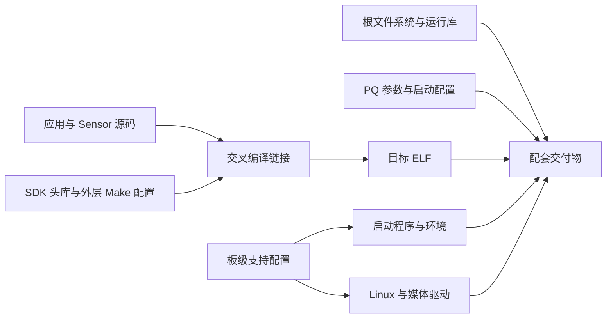
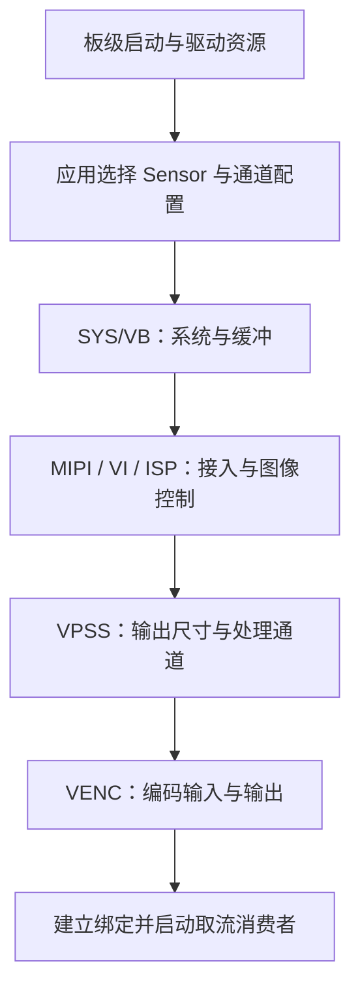
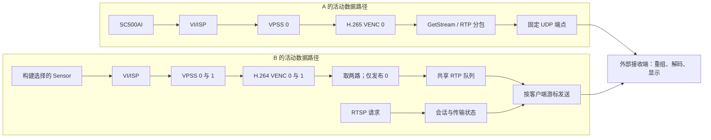

# 01 项目总览与三条流程

[返回学习入口](README.md) · [下一章：BSP 与 SDK 构建基础](02_BSP与SDK构建基础.md)

设想相机前的物体开始移动，接收端随后显示这个变化。要解释这件事，必须连接三个过程：开发机准备了哪些配套文件，板端怎样把硬件组织成流水线，一幅图像又怎样被处理、压缩和传过去。**构建流程产生程序与资源，初始化流程建立可运行的关系，逐帧流程持续消费这些关系。** 三者互相依赖，执行时机和参与者却不同。

## 1.1 先看最终产出，再认识参与者

Sensor（图像传感器）把光转换成像素采样，通过图像接口交给 Hi3516CV610。RAW Bayer 的一个像素位置通常只采集一个颜色分量，需要图像处理才能得到适合后续编码的彩色图像。沿这条路径，VI 负责视频输入与接入管理，ISP 负责原始图像处理，VPSS 负责后续处理及不同尺寸的通道输出，VENC 负责视频编码。先记住这些职责即可，具体接口与耦合关系会随图像展开。应用负责配置、连接这些单元，并在编码出口组织传输。

Linux 驱动管理硬件资源；SDK 提供头文件、库、示例和控制接口。项目中的 MPI 指厂商媒体接口，应用通过 `ss_mpi_*` 调用配置通道、绑定生产者与消费者、借用码流和归还缓冲。相同缩写在其他领域可能指另一套标准，读代码时以这里的接口含义为准。

接收端拿到网络数据后，还必须完成重组、解码和显示。因此“应用调用了发送函数”只是链路中的一次交接。接收器实现不在当前两条主入口中，接收缓存和显示延迟需要接收侧证据。

| 参与者 | 交付给下游的结果 | 下游成立的前提 |
| --- | --- | --- |
| 电源、时钟、复位、引脚与驱动 | 能访问且连线匹配的设备 | Sensor 和 SoC 接收端使用一致时序与接口 |
| Sensor | RAW 像素及帧/行时序 | MIPI、VI/ISP 接收配置与模式一致 |
| 媒体处理链 | 带布局和时间信息的通道图像 | 尺寸、格式、缓冲和绑定满足 VENC 输入 |
| VENC | 压缩码流及 SDK 描述符 | 应用在借用周期内读取正确区间 |
| 协议发送 | RTP 数据或会话控制响应 | 双方对编码、时间与分片有共同解释 |
| 接收端 | 可解码并显示的画面 | 参数集、参考图像、完整性和时间调度满足要求 |

这张表也是后面排障的起点：如果最后没有画面，先找到最后一个有证据的交接，再检查它的消费者。

## 1.2 两个入口分别完成什么

仓库由多个示例与配套材料组成，分析时选择一条完整链，而不是把不同示例中的参数拼在一起。

| 配置维度 | A：自定义 RTP | B：RTSP 主示例 |
| --- | --- | --- |
| 源码入口 | [new_main2.c](../../hi3516firm/new_main2.c) 的 `main` | [rtsp_4m/sample_rtsp.c](../../sample_source/rtsp_4m/sample_rtsp.c) 的 `main` |
| Sensor 来源 | 源码选择 SC500AI 1080p/100 fps 模式 | `SENSOR0_TYPE` 构建选择；当前 [Makefile.param](../../sample_source/Makefile.param) 缺省为 SC4336P 4M/30 fps，外层可覆盖 |
| 图像与编码目标 | 1920×1080，H.265 CBR 4096 Kbit/s，100 fps | 2560×1440 与 1024×768 两路 H.264，30 fps |
| 媒体模式 | VI offline、VPSS online，wrap 关闭，编码切片输出 | VI/VPSS online，默认启用 wrap，两路编码取流 |
| 输出消费者 | 自定义 RTP/UDP，固定 `192.168.0.2:5622` | RTSP 554、`/test.264`，仅发布编码通道 0 |
| 应用组织 | 较多直接调用 MPI，主线程取流与发送 | `sample_comm_*` 辅助层启动媒体，worker 取流并处理 RTSP |

表中数值是当前代码请求的配置，已有二进制采用的宏值、板端生效参数与实际吞吐还需验证。CBR 约束码率预算，并不使每幅图像产生相同字节数。

A 的接收方预先知道地址与媒体约定；B 先由客户端请求媒体描述、建立传输并开始播放，再发送 RTP。RTSP 因而增加的是会话控制和消费者管理，实际视频仍需要 RTP 等媒体承载。

两个 VENC 通道也不表示两个 Sensor。B 把一个采集源分成两种输出，通道 1 虽被编码、取流和归还，却未送入当前 RTSP 会话。后续所有性能解释都要沿真正对外发布的通道核对。

历史无线部署还多了一次进程间交接：派生发送程序把视频 UDP 交给本机 WFB 进程，WFB 再承担无线传输；MAVLink 是另一条遥测消息通路，由外部程序转发串口与 UDP 数据。当前 A 的目的地却是远端 `192.168.0.2:5622`，所以接入本机无线进程时要重新核对发送端点。[14 扩展](14_扩展示例与无线部署.md) 再展开这些外部组件。

## 1.3 构建流程：让软件和目标板配套

开发主机首先要把源码变成目标 CPU 能执行、目标运行库能装载的程序。交叉工具链负责这种转换；ABI 约定指令、函数调用、数据布局与运行库接口。编译成功依赖头文件和符号，板端可运行还依赖实际内核、驱动和用户态库与它配套。

图中多个产物汇合到交付，而不是由应用依次生成驱动、内核和文件系统。一次只改应用时，是否需要重建其他部分取决于 ABI、接口或配置是否也改变。

当前本地保存了 SDK/工具链归档、示例、ELF 和镜像，Git 已跟踪筛选后的源码、文档及必要资源。归档存在说明有材料，Git 提交说明源码可定位；要证明某个 ELF 来自它，还需构建参数、配套库和产物摘要。[02 构建基础](02_BSP与SDK构建基础.md) 将进一步解释 Makefile 如何把这些依赖连接起来。

## 1.4 初始化流程：建立资源与连接

应用开始执行前，板端应已经具备匹配的内核、设备节点、媒体内存和 Sensor 硬件条件。实际启动器、分区及启动脚本必须从目标板或对应交付记录核实。进入应用后，初始化代码把这些能力配置为可持续工作的通道。

这张图表示依赖层级，具体调用顺序在 [04 初始化](04_媒体系统初始化.md) 分别展开。例如 B 在媒体启动前创建 RTSP server 与 session，网络对象存在并不表示媒体已经就绪。A 在 ISP 初始化后加载 PQ BIN，后加载的参数可能影响此前设置，最终值需要配套语义与回读确认。

初始化“完成”还应有成功依据：返回值成功、资源创建成功、下游建立连接，才允许下一阶段依赖它。A 的多处调用未检查结果，执行到打印位置只能证明控制流经过了那里。B 有分阶段回退，仍需另外处理运行中的 worker 失败。

## 1.5 逐帧流程：硬件推进，应用管理出口

完成绑定以后，Sensor 持续输出，VI/ISP 接入并处理图像，VPSS 形成通道输出，VENC 读取图像并压缩。CPU 无需对每帧顺次调用一次“ISP 运算、VPSS 运算、编码运算”；初始化建立的关系由硬件与驱动持续推进，ISP 控制线程和应用取流线程承担各自工作。

图像路径中的箭头是模块数据交接，网络路径中的箭头则涉及用户态读取、复制与 socket 发送。`bind` 建立 SDK 的数据关系，不能替所有边界证明零复制。A 会复制协议数据；AI 扩展还会映射、复制原始图像。

B 的控制和媒体路径还有一个实际耦合：RTSP 网络事件由视频发布函数尾部调用 `rtsp_do_event()` 推进。如果通道 0 不再发布，控制请求也可能停止被处理。这个关系会在 [09 RTSP](09_RTSP会话与媒体分发.md) 中沿一次客户端请求展开。

## 1.6 用同一幅图像认识四种边界

先用编码前的图像估算数据量：8 位 YUV420 的每个 2×2 像素区域保留 4 个亮度 Y、1 个色度 U 和 1 个色度 V，共 6 字节，因此平均每像素 1.5 字节。

因此，一幅 1920×1080 的紧凑 8 位 YUV420 图像含 `1920×1080×1.5 = 3,110,400` 字节，约 3.11 MB。若每秒 100 幅，仅一次完整流过的像素量就是约 311 MB/s。它说明编码为何必要；实际存储还受行步长 stride、对齐、压缩和读写次数影响，这个算例不是 DDR 测量结果。[05 缓冲](05_SYS_VB与缓冲区管理.md) 会把这些分量放回实际内存布局中。

编码后的大小依内容与参考关系变化。一幅编码图像可由多个 NAL 组成，NAL 是码流语法单元；SDK 用 pack 描述借给应用的字节区间，pack 与 NAL 的映射需要接口契约；大的 NAL 又会拆成多个 RTP 包。后面必须同时保留这四层：**图像描述采样结果，NAL 描述编码结构，pack 描述 SDK 交付，RTP 包描述一次媒体传输。**

A 在 `processStream()` 中查询包数、准备描述符、取得码流，再从 `addr + offset` 读取 `len - offset` 字节。描述符记录位置和元数据，不是把整幅图像装在结构体里。RTP 封装完成并调用发送后，应用执行 `ReleaseStream`，结束本次对 SDK 缓冲的使用。

B 则把通道 0 的压缩数据复制进库自己的 RTP 队列，各客户端随后按自己的游标读取；因此应用归还 SDK stream 后，排队副本仍有独立寿命。第 05、07、09 章会分别解释图像缓冲、编码借用和网络队列，避免把三个“缓冲”当成同一块内存。

一旦下游慢于上游，这些边界会出现等待、排队或丢弃。退出时也必须确认谁还在使用它们，才能安全释放。由此，性能分析与资源回收自然属于同一条主线，分别在第 10 和第 12 章展开。

## 1.7 自查问题

1. 在一张纸上分别画出构建、初始化、逐帧三条流程。指出应用 ELF、PQ BIN、通道绑定分别属于哪条流程，在哪个交点被使用。
2. B 有两个 VENC 通道。仅凭这一事实，能否判断相机数量、RTSP 地址数量和发布路数？还应查看哪里？
3. 一个指针在 `ReleaseStream` 之后仍保持原来的数值，为什么仍不能让后台线程继续读取它？
4. 将资料中的 WFB 和 MAVLink 放进系统图，它们消费什么？A 当前固定目的地址还要核对什么？

## 1.8 参考答案

1. ELF 是构建产物，被板端加载后执行初始化和取流；PQ BIN 在构建/交付阶段配套，在 A 初始化时读取；绑定在初始化时建立，后续逐帧数据通过它流动。构建和初始化先后发生，不等于每帧重新执行。
2. 必须查 Sensor 配置、VPSS 的分支、VENC 绑定与发布条件。当前 B 是一个采集路径生成两个编码输出，只有通道 0 进入一个 `/test.264` 会话。
3. 指针值只是地址，使用权来自 Get/Release 的生命周期。归还后 SDK 可复用原存储；后台线程需要独立副本或经接口证明的持有机制。
4. WFB 消费本机视频 UDP 并负责无线承载，MAVLink 转发器消费串口/遥测 UDP。资料中的派生程序发送到本机，A 当前为 `192.168.0.2:5622`，需先确定部署所用程序和端点，才能把两者连起来。

下一章从构建产物继续：应用怎样找到正确的头文件、库和 Sensor 适配，才能把这条图像路径变成目标板上的可执行程序？
