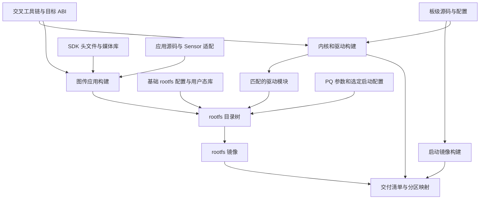

# 02 BSP 与 SDK 构建基础

本章位于“知道系统做什么”与“理解板上程序怎样启动”之间。先回答一个基本问题：为什么有了 `new_main2.c`，仍然不能直接得到一套可烧录、可采集、可传输的系统？

核心原因是应用只控制媒体业务；让 CPU 能启动、让内存可用、让 Sensor 接口和媒体硬件可访问，还依赖另一组构建产物。阅读时把这些依赖连起来，但不要把它们误画成“编完应用才能编内核”的单一串行流程。

返回 [学习首页](README.md)。本章以 2026-10-06 重新读取的源码、Makefile、归档文件名和部署资料为依据；没有执行安装、解包构建、刷机或板端启动。

## 2.1 先理解五种交付物解决的问题

**BSP（Board Support Package，板级支持包）**把处理器和具体电路板接起来，通常包含启动、内核和驱动等适配。**SDK（Software Development Kit，软件开发套件）**则给应用提供头文件、库、例程与构建约定。两者职责相关，但不能因为目录里存在 SDK 压缩包，就认为已经拥有当前板卡的完整、可重复构建环境。

【背景原理】一套嵌入式 Linux 设备通常需要以下产物配合：

| 产物 | 解决的问题 | 与图传应用的关系 |
|---|---|---|
| boot 启动镜像 | 从上电进入可加载操作系统的状态；具体职责取决于板级启动设计 | 必须匹配板卡和启动介质，不能用应用可执行文件替代 |
| kernel 内核镜像 | 管理 CPU、内存、调度、网络与设备驱动 | 为应用提供进程、线程、socket 和设备接口 |
| rootfs 根文件系统 | 提供运行目录、动态库、配置、工具和启动脚本 | 决定可执行文件、调校参数和运行依赖放在哪里 |
| 驱动模块及板级配置 | 把硬件接口、媒体单元和预留内存接入内核 | 驱动版本、装载顺序和资源配置必须与内核及媒体库相容 |
| 应用与运行数据 | 创建媒体链路、取流、封装并发送；装载图像参数 | A、B 两条主线是两个独立应用，PQ BIN 等是运行时数据 |

`rootfs` 是根文件系统的简称；它可能先构建成一个目录树，再打包成文件系统镜像。它不是某个 C 文件的编译结果。

【源码及文件可确认】当前 [hi3516firm](../../hi3516firm/) 中有 `boot_image.bin`、`nand_env.bin`、`uImage`、`rootfs.ubi`，以及 `rtp_demo2`、`8812eu.ko` 和 `sc500ai_1080P_100.bin`。这些文件分别属于不同层。文件存在能证明“有交付物”，不能单独证明其来源、版本、装载状态或板端运行结果。

其中 `.ko` 是 Linux 内核模块文件；`.a` 是供链接器使用的静态库；ELF 是 Linux 常见的可执行文件格式。三者不能互换：应用需要的库被链接成功，不代表内核中对应的驱动已经就绪。

## 2.2 构建关系是汇合，不是逐个串联

下面画的是依赖和交付关系，不是当前工作区已经执行过的命令。

【背景原理】启动镜像、内核、基础 rootfs 和应用可以分别构建。最后把需要随系统交付的应用、驱动和参数放入 rootfs，再与启动镜像、内核及分区方案形成同一套交付。也可以在已有兼容系统上只更新应用；这种交付仍需要记录它依赖的内核、驱动和库版本。

**交叉编译**表示在开发机上运行编译器，却生成另一种处理器和运行环境使用的机器码。**ABI（应用二进制接口）**约定机器指令、参数传递、数据布局和库调用等规则。头文件、静态库、动态库与编译选项必须对得上，否则可能在链接时失败，也可能到运行时才暴露不兼容。

【文件可确认】[工具链目录](../../交叉编译工具链/)保存 `gcc-20250305-arm-v01c02-linux-musleabi.tgz`；名称说明其目标工具链线索，不能把 `20250305` 当作 GCC 语义版本。[SDK 目录](../../SDK/)保存 `Hi3516CV610_SDK_V1.0.2.0.tgz`，本次未把归档展开成构建环境。

【资料记录】展开的厂商参考文档位于 `海思Hi3516CV610R001C01SPC020/ReleaseDoc`；已查阅的 MPP、ISP 文档标注版本 11、日期 2025-03-19。资料目录标签、SDK 归档版本和板上媒体库版本之间，尚未建立完整对应关系。以下章节引用其接口语义时，仍保留这一版本边界。

## 2.3 主线 B：Makefile 如何把示例与 SDK 接起来

从 [RTSP 示例 Makefile](../../sample_source/rtsp_4m/Makefile) 入手，可以看到编译目标是 `sample_rtsp_4m`。该文件先包含 `../Makefile.param`，再把本目录 `.c`、公共模块对象和库交给链接器。

这一步的因果关系是：业务代码调用媒体接口，因此需要 SDK 头文件；调用只有声明还不够，链接时还要找到实现这些接口的库；公共模块把重复的初始化步骤封装起来，因此其对象文件也必须参加链接。

【源码实现】[示例公共参数](../../sample_source/Makefile.param)负责三类信息：

1. 用 `SENSOR0_TYPE`、`SENSOR1_TYPE` 和 `BOARD_TYPE` 选择编译时场景，并通过 `-D` 传入 C 代码。
2. 根据 `CONFIG_OT_ISP_SUPPORT` 等选项加入 MPI、ISP、AE、AWB 和各 Sensor 库。
3. 组织 `sample_comm_sys.c`、`sample_comm_vi.c`、`sample_comm_isp.c`、`sample_comm_vpss.c`、`sample_comm_venc.c` 等公共对象。

**MPI**是厂商媒体编程接口。这里的 `hi_mpi_*`、`ss_mpi_*`、`ot_*` 名称来自本地示例及其 SDK 接口体系；不能仅凭名称相似自行认定头文件与库可以跨版本混用。

【配置目标】该参数文件使用 `?=` 给出默认值：`SENSOR0_TYPE=SC4336P_MIPI_4M_30FPS_10BIT`，`BOARD_TYPE=DMEB_QFN`。`?=` 允许外部预先定义的变量覆盖默认值。因此可以说“当前文件默认选择 SC4336P”，不能仅凭这个文件认定已有二进制一定使用该 Sensor，更不能把主线 A 的 SC500AI 100fps 设置套到 B。

### 外层构建环境究竟缺在哪里

【源码实现】当 `PARAM_FILE` 未设置时，`sample_source/Makefile.param` 继续包含 `../../../Makefile.param`；[示例总 Makefile](../../sample_source/Makefile)也依赖目录外的 `../../Makefile.param`。GNU Make 的相对包含路径与启动目录有关，不能把这些路径机械理解为相对于被包含文件的位置。

`CC`、`SDK_PATH`、`REL_INC`、`HI_REL_INC`、`REL_LIB`、`HI_REL_LIB`、目标架构及功能开关等信息，要由 SDK 的外层环境补齐。当前根目录没有提供一套把这些变量、解包位置和工具链统一锁定的顶层构建入口。

所以真正的依赖链是“恢复匹配的 SDK 构建环境 → 确认实际使用的参数 → 编译公共模块与业务模块 → 链接对应库”。历史构建记录中的 Linux 路径，是这条链路曾被组织过的线索，不是当前 Windows 工作区已经具备全部前提的证据。

### 为什么已有 librtsp.a 不能消除构建问题

【源码实现】`rtsp_4m/Makefile` 的 `all` 先依赖应用目标，之后才在配方中进入 `rtsp_lib` 执行 `make`；应用链接规则使用 `librtsp.a`，却没有把它声明为前置依赖。

这会产生一个可解释的构建顺序风险：库不存在时，应用可能在构建库之前就链接失败；库存在但源码变了时，应用可能先链接旧库，再在后面更新库。它是从 Makefile 能确认的依赖关系问题；本次没有通过实际构建复现。

学习重点不是记住某条补救命令，而是理解：构建系统必须表达“谁依赖谁”，文件已经存在不能代替依赖声明。未来整理可重复构建流程时，应先补齐依赖关系和版本记录，再谈批量自动化。

## 2.4 主线 A：自定义程序还有两组额外输入

[new_main2.c](../../hi3516firm/new_main2.c)不沿用 B 的完整示例构建入口。它直接选用 SC500AI 对象，并包含 `./smart_sc500ai_100/sc500ai_cmos.h`，还包含 PQ 参数导入接口 `ot_pq_bin.h`。

【源码实现】当前 Sensor 源码实际保存在 [学习文件/smart_sc500ai_100](../../学习文件/smart_sc500ai_100/)，并不处于 `new_main2.c` 旁边的同名子目录。要重建 A，需要明确 Sensor 源码放置或 include 搜索路径，以及哪些 `.c` 参加编译。不能将“找到了适配源码”写成“当前相对包含关系已可直接编译”。

**PQ（Picture Quality，图像质量）参数**控制 ISP 等模块的画质处理行为。这里需要区分两件事：

- 编译和链接时，需要声明、实现 `OT_PQ_BIN_ImportBinData` 的配套头文件与库。
- 运行时，需要应用能够找到并读取正确的 `sc500ai_1080P_100.bin` 参数文件。

【资料记录】[使用文档(3)](../../hi3516firm/hi3516firm/海思hi3516-hi3519使用文档%283%29.docx)记录过 `Hi3516CV610_PQ_ext_api_V1.0.2.0/libbin/include/ot_pq_bin.h` 与 `libbin.a`，并给出把 `new_main2.c`、Sensor 源文件及媒体库链接起来的命令。该记录有助于恢复依赖，但不证明相关外部目录当前已经存在，也不证明现有 `rtp_demo2` 就是这份源码、这些参数生成的结果。

【源码实现】A 以 `fopen("./sc500ai_1080P_100.bin", ...)` 读取参数，路径相对于进程工作目录，而不是可执行文件所在目录。即使二进制与 BIN 文件都在 `/root`，从其他目录启动应用仍可能找不到文件；运行目录也属于交付约定。

## 2.5 从构建产物到上电，不能跳过哪一层

【背景原理】启动链负责先让 CPU、内存、内核和用户空间可运行；用户空间的初始化系统再执行选定脚本，准备驱动、网络和业务进程。应用的 `main()` 处于这条链路的后半段，它没有替代启动镜像、内核初始化和板级资源配置。

【资料记录】使用文档中出现过 Buildroot overlay 的应用拷贝步骤和 `/etc/init.d/S99autostart` 脚本片段。**overlay**是在生成 rootfs 时合并进去的附加目录树，因此它适合放应用、参数和启动配置。该片段包括加载媒体驱动、设置网络、启动不同图传方案的函数。

但同一片段的功能调用开关默认处于注释状态。本次未在工作区发现对应的独立 `S99autostart` 文件，也没有展开现有固件核对其中的版本和启用项。故这些内容属于部署方案记录，不能当作板卡正在执行的启动链。

【文件可确认】[nand_burn_table.xml](../../hi3516firm/nand_burn_table.xml)列出 boot、env、kernel、rootfs 分区；rootfs 项的 `SelectFile` 当前为空。这能用于理解分区映射，却不能据此宣称某个 `rootfs.ubi` 已被选中、烧录或启动。`mirror/buildroot`、`mirror/busybox` 中存在镜像，也不等于存在对应的完整构建源码树。

## 2.6 怎样建立可追溯关系

如果以后要证明“这份源码就是板上正在运行的程序”，需要把四个阶段接起来。下表是待执行的验证思路，本次没有执行其中的构建与板端操作。

| 待建立的证据 | 能证明什么 | 仍不能证明什么 |
|---|---|---|
| 记录入口源码、Sensor 文件、Makefile、SDK/PQ/工具链版本及文件哈希 | 输入组合被固定，可以讨论同一份构建 | 不证明已成功编译 |
| 保存完整编译参数、链接清单、构建日志与产物哈希 | 指定输入产生了哪个目标文件 | 不证明它已部署 |
| 核对 rootfs 内容、启动配置、运行目录和板上程序哈希 | 交付与运行对象相符 | 不证明 Sensor、媒体硬件及网络功能正常 |
| 记录板端模块版本、初始化返回值、帧/码流计数及接收端解码 | 实际运行链路推进到哪些阶段 | 单次成功不证明长期稳定性或端到端延迟目标 |

哈希是文件内容的摘要，适合识别“是否同一份字节内容”。它必须与源码清单和构建记录一起使用，单独记录一个二进制哈希仍不能还原构建过程。

## 2.7 自查问题

1. **为什么应用、内核和 rootfs 不能简单画成一条编译流水线？**

   回答要点：它们有不同输入，可以分别构建；应用及驱动可以进入 rootfs 目录树；最终通过版本、依赖和分区清单汇合成兼容的交付组合。

2. **目录中已有 `librtsp.a`，为什么仍需要检查 Makefile？**

   回答要点：文件存在不保证新旧一致；当前规则先链接应用、后构建库，而且应用未声明库依赖。要区分现有文件可被使用与依赖图能够正确重建。

3. **PQ 头文件、`libbin.a` 与 PQ BIN 分别在哪个阶段使用？**

   回答要点：头文件参与编译，库参与链接，BIN 是运行时导入的数据。BIN 的位置受工作目录影响，其内容和 ABI 配套还需确认。

4. **只更新图传应用能否免去 BSP 检查？**

   回答要点：可以采用应用级交付，但仍要确认内核、驱动、媒体库、Sensor 连接和内存配置兼容。应用能启动与硬件能连续产流是两级证据。

下一章：[03 板级资源与 Sensor 适配](03_板级资源与Sensor适配.md)。它继续回答：系统具备执行程序的条件后，应用怎样让正确的 Sensor 按正确的时序产生图像？
