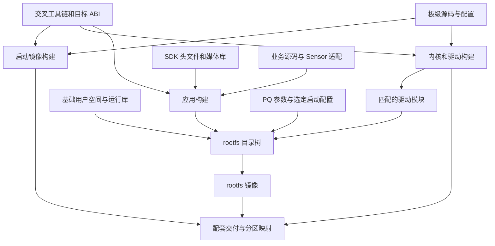

# 02 BSP 与 SDK 构建基础

[学习首页](README.md) · [上一章：项目总览与三条流程](01_项目总览与三条流程.md) · [下一章：板级资源与 Sensor 适配](03_板级资源与Sensor适配.md)

上一章把图传分成构建、启动和持续处理三条流程。本章先沿构建流程走一次：开发机读入源码与配套库，产生目标板可执行的应用；应用再与驱动、参数和启动配置汇合，成为板端可以消费的交付物。后面分析 `main()` 时，才能知道它默认依赖哪些已经成立的条件。

主线 A 是 [new_main2.c](../../hi3516firm/new_main2.c)，主线 B 是 [sample_rtsp.c](../../sample_source/rtsp_4m/sample_rtsp.c)。二者有不同的构建输入。本章依据当前源码、Makefile 和本地资料解释依赖，尚未执行交叉编译、镜像展开或板端启动。

## 2.1 一份 C 源码为什么还不能让板子出图

设想把 `new_main2.c` 复制到一块空白板卡。CPU 上电后既不知道文件在哪里，也没有文件系统、进程或 `main()` 的概念。必须先有启动代码建立最初的运行条件，再由 Linux 内核管理硬件和进程，最后用户空间才能装载图传应用。

**BSP**（Board Support Package，板级支持包）解决处理器怎样在具体电路板上工作的适配问题，涉及启动、内核、驱动和板级配置。**SDK**（Software Development Kit，软件开发套件）给应用提供头文件、媒体库、示例和构建约定。应用借助 SDK 请求硬件工作，BSP 则使这些请求有可到达的设备和资源。

由此可以把最终交付分成五类。每一类都有自己的生产过程和消费者。

| 交付物 | 主要输入与职责 | 谁在运行时消费它 |
| --- | --- | --- |
| boot 启动镜像 | 启动源码、板级配置；建立早期环境并进入后续启动阶段 | 芯片启动机制及后续启动阶段 |
| kernel 内核镜像 | 内核源码、配置和内建驱动；管理内存、调度、网络与设备 | 启动程序加载它，用户进程随后使用它提供的接口 |
| 驱动模块与板级配置 | 匹配内核的驱动源码及硬件资源约定 | 内核装载模块，设备控制请求进入相应驱动 |
| rootfs 根文件系统 | 基础用户空间、库、配置和附加文件；形成板上的目录树 | 用户空间初始化系统和应用进程 |
| 图传应用与运行数据 | 业务源码、SDK、Sensor 适配、PQ 参数 | 进程装载应用，应用运行时读取参数并控制媒体链路 |

**rootfs**是 root filesystem 的缩写。它可以先是开发机上的一个目录树，最后打包成可部署的文件系统镜像。应用可以放进这棵树，也可以在已有兼容系统上单独更新；这两种方式都要求应用与系统接口配套。

当前 [hi3516firm](../../hi3516firm/) 中的 `boot_image.bin`、`nand_env.bin`、`uImage`、`rootfs.ubi`、`rtp_demo2`、`8812eu.ko`、`sc500ai_1080P_100.bin` 分属上述不同层。其中 `.ko` 是内核模块，`.a` 是静态链接库，ELF 是可承载目标文件、可执行文件和共享库的二进制格式。**文件存在证明有一份产物，构建记录才把产物与输入源码连起来。**

## 2.2 构建有多条分支，交付时才汇合

启动镜像、内核、基础 rootfs 和应用可以分别构建。下面的箭头表示依赖或装配关系；不同分支没有被强行排列成同一次串行编译。



例如，内核可以先产生一个镜像和一组驱动模块；应用则在另一条分支完成编译、链接。装配 rootfs 时把选定应用、所需模块和参数放入目录树。最后交付清单说明 boot、kernel、rootfs 各使用哪个文件，以及它们怎样放到启动介质上。应用源码改了一行，通常不意味着必须重编所有启动代码，但仍要核对接口兼容性。

**交叉编译**指在开发机上运行编译器，生成目标处理器使用的机器码。**ABI**（应用二进制接口）规定指令集、调用约定、数据布局及库调用规则。即使 C 函数名称相同，目标架构、结构体定义或库版本不配套，也可能在链接或运行阶段失败。

因此，恢复构建环境的第一步是确定一套相互匹配的输入。头文件让编译器知道函数与结构体的形状；库提供已编译的实现；目标系统还必须提供这些实现运行时依赖的内核接口、驱动和用户态环境。

## 2.3 B 怎样从 Makefile 走到可执行文件

主线 B 的 [Makefile](../../sample_source/rtsp_4m/Makefile) 把目标命名为 `sample_rtsp_4m`。它收集本目录的 C 文件，加入公共辅助模块对象，再链接 MPI、RTSP 和其他配套库。**MPI**在这里指厂商媒体编程接口，业务代码通过它建立 VI、VPSS、VENC 等资源。

这一步有三个连续结果：预处理阶段选定代码分支；编译阶段形成目标文件；链接阶段把本地目标文件与库中的实现连接起来。Sensor 的选择发生得很早，会影响后续编译得到哪套配置。

### 2.3.1 Sensor 宏把构建选择带进程序

[Makefile.param](../../sample_source/Makefile.param) 中与默认 Sensor 选择有关的节选如下。它展示实际规则，不是一套独立可运行的构建脚本。

```makefile
SENSOR0_TYPE ?= SC4336P_MIPI_4M_30FPS_10BIT
BOARD_TYPE ?= DMEB_QFN
CFLAGS += -D$(SENSOR0_TYPE)_SELECT=y
CFLAGS += -DSENSOR0_TYPE=$(SENSOR0_TYPE)
CFLAGS += -DBOARD_TYPE=$(BOARD_TYPE)
```

`?=` 表示变量尚未定义时才采用默认值；`-D` 把结果传给 C 预处理器。因此本地文件默认选择 SC4336P，但外层构建可以覆盖这个值。已有 ELF 使用哪种 Sensor，仍需要当时的编译参数或可核对的构建记录。

公共参数文件还按 `CONFIG_OT_ISP_SUPPORT` 等开关加入 ISP、AE、AWB 和 Sensor 库，并组织 `sample_comm_sys.c`、`sample_comm_vi.c`、`sample_comm_isp.c`、`sample_comm_vpss.c`、`sample_comm_venc.c` 等对象。业务文件调用公共函数，公共函数再调用 SDK；这就是它们必须一起参与链接的原因。

### 2.3.2 外层 SDK 给局部 Makefile 补齐上下文

当 `PARAM_FILE` 未设置时，示例公共参数文件继续包含 `../../../Makefile.param`；[示例总 Makefile](../../sample_source/Makefile) 则引用目录外的 `../../Makefile.param`。这些路径依赖 Make 的启动目录，不能简单按被包含文件的位置逐层拼接。

外层环境需要提供编译器 `CC`、SDK 路径、头文件目录、库目录、架构选项和功能开关。当前项目没有一个已核实的顶层入口，把这些值、工具链解包位置和 SDK 版本统一锁定。局部 Makefile 是完整构建链的一段，直接在当前 Windows 目录运行它并不能自动恢复历史 Linux 构建环境。

### 2.3.3 静态库必须先于使用它的链接动作更新

静态库是若干目标模块的集合。链接器按链接规则解析程序需要的符号，所以既要提供正确的库，也要让库在应用链接前完成更新；仅把文件路径写在命令中还不够。

当 `librtsp.a` 中的实现被静态链接进应用，运行时使用的是可执行文件中已经合入的代码，一般不需要把这个 `.a` 再复制到板上供程序打开。共享库 `.so` 则可能在装载或运行时另行加载。B 链接了多个 `.a`，但外层构建参数和系统库的链接方式仍需核对，不能据此断言整个 ELF 已完全静态链接。这也解释了为什么“编译时需要的文件”与“板端必须存在的文件”应分别列清单。

在常见 GNU 静态链接方式中，扫描库时会按当前未解析的引用提取所需成员，因而提供符号的库通常跟在提出引用的对象之后。B 的目标文件经 `$^` 放在 `$(MPI_LIBS)` 前面，表达了业务对象先提出接口需求、媒体库再提供实现的关系。库彼此仍可能有依赖，恢复链接命令时要保留其配套顺序。

当前 RTSP Makefile 的关系是 `all` 先依赖应用目标，随后才在配方中进入 `rtsp_lib` 执行 `make`。应用目标只声明了 `$(OBJ)` 和 `$(COMM_OBJ)`，链接时却还使用 `rtsp_lib/librtsp.a`。因此库缺失时可能先遇到链接失败，库源码更新时也可能先链接旧库，再更新库文件。

这是依赖图能够说明的风险，本次未实际构建复现。恢复可重复构建时，需要让“生成库”和“链接应用”的依赖关系体现在规则中，并核对库的链接次序；不能由已有 `librtsp.a` 推断增量构建一定正确。

## 2.4 A 的 Sensor、PQ 库和 PQ 数据分别在哪一步交接

A 直接包含 `./smart_sc500ai_100/sc500ai_cmos.h` 并使用 `g_sns_sc500ai_obj`。实际适配源码位于 [学习文件/smart_sc500ai_100](../../学习文件/smart_sc500ai_100/)，没有放在 `new_main2.c` 旁边的同名目录。重建时需要明确源码布局和参与编译的文件，并让该 include 路径可以解析。

这个对象由 Sensor 适配实现提供。编译时知道对象声明，只解决“名称和类型是什么”；链接时仍要把实现该对象及回调的目标模块交给链接器。下一章将沿这个对象进入寄存器配置和动态曝光控制。

A 的另一组依赖是 **PQ**（Picture Quality，图像质量）参数导入。这里有三个用途不同、名字相近的输入：

| 输入 | 使用阶段 | 它交给下一阶段什么 |
| --- | --- | --- |
| `ot_pq_bin.h` | 编译 | 导入函数与参数类型的声明 |
| 配套 `libbin.a` | 链接 | `OT_PQ_BIN_ImportBinData` 等函数实现 |
| `sc500ai_1080P_100.bin` | 运行 | 应用读入后交给 PQ 库的一组调校数据 |

[使用文档（3）](../../hi3516firm/hi3516firm/海思hi3516-hi3519使用文档%283%29.docx) 记录过 `Hi3516CV610_PQ_ext_api_V1.0.2.0/libbin/include/ot_pq_bin.h`、`libbin.a` 及 A 的链接命令。这些是恢复外部依赖的历史线索，尚未证明配套目录在当前环境中齐全，也未证明已有 `rtp_demo2` 与当前源码对应。

运行时，`isp_calibration_load_bin()` 使用 `fopen("./sc500ai_1080P_100.bin", ...)`。相对路径以进程工作目录为起点。例如应用和 BIN 都在 `/root`，从别的目录执行 `/root/rtp_demo2`，也仍可能打不开该 BIN。由此可见，交付应用时还要交付运行目录约定，才能把链接完成的程序接到实际参数上。

## 2.5 rootfs 怎样把文件装配成启动条件

历史使用文档给出了 Buildroot **overlay** 的拷贝步骤。overlay 是生成 rootfs 时合并的附加目录树，适合安排应用、参数及启动脚本的位置。应用放进去以后，仍需有明确的启动者选择何时执行它。

同一文档中的 `/etc/init.d/S99autostart` 片段安排了媒体驱动加载、网络准备和不同图传程序的启动函数。片段里的功能调用开关初始为注释状态；当前未找到对应独立脚本，也未展开现有固件核实其启用项。因此它说明一种部署方案，不能用来确认当前板卡上电后必然启动 A 或 B。

[nand_burn_table.xml](../../hi3516firm/nand_burn_table.xml) 列出 boot、env、kernel、rootfs 分区，rootfs 的 `SelectFile` 当前为空。它提供分区映射信息，但尚未把某个 `rootfs.ubi` 明确选入这份烧录配置。`mirror/buildroot`、`mirror/busybox` 中保存的镜像也不能替代完整构建源码和配置记录。

到这里，构建流程与启动流程的交点就清楚了：构建交出配套文件，部署决定文件的位置，启动配置决定装载顺序和运行环境，应用才有条件进入 `main()`。第 04 章分析媒体初始化时，将把驱动、媒体内存和工作目录当作需要确认的前提。

## 2.6 怎样证明板上运行的是这次构建

本地 [工具链目录](../../交叉编译工具链/) 有 `gcc-20250305-arm-v01c02-linux-musleabi.tgz`，[SDK 目录](../../SDK/) 有 `Hi3516CV610_SDK_V1.0.2.0.tgz`。前者的日期串不能直接当作 GCC 语义版本。展开的厂商文档来自 `Hi3516CV610R001C01SPC020/ReleaseDoc`，其中所用 MPP、ISP 参考标注版本 11、2025-03-19；其与 SDK 归档、板上库的完整对应关系仍待确认。

可追溯构建需要逐步补上下面的关系。这是后续验证方案，本次没有执行构建或部署。

| 关系 | 应保留的证据 | 得到的结论 |
| --- | --- | --- |
| 输入 → 构建 | 源码版本、Sensor 选择、工具链/SDK/PQ 版本、完整参数 | 知道参与构建的是哪套输入 |
| 构建 → 产物 | 日志、链接清单、产物哈希 | 知道哪份二进制来自这套输入 |
| 产物 → 板端进程 | rootfs 内容、板端文件哈希、启动配置、工作目录 | 知道选定程序及其运行数据已部署 |
| 进程 → 图传功能 | 初始化返回、驱动状态、帧/码流计数、接收解码 | 知道链路实际推进到哪个阶段 |

**哈希**是内容摘要，可以比对两个文件是否为同一份字节内容。它无法单独说明构建过程，也不能证明硬件运行正确。把各阶段证据连接起来，后续排障才能区分源码问题、构建差异和部署偏差。

## 2.7 自查问题

1. 应用源码发生修改时，为什么可以单独更新应用，却仍需核对 BSP 和 SDK？
2. 已有 `librtsp.a`，为何 B 的 Makefile 仍可能在增量构建中使用旧实现？
3. `ot_pq_bin.h`、`libbin.a`、PQ BIN 分别由谁消费？应用与 BIN 同在 `/root`，为什么还可能打开失败？
4. 手上只有一份 `rtp_demo2` 和源码，至少还缺哪些证据，才能说明板上跑的是这份源码？

### 2.7.1 参考答案

1. 应用、内核、启动镜像有不同构建分支，可以分别交付；单独更新应用仍需兼容目标 ABI、用户态库和驱动接口，并满足 Sensor 与媒体内存条件。
2. 当前应用目标没有声明静态库依赖，`all` 的配方在应用链接后才构建库。文件存在使链接可能成功，但没有保证它包含最新源码。
3. 编译器消费头文件，链接器消费静态库，运行中的应用读取 BIN 再交给 PQ 库。A 使用相对工作目录路径；从其他目录启动时，文件查找起点也随之改变。
4. 需要固定源码与依赖版本、实际编译宏和链接参数、构建日志及产物哈希，再核对板上文件、启动选择和工作目录。最后还要用媒体与接收端证据证明运行功能。

下一章：[03 板级资源与 Sensor 适配](03_板级资源与Sensor适配.md)。已经明确应用需要哪些输入，接下来沿 Sensor 适配看软件如何使器件开始并持续产生符合接收约定的像素。
