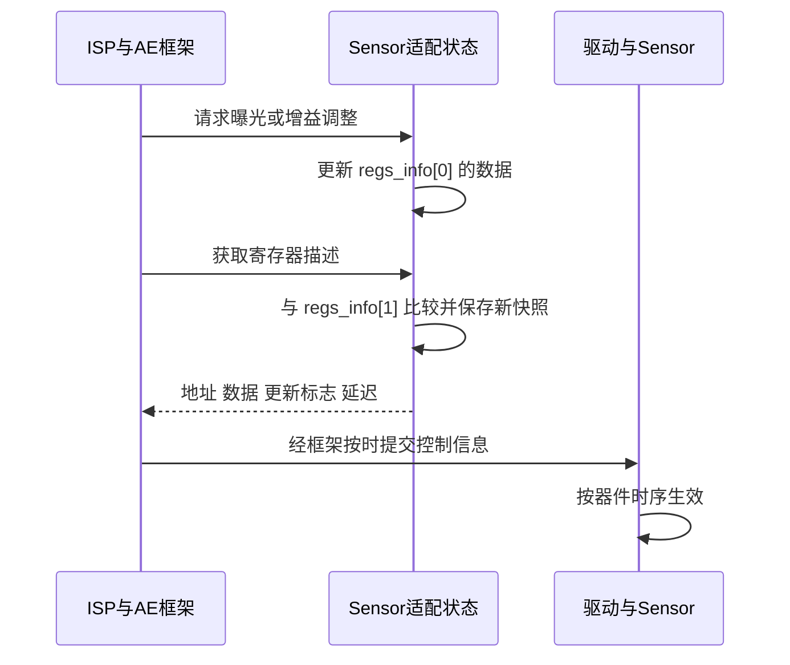

# 03 板级资源与 Sensor 适配

[学习首页](README.md) · [上一章：BSP 与 SDK 构建基础](02_BSP与SDK构建基础.md) · [下一章：媒体系统初始化](04_媒体系统初始化.md)

上一章交出了应用、配套库和运行数据。本章继续追踪其中的 Sensor 适配：软件怎样使图像传感器开始输出，以及场景明暗变化后怎样持续调整它。先沿主线 A 的 SC500AI 完成一次启动和一次曝光调整，再回到 B 的编译选择，避免把两套 Sensor 配置混在一起。

本章研究的是控制契约。像素如何经过 VI、ISP、VPSS，以及哪些边界使用内存，将在第 06 章展开。

## 3.1 同一颗 Sensor 有控制通道和图像通道

**Sensor**把光转换成原始像素采样。为了得到稳定图像，除了给它供电，还要提供时钟、解除复位，并告诉它用哪种分辨率、帧率和输出格式工作。这些控制发生以后，像素才能按约定进入接收端。

项目通过 **I²C** 这一低速控制总线访问 Sensor 寄存器，寄存器是器件内部保存控制值的地址单元。图像则通过 **MIPI CSI** 高速图像接口输出，接口中的 **lane** 是承载高速数据的通道。I²C 上传输的是地址和控制值，MIPI 上传输的是像素数据，两条通道的成功条件不同。

下面把控制与数据画在同一颗 Sensor 两侧，箭头不表示每帧图像需要先经过用户态回调。


A 的 [new_main2.c](../../hi3516firm/new_main2.c) 在 `set_vi_sns_info()` 中选择总线 0、时钟源 0、复位源 0；`vi_init()` 打开 `/dev/ot_mipi_rx`，通过 `ioctl` 配置 lane 分组、时钟、复位与接收属性。**ioctl** 是用户进程向设备驱动提交专用控制请求的接口，真正操作硬件需要驱动及板级资源支持。

这些编号怎样对应当前板卡的引脚和电路，仍需电路图、内核配置、加载参数或板端测量确认。[pin_mux.c](../../hi3516firm/pin_mux.c) 是内核侧引脚复用片段，包含按板型写寄存器的逻辑；它放在应用目录附近，不代表 `new_main2.c` 会自动执行它。

因此，“I²C 写成功但没有图像”有明确的解释路径：器件可能尚未输出，也可能是时钟、lane、接收格式或帧时序不匹配。这个阶段应先核对 Sensor 与接收端约定，网络发送还没有拿到可用输入。

## 3.2 工作模式是一组相互约束的参数

**RAW Bayer**是原始颜色采样排列，每个像素位置先记录一种颜色分量，随后由 ISP 恢复和处理图像。**ISP**（Image Signal Processor）指图像信号处理硬件及其相关控制软件。接口上的 RAW10 表示原始采样传输位宽为 10 bit；它与后续 NV21 图像或 H.265 码流属于不同阶段。

A 选择 `SC500AI_MIPI_2M_100FPS_10BIT`，MIPI 接收目标为 4 lane、1920×1080、RAW10；ISP 公共属性对应 1920×1080、100fps 和 `OT_WDR_MODE_NONE`。**WDR**是宽动态范围模式，此处未选择多曝光 WDR。

[sc500ai_cmos.c](../../学习文件/smart_sc500ai_100/sc500ai_cmos.c) 的活动模式表包含 5M30 和 2M100 两种线性模式。尺寸、最大帧率和时序常量来自 [sc500ai_cmos.h](../../学习文件/smart_sc500ai_100/sc500ai_cmos.h)。`cmos_isp_global_init()` 先把状态设为 2M100；`cmos_isp_set_image_mode()` 再按尺寸、帧率和 WDR 条件查找可接受的模式；`cmos_isp_init()` 根据最终状态选择对应的寄存器初始化函数。

这条关系说明，修改应用里的一个 `fps` 值，只改变了请求的一部分。模式表、时序常量、寄存器配置、MIPI 接收和 ISP 公共属性必须能够解释同一种实际输出。

### 3.2.1 用一帧时间理解帧率和曝光

在通常的帧时序模型中，帧周期约等于总时序行数乘以行周期。有效高度只描述画面里有多少行，行、场消隐等时序也占时间；因此 1080 行画面不代表每帧总时序正好是 1080 行。

A 的 2M100 模式基础 `VMAX` 常量为 1305，适配状态中的 `fl_std` 使用它的两倍。以下是 `cmos_fps_set()` 的时序换算节选；省略了前面的指针、帧率范围检查及后面的其他字段更新。

```c
vmax = (td_u32)(lines * max_fps / div_0_to_1_float(fps));
vmax = (vmax > lines_max) ? lines_max : vmax;
cmos_config_vmax(sns_state, vmax);
sns_state->fl_std = vmax << 1;
ae_sns_dft->fps = fps;
ae_sns_dft->full_lines_std = sns_state->fl_std;
```

`lines`、`max_fps` 来自选中模式，`fps` 是请求值。请求帧率降低时，公式允许增加每帧时序行数；更新后的 `vmax` 又进入寄存器描述，`fl_std` 等字段则把新约束交还给 AE。左移一位来自该 Sensor 的适配单位，不能套用成所有传感器通用公式。

以 100fps 为目标，一帧名义时间是 `1/100s = 10ms`。A 在 `true_isp_init()` 中把自动曝光上限设为 10000μs，表达了控制曝光时间预算的意图。它仍需要与 Sensor 的有效曝光范围、消隐和慢帧率策略匹配；真实帧率要由连续时间戳或帧计数证明。

还应保留一个具体核对点：同一 `cmos_fps_set()` 把 `lines_per500ms` 写为 `(lines * 2) * 15`，该常数没有随请求帧率变化。它在 2M100 场景下与 AE 库的预期怎样配套，尚需匹配接口资料和运行结果确认。不能仅凭 `fps=100` 推断所有 AE 时序字段均已完成适配。

初始化函数打印的 `27MInput`、`4lane`、`792Mbps` 是代码中的模式标签。当前没有时钟与链路测量，因此这些标签不作为板上测得值。

## 3.3 应用怎样把 Sensor 的操作方法交给框架

自动调整需要两种知识：算法要决定图像应该多亮、颜色怎样校正；Sensor 适配要知道某个曝光或增益值该如何编码成器件寄存器。把两者分开，算法才可能服务不同 Sensor。

**AE**（自动曝光）根据图像信息调节曝光时间和增益等；**AWB**（自动白平衡）估计并校正光源造成的颜色偏差。**回调**是交给框架的函数地址，让框架在相应阶段调用器件特有的操作。当前应用采用厂商算法库，Sensor 适配提供能力范围、初始参数和执行方法。

A 的 `true_isp_init()` 按以下顺序建立这种关系：

1. 取得 `g_sns_sc500ai_obj`，准备 AE、AWB 的库名称和管道标识。
2. 调用对象的 `pfn_register_callback`，登记 Sensor 对 ISP、AE、AWB 的适配函数。
3. 调用 `pfn_set_bus_info` 保存 I²C 总线号，再登记所用 AE/AWB 算法库。
4. 初始化 ISP 内存和公共属性，执行 ISP 初始化，创建线程进入 `ss_mpi_isp_run()`。

其中 Sensor 回调注册交出了“如何控制该器件”，算法注册交出了“使用哪套算法”。Sensor 对象的 `cmos_register_callback()` 构造三组函数表，再交给 [sensor_common.c](../../学习文件/smart_sc500ai_100/sensor_common.c) 的 `cis_register_callback()`；后者创建状态，并分别提交给 ISP、AE、AWB 注册接口。

| 框架所在阶段 | 需要的器件信息或操作 | 本地函数入口 |
| --- | --- | --- |
| 初始化和模式选择 | 支持何种尺寸/帧率，怎样配置器件 | `cmos_isp_set_image_mode()`、`cmos_isp_init()` |
| 建立 AE 约束 | 初始参数、帧率与曝光范围 | `cmos_get_ae_default()`、`cmos_fps_set()` |
| 运行时调节 | 把曝光、增益换算为器件数据 | `cmos_inttime_update()`、`cmos_gains_update()` |
| 提交动态寄存器 | 哪些地址要更新，何时生效 | `cmos_isp_get_sns_regs_info()` |
| 建立 AWB 初值 | 参考色温、初始增益和颜色相关参数 | `cmos_awb_get_default()` |

本地 [ISP 开发参考](../../hi3516cv610/海思Hi3516CV610R001C01SPC020/ReleaseDoc/zh/01.software/board/ISP/ISP%20开发参考.pdf) §1.2 区分初始化任务与动态调节阶段；§2.3.53 说明模式发生改变时框架可重新调用 Sensor 初始化回调。资料支持上述调度职责，闭源库内部每次回调的精确时刻则不能从本地示例反推出来。资料与当前 SDK 配套边界见第 02 章。

## 3.4 先用模式表启动，再用寄存器描述持续调整

### 3.4.1 启动时直接写出完整模式

`cmos_isp_init()` 先设置 I²C 地址和地址/数据宽度，再调用 `cis_i2c_init()`。普通 I²C 分支打开 `/dev/i2c-N`，按保存的总线号选择设备，并设置从设备地址。源码把 `0x60` 右移一位交给 Linux 接口，所以读器件资料时要先核对地址采用的是哪种表示法。

这里的换算是 `0x60 >> 1 = 0x30`：常见的 8 位地址字节把 7 位设备地址放在高位，最低位表示读写方向；当前驱动控制调用使用去掉方向位后的地址。它与随后要访问的器件内部寄存器地址也不是同一个数，例如本适配的寄存器地址占 2 字节、数据占 1 字节。先选中哪颗器件，再指定器件里的哪个寄存器，才能正确理解后面的写操作。

I²C 就绪后，2M100 模式进入 [sc500ai_sensor_ctrl.c](../../学习文件/smart_sc500ai_100/sc500ai_sensor_ctrl.c) 的 `sc500ai_linear_2m100_10bit_init()`，选取 [sc500ai_cfg.h](../../学习文件/smart_sc500ai_100/sc500ai_cfg.h) 中的寄存器表。`sc500ai_reg_init()` 的执行顺序是软件复位、短暂等待、逐项写模式表、补写动态寄存器初值，最后使 Sensor 开始输出。

每次 `cis_write_reg()` 把寄存器地址和数据编码进字节缓冲，再通过 `write()` 提交给 I²C 驱动。模式表建立完整工作环境；动态寄存器初值把这套环境接到当前曝光和增益状态，避免两者各自停留在不一致的默认值。

### 3.4.2 运行时先形成下一组控制数据

场景变暗后，AE 可以请求增加曝光或增益。本地适配的 `cmos_inttime_update()`、`cmos_gains_update()` 把算法值拆成寄存器所需的高低位，写进 `sns_state->regs_info[0].i2c_data[]`。这两个回调主体没有为每次调整直接调用 `cis_write_reg()`。

框架随后通过 `cmos_isp_get_sns_regs_info()` 取得这组描述。第一次需要准备总线、地址和延迟信息；之后与 `regs_info[1]` 中的上次快照比较，只给变化项设置更新标志。提交描述后，再把当前值复制成下次比较的快照。

下面表示职责交接，不限定闭源框架的线程和中断细节。



ISP 参考把 `pfn_cmos_get_sns_reg_info` 用于向内核态提供 AE 寄存器配置。本地曝光与 VMAX 描述的 `delay_frame_num` 也并非全相同。因此，回调修改内存、框架取走描述、总线写入以及曝光生效，是同一次控制调整的不同阶段；实际生效帧和底层错误传播仍需配套 SDK 与板端证据。

### 3.4.3 状态赋值需要底层结果支撑

当前 `cmos_isp_init()` 检查了 I²C 初始化结果，却没有检查具体模式初始化函数的返回值，之后仍会设置 `sensor_state->init=TD_TRUE`。模式表初始化中的动态初值写入也有仅记录错误的路径。因此状态变为“已初始化”，不能代替寄存器写入和实际产帧证据。

本地 `cmos_read_register()`、`cis_read_reg()` 只是返回成功的占位实现，尚不能用它们证明硬件回读正确。退出时，`cmos_isp_exit()` 可以关闭 I²C fd，解除注册可以释放适配状态；A 的主程序还没有把这些步骤接成完整退出路径。第 10 章会继续讨论这种“接口存在但调用链未闭合”的资源问题。

## 3.5 模式启动以后，PQ 继续决定图像处理参数

Sensor 模式决定原始像素怎样产生，**PQ BIN**保存调校过的图像质量参数。A 在 `true_isp_init()` 后执行 `isp_calibration_load_bin()`，读入工作目录中的 `sc500ai_1080P_100.bin`，通过 `OT_PQ_BIN_ImportBinData()` 导入 ISP 和 **3DNR** 参数；3DNR 是利用图像时空关系进行降噪的处理类别。

这形成另一条配置交接：文件字节进入应用缓冲，再由 PQ 库解释并应用。A 没有逐字段解析该 BIN，文件名也不足以证明内部版本、全部参数和 Sensor 配套关系。

导入位置会影响对最终参数的判断。曝光上限先在 `true_isp_init()` 中设置，PQ 后导入；若 BIN 包含相关配置，后者可能改变前面的值。需要确认导入返回值、参数覆盖范围及最终回读，才能说明实际生效设置。当前导入函数出错后会返回，而主流程仍继续建立 VPSS、VENC。

因此学习时应沿“模式 → 自动控制约束 → PQ → 最终属性”理解配置结果。画质异常或帧率变化时，这个顺序比单独搜索某次赋值更有解释力。

## 3.6 B 从编译选择进入另一套 Sensor 适配

B 的 `SENSOR0_TYPE` 来自构建宏，当前 [Makefile.param](../../sample_source/Makefile.param) 缺省为 SC4336P 4M30。`sample_comm_vi_get_default_vi_cfg()` 据此准备接收与 ISP 参数；`sample_comm_vi_register_sensor_lib()`、`sample_comm_isp_get_sns_obj()` 查找相应对象，再由公共 VI 启动链注册和运行 ISP。

所以 B 的基本控制契约相似，实际函数实现、模式和时序常量却来自所选 Sensor 库。不能把本章 A 的 SC500AI 2M100 表当作 B 的默认寄存器表，也不能把本地适配源码与 SDK 中 `libsns_sc500ai.a` 直接视为同一版本。

B 后级安排 2560×1440 与 1024×768 两个输出，编码目标均为 30fps；这是后级需求，不是物理 Sensor 状态的独立证据。B 默认分支里宏名的 `10BIT` 与实际 MIPI RAW12 字段还需要分别阅读，第 06 章会把它放到完整输入边界中说明。

## 3.7 自查问题

1. I²C 写入成功但 VI 没有输入，应优先检查哪些交接条件？
2. 用 A 的 100fps 目标说明，为什么有效高度、VMAX、`fl_std` 和 10ms 曝光上限不能直接互换？
3. AE 更新 `regs_info[0]` 后，控制值还要经过哪些阶段才影响 Sensor？为什么需要 `regs_info[1]`？
4. Sensor 回调、AE/AWB 库和 PQ BIN 各自提供什么？为什么“初始化标志为 true、应用继续运行”仍不足以证明配置成功？

### 3.7.1 参考答案

1. 核对 Sensor 是否开始输出、供电/时钟/复位、lane 接线、RAW 位宽、尺寸与时序，以及 MIPI/VI 控制返回。I²C 只证明控制通道的一步，像素走另一条通道。
2. 有效高度描述可见行，VMAX 参与器件帧时序，本适配用两倍 VMAX 表示 `fl_std`；100fps 对应名义帧间隔 10ms。曝光还受器件单位、消隐、自动控制和后续参数影响，真实帧率要测量。
3. 先改描述，再与上次快照比较并标记变化，框架取得地址、值和延迟后提交驱动，Sensor 按时序生效。快照用于区分变化项，避免把每个字段都视为新配置。
4. 回调提供器件能力和操作，算法库提供自动控制算法，PQ 提供调校参数。当前存在返回值未传递、读回占位和 PQ 失败后继续的路径；需用接口结果、最终参数和实际产帧闭合证据。

下一章：[04 媒体系统初始化](04_媒体系统初始化.md)。现在已有像素产生与控制的契约，接下来由应用为采集、处理和编码建立资源，把这些契约接成一条可工作的链路。
