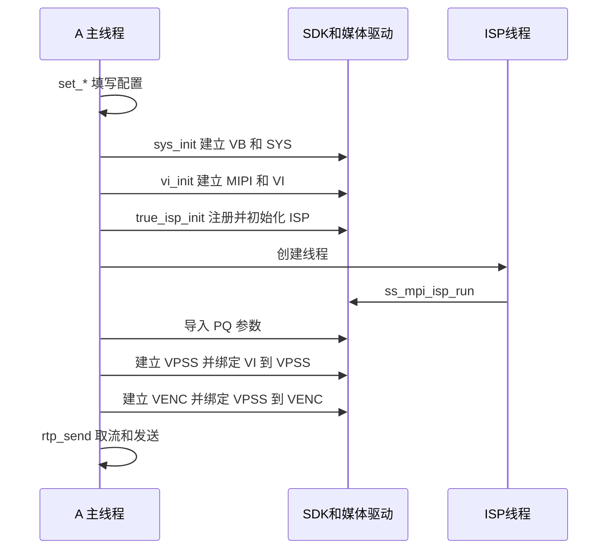

# 04 媒体系统初始化

[学习首页](README.md) · [上一章：板级资源与 Sensor 适配](03_板级资源与Sensor适配.md) · [下一章：SYS/VB 与缓冲区管理](05_SYS_VB与缓冲区管理.md)

前两章说明应用怎样得到配套产物，以及 Sensor 怎样提供像素和控制接口。本章从应用进入 `main()` 开始，观察这些输入怎样变成活动资源：先有可用的媒体系统，再有采集和处理对象，最后建立绑定，让编码器和取流代码得到数据。

读初始化代码时，要始终跟住两个问题：刚才只是准备了参数，还是已经申请了资源；如果下一步失败，之前已经成功的部分由谁撤销。这样才能把启动顺序与后面的持续运行、退出联系起来。

## 4.1 进入 main 时，哪些条件应当已经成立

进程能执行 C 代码，说明 Linux 已经能够装载它；媒体设备能否工作，还取决于更具体的前提。A 会打开 `/dev/ot_mipi_rx`，两条主线都会调用媒体 MPI 接口，这些请求需要配套驱动和内存资源承接。

| 运行前提 | 应用接下来怎样使用它 | 缺失时最早可能出现的问题 |
| --- | --- | --- |
| 目标程序和用户态运行库配套 | 装载进程、调用库函数 | 进程装载失败或接口不兼容 |
| 媒体驱动已就绪 | MPI 和设备控制请求进入驱动 | 打开设备或初始化模块失败 |
| Sensor 与板级设置匹配 | 配置接收接口并启动图像输入 | 没有有效帧、接收错误或异常图像 |
| 媒体内存可满足请求 | 建立 VB 池和模块内部资源 | 分配失败或模块启动失败 |
| 工作目录能找到运行数据 | A 打开相对路径 PQ BIN | 文件未加载，调校没有按预期生效 |
| 指定资源编号可用 | 创建 dev、pipe、group、channel | 与其他媒体业务冲突 |

这些是需要核对的条件，当前没有板端状态证明它们全部成立。[使用文档（3）](../../hi3516firm/hi3516firm/海思hi3516-hi3519使用文档%283%29.docx) 的 `S99autostart` 片段记录过先加载媒体驱动、再启动应用的方案；脚本、MMZ 地址和 Sensor 参数仍属于历史部署记录，不能自动当作当前启动配置。

**dev、pipe、group、channel**是媒体接口用来标识设备、处理管道、组和输出通道的编号。两条主线大量使用编号 0，因此不能仅凭它们是两个进程就推断可同时占用同一组硬件资源。

## 4.2 先区分配置对象和已经建立的资源

在 A 的 [new_main2.c](../../hi3516firm/new_main2.c) 中，`main()` 先创建 `sys_cfg`、`vi_cfg`、`vpss_cfg`、`venc_vpss_chn` 等变量，再调用 `set_vi_*()`、`set_dev_info()`、`set_vpss_*()` 填写它们。

此时改变的是进程内存中的结构体。比如写下通道宽高，只表达稍后希望硬件输出何种图像；调用创建、设置、启动接口之后，平台才尝试建立相应对象。接口返回成功，又是比“参数已填写”更进一步的证据。

配置传递也不意味着被调用函数一定按传入值执行。A 的 `set_vi_sys_cfg()` 准备媒体工作模式，但 `sys_init()` 内部又直接设置各 pipe 的模式。因此应沿参数的实际使用点追踪最终请求，不能停在结构体赋值处。

可以把启动过程看成一份逐渐增加的资源记录：SYS/VB 成功后才有公共基础；VI/ISP 成功后才有输入与控制执行者；VPSS 成功后才有后处理输出；VENC 成功后才可能出现压缩码流。这份记录同时决定异常退出时需要撤销哪些对象。

## 4.3 A 怎样把资源接成一条发送链

### 4.3.1 SYS/VB 先给后续模块准备公共基础

`sys_init()` 先请求退出已有 SYS/VB 状态，再提交 VB 配置，初始化 VB、SYS，最后设置 VI/VPSS 模式。**SYS**是媒体系统公共管理层；**VB**是视频缓冲池机制，用于组织媒体模块可反复取得和归还的图像块。

A 根据 Bayer 图像属性计算块大小，在公共池 0 请求三个块。这里先记住“请求了怎样的资源”；块的布局、池数与实际分配差异留到第 05 章。调用 SYS/VB exit 也说明这段示例面向自行掌握媒体系统的运行方式，多业务共存时必须另行设计初始化责任。

A 的 `sys_init()` 为 `void`，多项返回值没有形成向 `main()` 传播的成功条件。所以下一行代码继续执行，只说明控制流继续，不能据此证明公共基础已经建立。

### 4.3.2 VI/ISP 建立输入对象和持续控制者

`vi_init()` 打开 MIPI 接收设备，提交 lane、时钟、复位和接收属性；随后配置并使能 VI dev，建立 dev 与 pipe 的关系，创建和启动 pipe，再配置输出通道。这个阶段把第 03 章的像素输入契约落实到接收端对象。

`true_isp_init()` 则沿另一种职责继续：取得 `g_sns_sc500ai_obj`，注册 Sensor 回调和 AE/AWB 算法，初始化 ISP 内存与公共属性，完成 ISP 初始化，最后创建线程运行 `ss_mpi_isp_run()`。主线程可以继续建立后级，ISP 线程则进入持续运行阶段。

两者的关系是输入和处理条件共同就绪。没有 Sensor/ISP 控制，接收模块存在也不足以证明图像正确；没有正确接收配置，算法注册成功也不会产生可供后级消费的有效帧。

### 4.3.3 PQ、VPSS、VENC 依次补上后级条件

主线程随后执行 `isp_calibration_load_bin()`，读入 PQ 参数并交给导入库。它发生在 ISP 初始化和手动曝光约束之后，因此第 03 章所述的最终参数覆盖问题仍然存在；导入失败时，当前主流程也没有停止后续启动。

`vpss_init()` 建立 VPSS 组与输出通道，`vi_bind_vpss()` 把 VI 输出连接到 VPSS。**VPSS**负责把输入图像组织成后级需要的输出；绑定是交给平台的数据连接关系，应用随后无需每帧先取得原始图像再手动送到下一模块。

`encoder_init()` 建立 H.265 编码器并开始接收，`vpss_bind_venc()` 再连接 VPSS 通道 0 与 VENC 通道 0。**VENC**是视频编码器，此时它才拥有来自前级的图像输入路径。最后 `rtp_send()` 建立网络发送资源，进入取压缩码流和发送的持续循环。

下面展示 A 的源码编排次序，以及 ISP 线程从何处开始与主线程并行。

图中每个箭头都需要接口结果支撑才能视为成功。尤其 `g_start_isp` 在 `pthread_create()` 后直接置真，没有依据创建结果决定；`Ready for streaming` 的打印也没有覆盖前面每项请求。它们是程序记录的状态和输出文字，实际可用性仍需返回值、属性及数据推进共同确认。

## 4.4 B 把同类依赖收进公共辅助层

B 的 [sample_rtsp.c](../../sample_source/rtsp_4m/sample_rtsp.c) 先在 `main()` 注册 SIGINT/SIGTERM 信号处理，再创建端口 554 的 RTSP server 和 `/test.264` 会话。**信号**是操作系统向进程通知事件的一种方式，这里用于发出退出请求。

先创建会话，是为了后面取到码流时有确定的发布对象。它还不能证明 RTSP 已有独立事件线程持续处理客户端；实际事件推进位置在第 09 章追踪。

### 4.4.1 start_sys_vi_vpss 交出可供编码的输出

`sample_venc_rtsp()` 先把输出尺寸转换成宽高，再调用 `start_sys_vi_vpss()`。后者根据编译选择的 Sensor 准备 VI 默认配置、VPSS 两路输出和 wrap 计算结果，随后初始化 SYS/VB、启动 VI、启动 VPSS，最后绑定 VI 到 VPSS。

进入 [sample_comm_vi.c](../../sample_source/common/sample_comm_vi.c) 的 `sample_comm_vi_start_vi()`，才能看到封装之下的 MIPI、dev、pipe 和 ISP 启动。`sample_comm_vi_start_one_pipe_isp()` 负责具体 ISP 注册与初始化，再经 [sample_comm_isp.c](../../sample_source/common/sample_comm_isp.c) 的 `sample_comm_isp_run()` 启动运行线程。

因此 B 的主文件没有 A 的 `true_isp_init()`，但仍具有 ISP 执行者。封装改变了代码所在位置，没有消除硬件和控制依赖。

### 4.4.2 两路编码成功后，再把读取权交给 worker

`venc_start_encode()` 准备两份 H.264 参数，设置小缓冲模式，然后依次启动 VENC 通道 0、1，并绑定相应 VPSS 输出。两路成功后才创建取流 **worker**，即承担持续取流工作的线程；这避免它在编码对象未就绪时开始访问通道。

worker 等待两个 VENC fd，取得码流、处理后归还。**fd**（文件描述符）是进程引用内核对象的整数句柄，这里的 VENC fd 用来等待编码数据就绪。当前会话只发布通道 0，通道 1 也会取还码流，但不进入同一个发送分支。

主线程随后每秒检查退出标志。这个循环只负责等待结束条件，图像采集、硬件处理、编码和 worker 取流都有自己的推进机制。把它误当作业务主循环，会错误地认为媒体只能一秒处理一次。

## 4.5 用一次启动失败推导回退顺序

假设 B 的 SYS/VB 和 VI 已成功，而 VPSS 启动失败。此时编码器和 worker 尚未创建，资源记录中只有前两阶段。正确回退应先停止已经拥有的 VI/ISP，再退出 SYS/VB，而不是继续绑定一个不可用的 VPSS。

`start_sys_vi_vpss()` 使用 `exit_vpss`、`exit_vi`、`exit_sys` 标签表达阶段回退。若失败发生得更晚，例如 VI 到 VPSS 的绑定失败，便需要先停已启动的 VPSS，再回收 VI 和系统基础。编码启动也记录循环进度：当前通道绑定失败时先停止当前通道，再撤销前面已完成的通道。

| 失败发生时已经完成的阶段 | 此时仍可能持有的资源 | 外层回退应覆盖的范围 |
| --- | --- | --- |
| SYS/VB 成功，VI 启动失败 | 公共基础；VI 内部可能有部分资源 | VI 内层处理自身阶段，再由外层退出 SYS/VB |
| VI 成功，VPSS 启动失败 | VI/ISP、公共基础 | 停 VI/ISP，再退出 SYS/VB |
| VPSS 成功，输入绑定失败 | VPSS、VI/ISP、公共基础 | 停 VPSS，再依次撤销输入与基础 |
| 部分编码通道成功，后续失败 | 已启动或已绑定的编码通道 | 按完成位置解绑、停止，再撤销前级 |

这里还需要区分“外层有回退”与“所有嵌套函数均无遗漏”。例如公共 SYS 初始化在 VB 成功、SYS 初始化失败时没有在该失败分支立即退出 VB；公共 ISP 启动也有直接返回的失败路径。小缓冲设置返回值未检查、worker 异常结果未送回 main 等问题，又属于跨阶段错误传播。B 有较完整的阶段结构，但还不能被描述为所有失败都已完整闭合。

A 的多项初始化函数为 `void`，主循环结束后直接 `exit(0)`，尚未建立对应的反向媒体清理。退出时如何先停消费者、等待线程结束，再撤销输入与公共资源，详见第 10 章。

## 4.6 启动完成应交给运行阶段什么

经过初始化，后续代码需要的不是一串“已经调用”的函数名，而是一组可使用对象和关系：Sensor 有匹配控制，VI 能提供有效图像，VPSS 有正确输出，VENC 已接收并产生码流，取流执行者能够使用它，发送对象能够消费对应字节。

可以依次提高证据强度：先确认请求返回，再查询可读属性，再观察帧或码流计数持续增长。接收端成功解码则进一步证明编码、封装和传输的配合。每一步都缩小问题范围，但不越过尚未观察的边界。

A 与 B 在这里交出的对象不同：A 是一个 H.265 通道，由主线程取流发送；B 是两个 H.264 通道，由 worker 取还，当前 RTSP 只发布通道 0。两者都有 ISP 线程，B 另外具有 RTSP server/session。后续分析缓冲、阻塞和退出时，应继续使用这份具体资源关系。

## 4.7 自查问题

1. `set_vi_pipe_info()` 返回与 VI pipe 真正工作之间，还隔着哪些步骤和证据？
2. B 的 main 没有直接调用 ISP Run，怎样从源码找到 ISP 线程的创建者？
3. 若 B 的输入绑定失败，为什么应先撤销 VPSS，再撤销 VI/ISP 和 SYS/VB？外层标签是否能证明所有内部失败都已清理？
4. A 在 ISP 初始化后导入 PQ，再打印准备发送。为什么仍需分别检查线程、导入结果和码流推进？

### 4.7.1 参考答案

1. 配置函数只填进程结构体。随后需要创建、设置和启动接口成功，查询属性符合预期，并观察实际帧推进；这几个阶段不能由一次函数返回合并证明。
2. 从 `sample_comm_vi_start_vi()` 追到 `sample_comm_vi_start_one_pipe_isp()`，再到 `sample_comm_isp_run()`。ISP 初始化属于 VI 公共启动链的一部分，线程运行封装位于 ISP 公共文件。
3. 下游依赖仍在时不能先拆其输入基础。外层回退按已完成阶段撤销对象，内层函数仍必须处理自己建立到一半的资源，需要分别检查返回路径。
4. 线程创建可能失败，PQ 可能未导入或改变先前参数，发送提示也未验证所有前级。应先核对接口结果与最终属性，再确认 VENC 持续产流和接收端结果。

下一章：[05 SYS/VB 与缓冲区管理](05_SYS_VB与缓冲区管理.md)。模块已经有了创建与连接关系，接下来把“有数据可用”展开为图像的布局、内存块的容量，以及持有和归还的时机。
