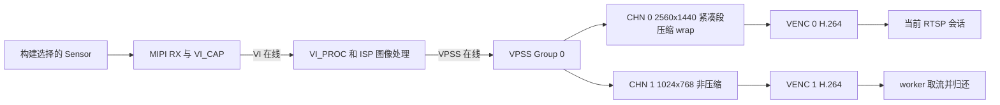

# 06 VI、ISP、VPSS 图像通路

[学习首页](README.md) · [上一章：SYS/VB 与缓冲区管理](05_SYS_VB与缓冲区管理.md) · [下一章：VENC 编码与码流生命周期](07_VENC编码与码流生命周期.md)

前面已经建立 Sensor 控制、媒体对象和缓冲使用规则。本章把这些条件放进持续工作的一帧图像：Sensor 输出原始采样，芯片完成接收与图像处理，VPSS 按后级需求提供输出，编码器取得可以压缩的图像。

主线 A 是 [new_main2.c](../../hi3516firm/new_main2.c)，主线 B 是 [sample_rtsp.c](../../sample_source/rtsp_4m/sample_rtsp.c)。下面分别追踪它们的实际边界；所有尺寸、模式和行数都是当前源码请求的配置，尚无板端实测证明其全部生效。

## 6.1 一帧经过哪些职责边界

**VI**（Video Input，视频输入）负责接收和组织输入，包括设备、处理管道和输出通道。**ISP**（Image Signal Processor，图像信号处理）把 Sensor 的原始采样处理为可用图像，并配合自动控制软件维护画质。**VPSS**（Video Processing Subsystem，视频处理子系统）进一步提供适合后级的尺寸、布局和处理属性。

从数据用途看，VI 解决输入从哪里来和怎样接收；ISP 解决原始采样怎样被解释、处理；VPSS 解决同一输入怎样适配不同消费者。下一章的 **VENC**（Video Encoder，视频编码器）再把这些图像压缩成码流。

在本平台的软件模型中，VI PIPE 包含 ISP 相关图像处理，所以不应把 VI 和 ISP 画成两个完全独立的用户态搬运站。应用负责建立和控制流水线，像素持续流动主要由媒体硬件、驱动和缓冲关系推进。ISP 用户态线程支撑控制与算法调度，源码中没有 CPU 每帧依次调用 `VI()`、`ISP()`、`VPSS()` 的像素循环。

本地 [MPP 开发参考](../../hi3516cv610/海思Hi3516CV610R001C01SPC020/ReleaseDoc/zh/01.software/board/MPP/MPP%20媒体处理软件%20V6.0%20开发参考.pdf) §3.3 描述 VI 层次，§5.2 描述 VPSS 组与输出通道。它覆盖多个芯片，下面只将当前源码与 Hi3516CV610 相关语义连接；资料配套版本边界见第 02 章。

## 6.2 对象编号告诉我们谁与谁相连

**DEV**（设备）描述外部输入接口；**PIPE**（管道）组织一路图像处理；**CHN**（通道）提供输出；VPSS 的 **Group**（组）组织一路输入及它派生的多个输出。

A、B 的主要输入都经过 VI PIPE 0、VI CHN 0，进入 VPSS Group 0。A 只启用 VPSS 输出通道 0，B 则启用通道 0、1。B 的两路输出来自同一组输入，所以首先应理解为同一图像的两个处理结果，而不是两颗摄像头或两个独立 ISP。

当 `vi_bind_vpss()` 或公共绑定函数建立连接时，模块号、设备/组号和通道号共同定位边界。此后的 `VPSS CHN 0 → VENC 0`、`VPSS CHN 1 → VENC 1` 又把每个图像输出交给对应编码对象。读低延迟、尺寸或发送条件时，都要保留这个通道身份。

## 6.3 A：RAW 先经 DDR，处理后在线交给 VPSS

### 6.3.1 从 Sensor 输出到 VI PIPE

A 的目标是 SC500AI、1920×1080、100fps。MIPI 接收使用 4 lane RAW10；`set_dev_info()` 设置输入尺寸并关闭 VI 缩放；`set_vi_bind_pipe()` 选择 PIPE 0；`set_vi_grp_info()` 选择非 WDR 融合组。当前链路没有配置多曝光融合或多 Sensor 合成。

RAW Bayer 中每个位置先代表一种颜色采样，因此接收尺寸、位宽和 Bayer 排列必须匹配 Sensor。ISP 在原理上需要结合邻域及调校完成图像处理，A 并没有自行实现去马赛克、降噪或颜色转换算法。它提供公共属性、Sensor 控制及 PQ 参数，具体像素处理由平台完成。

这里要保留两个真实字段：MIPI 写 RAW10，`set_vi_pipe_info()` 则写 Bayer 12BPP、非压缩 PIPE 属性。它们描述不同接口边界，不能统一改写为“全程 RAW10”；相应传输与内部表达组合是否配套，需当前 SDK 约束和板端格式信息确认。

### 6.3.2 把 offline/online 放到准确的箭头上

A 的 `sys_init()` 设置 `OT_VI_OFFLINE_VPSS_ONLINE`。按 MPP §2.3.3，VI 的在线/离线描述 VI_CAP 采集侧到 VI_PROC 处理侧；VPSS 的在线/离线描述 VI_PROC 到 VPSS。

因此 A 的 RAW 先经过 DDR，处理后图像再在线送往 VPSS。图中 DDR 框只标明这个已确认的离线交接边界，不代表系统其余部分没有内部内存。


A 配置的公共 Bayer 池与 RAW 离线环节需求方向相符，具体大小和占用要回到第 05 章核对。不能把这条模式误画成“VI 先写出完整 YUV 到 DDR，再让 VPSS 读入”，那对应另一个边界的离线行为。

`set_vi_pipe_info()` 的 VI 输出通道采用 1920×1080、NV21、SDR8、线性、非压缩属性。**SDR8**是所选普通动态范围、8bit 输出属性；NV21 的 Y 与 VU 布局已在第 05 章推导。前后边界改变的是像素表达，尚未生成网络编码数据。

### 6.3.3 同尺寸 VPSS 仍承担输出衔接

`set_vpss_grp()` 把组最大输入尺寸设为 1920×1080；`set_vpss_chn()` 把通道 0 输出也设为 1920×1080、NV21、线性、非压缩、`depth=0`。该链路未开启 wrap，也没有开启镜像、翻转、边框或幅形比处理。

输入输出同尺寸，说明此处 VPSS 的主要作用不是缩放，而是按平台通路建立后级处理与输出。`vpss_init()` 创建组、设置输出属性和低延迟参数、启动组并使能通道；`vi_bind_vpss()` 与 `vpss_bind_venc()` 把这一路输出接到 VENC 0。

这些关系建立后，媒体系统持续向编码器交图像。A 主线程在 `rtp_send()` 中看到的是编码后的码流；它没有在该循环中主动取得每幅 NV21 再调用 VPSS。这个分工是后续理解 CPU 负载、码流缓冲和网络阻塞的基础。

## 6.4 B：一条在线输入产生两个用途不同的输出

### 6.4.1 公共配置把 Sensor 选择展开为具体属性

B 的 `SENSOR0_TYPE` 来自构建宏，[Makefile.param](../../sample_source/Makefile.param) 默认选择 SC4336P 4M30。`start_sys_vi_vpss()` 通过 [sample_comm_vi.c](../../sample_source/common/sample_comm_vi.c) 的 `sample_comm_vi_get_default_vi_cfg()` 展开 Sensor、MIPI、dev、pipe 与 ISP 属性。

在该默认分支下，有效尺寸和 ISP 公共属性为 2560×1440、30fps、非 WDR，PIPE 属性采用 Bayer 12BPP 与行压缩，VI 输出通道为 NV21、非压缩、`depth=0`。PIPE 存储属性怎样在在线模式下生效，应按该模式约束解释，不能因此凭空增加一个 RAW 落 DDR 的阶段。

一个特别需要实际读字段的位置是 MIPI 属性。变量名 `g_mipi_2lane_chn0_sensor_sc4336p_10bit_4m_nowdr_attr` 和宏名带有 `10BIT`，当前内容却是：

```c
.img_rect = {0, 0, WIDTH_2560, HEIGHT_1440},
.mipi_attr = {
    DATA_TYPE_RAW_12BIT,
    HI_MIPI_WDR_MODE_NONE,
    {0, 2, -1, -1}
}
```

这是结构体节选，展示默认分支真正提交的 RAW12 与两个有效 lane 编号。名称、字段和物理 Sensor 输出之间仍需核对；已有二进制使用的构建宏也未由这段源码证明。这里既不能按名字写成 RAW10，也不能声称已在板上验证 RAW12 正确。

### 6.4.2 全在线减少前两段内存交接

`get_sys_cfg()` 选择 `OT_VI_ONLINE_VPSS_ONLINE`。这使 VI_CAP 到 VI_PROC、VI_PROC 到 VPSS 两段都采用在线数据流；它减少这两个边界的整帧写读，同时增加模块启动次序和处理时序之间的约束。

B 的实际启动先完成 VI，再启动 VPSS，与 MPP 参考对全在线路径的顺序要求一致。公共 VI 启动内含 ISP 注册、初始化和线程运行，所以主文件没有直接调用 A 的 `true_isp_init()`，也仍然具有持续图像控制。

下面画出 B 的分支，输出存储仍存在，主通道采用 wrap，子通道使用普通图像缓冲。



图中两支来自同一输入，表示不同输出配置和消费者。当前发布关系只连 VENC 0；它不是两路同时对外发布的拓扑。

### 6.4.3 尺寸、压缩布局和编码是连续的不同处理

`get_vpss_cfg()` 按输入与输出尺寸安排组最大宽高，开启两个物理输出通道。主通道为 2560×1440、NV21 属性、紧凑段压缩并启用 wrap；子通道为 1024×768、NV21 属性、默认非压缩。两者均设 `depth=0`。

从默认 2560×1440 输入得到 1024×768 子图像，意味着输出采样尺寸发生变化。这种缩放与是否降低帧率是两个维度；通道帧率属性为 `-1/-1` 时表示此处不做指定的帧率控制，不能由尺寸缩小推断帧率也按比例变化。

还要独立考虑画面比例：2560×1440 是 16:9，1024×768 是 4:3，水平缩放系数为 `1024/2560=0.4`，垂直为 `768/1440≈0.533`。B 沿用 [sample_comm_vpss.c](../../sample_source/common/sample_comm_vpss.c) 中 `aspect_ratio.mode=HI_ASPECT_RATIO_NONE` 的默认值，当前入口未另设裁剪或保比例补边。因此不能把子图像描述为原画面的等比例缩小；在完整输入被映射到完整输出、且没有其他几何修正时，两个方向的不同比例会改变物体形状。实际有效配置和显示比例仍需板端图像及接收端信息核对。

**紧凑段压缩**是媒体模块交接图像使用的存储布局，服务内存与带宽需求；**H.264**是 VENC 生成的编码码流。主通道图像采用前一种布局后，仍要经过 VENC 才成为后者。它们不能因都叫“压缩”而被合并成一步。

B 的两路编码目标均为 30fps。`venc_start_encode()` 绑定 VPSS 0→VENC 0、VPSS 1→VENC 1；worker 对两路都获取和归还码流，只把通道 0 交给当前 RTSP 会话。这也意味着分析资源和性能时，不能忽略未发布子通道仍在编码和取流的成本。

## 6.5 提前通知和低延迟究竟减少哪种等待

在普通理解下，下游可能要等待图像积累到某个阶段才开始处理。若平台支持按行推进，可以让前后级部分重叠，减少等到整帧完成才交接的时间。但通知得早、数据可安全读取、消费者处理得过来，是三个相关条件。

A 在 `vi_init()` 中配置 `OT_FRAME_INTERRUPT_EARLY`，`early_line=880`，再设置 PIPE 低延迟行数 270；`vpss_init()` 对 VPSS 通道 0 设置低延迟行数 270。代码中的 VPSS 组提前中断调用被注释，因此不能把它也列为 A 已提交的配置。

B 的 `vpss_start()` 设置 `OT_FRAME_INTERRUPT_EARLY_END`，行数为组最大高度的一半。当前默认高度 1440 对应 720 行；Sensor 或尺寸变化后应重算，720 不是固定协议常量。随后它只为 VPSS 通道 1 设置 200 行低延迟，而当前 RTSP 发布的是通道 0。

| 需要跟踪的边界 | A 的活动配置 | B 的活动配置 |
| --- | --- | --- |
| VI 提前通知 | 880 行 | 本主例没有同样的手工设置 |
| VI PIPE 低延迟 | 270 行 | 本主例没有同样的手工设置 |
| VPSS 组提前中断 | 对应调用被注释 | 最大高度的一半，默认 720 行 |
| VPSS 通道低延迟 | 通道 0，270 行 | 通道 1，200 行 |
| 当前对外发送的编码通道 | VENC 0 | VENC 0 |

MPP §2.2.1 的低延迟说明包含保障先写后读的特定机制；VI 重要概念中说明提前上报中断本身不具有同样的硬件保证。两种配置都出现行数，但不能仅从数值推导相同的安全性或时延。

由此可见，B 的子通道 200 行设置不能直接解释当前发布主码流的效果，A 的行数也不能直接换算成接收端总延迟。还需要确认接口是否成功、当前模式是否支持组合、各级持续吞吐，以及编码、发送和接收缓存的时间。更完整的性能预算在第 12 章继续推导。

## 6.6 ISP、降噪与 PQ 在持续路径里怎样起作用

Sensor 回调和 AE/AWB 的职责已在第 03 章展开。本章只把它们接回图像：自动控制调整后续采样条件，ISP/PQ 参数决定图像处理行为，处理结果再成为 VPSS 和编码器的输入。因此“编码出流”只说明后级拿到了可处理数据，不能单独证明颜色、曝光和降噪符合预期。

A 启用正常模式的 VI 降噪，相关压缩关闭，使用 `OT_VI_NR_EFFECT_MODE_NORM`；注释中的其他降噪选项没有相应活动赋值。之后导入的 PQ 可能改变部分相关参数，需要导入返回和最终回读确认有效配置。B 当前入口没有调用 A 的 PQ 导入函数，其 Sensor/ISP 默认参数来自所选公共适配与库，不能直接借用 A 的调校结论。

如果图像颜色或几何异常，应先定位出现异常的最早边界：Bayer 排列和 RAW 位宽影响原始采样解释，Y/VU 顺序及 stride 影响处理后图像读取，Sensor/PQ 配套影响画质。把异常统一归给“编码器”会跳过这些仍可正常产流的错误路径。

## 6.7 从无画面现象回到具体交接点

现在可以按图像实际经过的顺序组织观察。每次先证明当前边界有数据，再把范围推进到下一层。

| 观察到的现象 | 首先核对的交接 | 可以进一步缩小到什么范围 |
| --- | --- | --- |
| VI 无有效输入 | Sensor 输出、时钟/复位、MIPI lane/格式及返回值 | 控制与像素接入条件 |
| VI 有输入，处理后无可用输出 | ISP 状态、模式、VB 资源、VI/VPSS 绑定 | 输入之后、编码之前的处理路径 |
| 主路正常，子路异常 | VPSS CHN 1 使能、尺寸、池和 VENC 1 | 同一输入派生出的子通道 |
| 新增用户取图后出现卡顿 | depth、Get/Release 配对与持有时长 | 新消费者改变的缓冲生命周期 |
| 有码流但颜色或画面异常 | 最早异常层的 Bayer、RAW、NV21 布局及 PQ | 像素含义与处理配置，而不只看产流能力 |

这些是源码导出的检查路线，尚未据此认定板端发生了任何一种故障。首先还需确认正在运行的程序、宏和库与本文分析对象对应。

停止时也应按同一依赖关系理解：B 先结束取流和编码，再撤销 VPSS、VI/ISP，最后退出 SYS/VB。`sample_comm_vi_stop_one_pipe_isp()` 请求 ISP 退出、停止对应线程并解除注册；A 尚缺完整反向清理。具体线程等待与异常传播留到第 10 章，不由正常的数据流图自动推定已经实现。

## 6.8 自查问题

1. 为什么 A 的模式应画成 RAW 经 DDR、处理后在线进入 VPSS？公共 Bayer 池与它有什么联系？
2. B 的 `10BIT` 宏名、RAW12 接收字段和实际 Sensor 输出，各属于哪一种证据？
3. B 的主、子通道在尺寸、图像压缩布局、低延迟配置和当前发布关系上有什么区别？
4. ISP 用户态线程、VPSS 图像处理和主线程取流各负责什么？提前中断行数为何不能直接等同于端到端延迟？

### 6.8.1 参考答案

1. VI offline 描述 VI_CAP→VI_PROC 的 RAW 内存交接；VPSS online 描述 VI_PROC→VPSS 的在线交接。A 的 Bayer 公共池与前一段需求方向相符，具体分配及占用仍需查询。
2. 宏名是编译选择标识，实际属性字段是当前源码提交意图，物理输出需要器件配置和板端证据。应保留三者间差异，并核对已有二进制的构建参数。
3. 主通道 2560×1440、紧凑段压缩和 wrap，经 VENC 0 发布；子通道 1024×768、非压缩，经 VENC 1 取还但不进入当前发送分支。200 行低延迟只明确设置在子通道，组提前中断则另有配置。
4. ISP 线程支撑控制和算法调度，媒体通路持续处理像素，取流代码消费编码结果。提前通知只改变某个阶段的等待条件，仍需安全读写机制、持续吞吐及后续编码/网络/接收时间共同决定总延迟。

下一章：[07 VENC 编码与码流生命周期](07_VENC编码与码流生命周期.md)。两条路径都已交出有尺寸、格式和生命周期的图像，接下来观察编码器怎样把它们变成带时间语义、可借用且必须归还的压缩数据。
