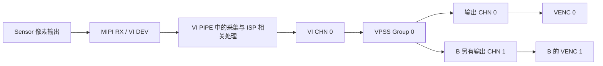

# 06 VI、ISP、VPSS 图像通路

本章承接 Sensor 控制和 SYS/VB 基础，解释图像产生后怎样进入芯片、完成处理并交给编码器。学习重点是看懂每个边界的格式和职责，而不是背下一长串初始化 API。

应用先配置和连接流水线；持续图像处理主要在媒体硬件、驱动及其缓冲关系中推进。ISP 用户态线程参与控制和算法调度，但不能据此把整个像素处理过程画成 CPU 每帧顺序调用 `VI()`、`ISP()`、`VPSS()`。

返回 [学习首页](README.md)。本章 A 为 [new_main2.c](../../hi3516firm/new_main2.c)，B 为 [sample_rtsp.c](../../sample_source/rtsp_4m/sample_rtsp.c)，两条链路分别解释。

## 6.1 为什么要有 VI、ISP 和 VPSS 三个名字

**VI（Video Input，视频输入）**建立采集设备、处理管道和输出通道，接收并管理输入时序。**ISP（Image Signal Processor，图像信号处理）**负责 RAW 图像的处理以及相关控制；在本平台的媒体软件模型里，VI PIPE 包含 ISP 相关处理功能，因此两者不是毫无重叠的两个独立用户态处理站。

**VPSS（Video Processing Subsystem，视频处理子系统）**接收前面的处理结果，再按业务需要输出尺寸、格式和处理属性不同的图像通道。**VENC（Video Encoder，视频编码器）**在下一章把这些图像压缩成码流。

可以按问题理解：VI 解决“从哪里来、按什么时序接收”；ISP 解决“原始采样怎样变为画质可用的图像”；VPSS 解决“同一图像怎样适配后级需要的尺寸和布局”。这些职责是理解接口的线索，不是当前芯片内部每一级寄存器和数据总线的完整图纸。

【资料记录】本地 [MPP 开发参考](../../hi3516cv610/海思Hi3516CV610R001C01SPC020/ReleaseDoc/zh/01.software/board/MPP/MPP%20媒体处理软件%20V6.0%20开发参考.pdf)§3.3.1–3.3.4说明 VI 的 DEV、PIPE、通道层次；§5.2说明 VPSS 的组和输出通道。文档同时覆盖多个芯片，不能把全部能力列表视为 Hi3516CV610 当前应用全部启用的功能。

## 6.2 先读懂设备、管道、组与通道的边界

**DEV（设备）**描述外部输入接口；**PIPE（管道）**描述一条图像处理路径；**CHN（通道）**是可供后级使用的输出；**Group（组）**组织 VPSS 的一路输入及其多个输出通道。

【源码实现】A 和 B 的主要业务都围绕 VI PIPE 0、VI CHN 0 和 VPSS Group 0 组织。B 的两个 VPSS 输出通道来自同一组输入，不代表两颗摄像头，也不代表需要两个独立 ISP 实例。

这张图表示逻辑数据关系。A 只启用输出通道 0；B 启用两个输出通道。不同模式下，箭头可能对应在线连接或内存交接；是否写入 DDR，要继续结合模式分析。

## 6.3 A：以 1080p、100fps 为目标的单路处理链

### 先准备结构体，再让硬件开始工作

【源码实现】A 的 `main()`先调用 `set_vi_*()`与 `set_vpss_*()`填写配置。这一阶段只是准备应用内存中的参数；只有进入 `sys_init()`、`vi_init()`、`true_isp_init()`、`vpss_init()`等步骤，才向平台请求建立实际资源。

`set_dev_info()`把 VI 输入尺寸设为 1920×1080，关闭 VI 缩放；`set_vi_bind_pipe()`指定一个 PIPE 0；`set_vi_grp_info()`选择非 WDR 融合组。因此当前主线没有多曝光融合，也没有通过多路 Sensor 合成图像。

【配置目标】MIPI 配置是 4 lane RAW10；`set_vi_pipe_info()`却使用 Bayer 12BPP、非压缩的 PIPE 图像描述。这是两个接口层的实际赋值，不能凭名字把它们统一写成“全链路 RAW10”。是否对应合法的传输位宽与内存表达转换，需要当前 SDK 约束与板端格式信息确认。

### RAW 与处理后图像在哪里交接

【配置目标】`sys_init()`把模式设为 `OT_VI_OFFLINE_VPSS_ONLINE`。按参考文档§2.3.3的定义，RAW 采集侧到处理侧先通过 DDR 交接，处理侧到 VPSS 则使用在线连接。A 的公共 VB 配置为非压缩 Bayer 块，与该 RAW 离线环节的需求方向相符。

`set_vi_pipe_info()`给 VI 输出通道设置 1920×1080、`YVU_SEMIPLANAR_420`、SDR8、线性、非压缩和 `depth=0`。**SDR8**是此处选用的普通动态范围、8bit 输出属性；具体画质转换由平台实现，应用没有提供自行完成去马赛克、降噪或色彩处理的像素循环。

`true_isp_init()`登记 Sensor 与 AE/AWB，设置 ISP 公共属性并启动 ISP 运行线程。Sensor 控制回调、曝光和 PQ 覆盖关系已经在 [第 03 章](03_板级资源与Sensor适配.md)展开。这里需要记住：线程运行支撑持续图像质量控制；它不是把每一帧读进应用后手写转换为 NV21。

### VPSS 向编码器提供什么

【源码实现】`set_vpss_grp()`设定组最大输入尺寸为 1920×1080，像素格式为 NV21；`set_vpss_chn()`把通道 0 的输出也设为 1920×1080、NV21、非压缩、线性、`depth=0`。没有开启镜像、翻转、边框、幅形比处理或 wrap。

因此 A 的 VPSS 当前不以改变分辨率为主要目的，而是承担平台图像通路中的后级处理和输出衔接。不要因为名为“视频处理”就把未启用的缩放、OSD 或 AI 自动补到这条链上。

`vpss_init()`创建组、提交通道属性与低延迟属性，然后启动组并使能通道；`vi_bind_vpss()`建立 VI PIPE 0/CHN 0 到 VPSS Group 0 的数据关系；编码器启动后，`vpss_bind_venc()`再把 VPSS CHN 0 绑定到 VENC 0。

一旦这些步骤成功，后续原始图像的交接由媒体系统推进。应用随后在 `rtp_send()`里获取压缩码流，而不是在该循环中调用 VPSS 处理每一幅图像。

## 6.4 A 的提前通知和低延迟参数在减少什么等待

通常需要等图像积累到一定阶段，下游才能安全开始工作。A 尝试通过更早通知和较小行数门槛，让前后级处理产生重叠，从而减少等待整帧完成的时间。

【源码实现与配置目标】`vi_init()`配置 `OT_FRAME_INTERRUPT_EARLY`，`early_line=880`；随后给 PIPE 低延迟设置 `line_cnt=270`。`vpss_init()`又给 VPSS 通道 0 设置低延迟行数 270。代码中的 VPSS 组提前中断设置则被注释，没有生效调用。

**提前中断**和**低延迟机制**不能只因都出现“行数”就混为一谈。MPP 参考§2.2.1说明低延迟路径存在保障先写后读的特定机制；VI 重要概念部分说明提前上报中断本身不具备同样的硬件保障。两种配置的组合是否受支持、实际通知点怎样影响后级，必须用当前 SDK 和真实运行信息核对。

较早开始处理可能缩短排队，但同时提高时序配合要求；下游读得过快、配置组合不受支持或吞吐不足，都不能靠“行数更小”自然解决。A 对相关接口返回值缺少检查，故本章只能确认它尝试配置了这些目标。

【源码实现】A 还启用正常模式的 VI 降噪，关闭该配置中的压缩，并选择 `OT_VI_NR_EFFECT_MODE_NORM`。注释提到的其他降噪模式没有实际赋值调用，不能把注释中的效果和延迟结论当作测量值。之后 PQ 导入还可能改变相关最终参数。

## 6.5 B：一条输入，两种输出，只有主码流进入当前 RTSP 会话

### Sensor 及输入属性由公共帮助函数展开

【源码实现】B 的 `sample_venc_rtsp()`取 `SENSOR0_TYPE`，交给 `start_sys_vi_vpss()`；后者通过 [sample_comm_vi.c](../../sample_source/common/sample_comm_vi.c)中的 `sample_comm_vi_get_default_vi_cfg()`准备 Sensor、MIPI、设备、绑定与 PIPE 属性。默认宏来自 [Makefile.param](../../sample_source/Makefile.param)，当前写为 SC4336P 4M30，且可被外层构建覆盖。

【配置目标】在这一默认宏下，公共函数给出的有效尺寸和 ISP 公共属性均为 2560×1440、30fps、非 WDR；PIPE 描述采用 Bayer 12BPP 与行压缩设置，VI 输出通道采用 NV21、非压缩、`depth=0`。这里描述的是提交的配置，实际在线路径上哪些存储属性发挥作用，要按工作模式解释。

还有一个不能省略的命名差异：当前选中的 `g_mipi_2lane_chn0_sensor_sc4336p_10bit_4m_nowdr_attr`变量名和 Sensor 宏带 `10BIT`，但其实际 `mipi_attr`赋值为 `DATA_TYPE_RAW_12BIT`，lane 为 `{0, 2, -1, -1}`。因此本章按源码写“接收属性配置 RAW12”，实际 Sensor 输出、该改动原因和二进制配套均属【待确认】。

### 全在线模式先建立输入，再启动 VPSS

【配置目标】B 的 `get_sys_cfg()`选择 `OT_VI_ONLINE_VPSS_ONLINE`并启用 wrap。按文档定义，采集侧到处理侧、处理侧到 VPSS 均在线连接；这不是“程序开了两个零内存通道”，后续 VPSS 输出和编码仍要使用各自资源。

【源码实现】`start_sys_vi_vpss()`先完成 SYS/VB，然后调用 `sample_comm_vi_start_vi()`。公共函数内部启动 MIPI RX、VI DEV、DEV 与 PIPE 关系、融合组、PIPE，再通过 `sample_comm_vi_start_isp()`完成 Sensor 注册及 ISP 启动。只有这些步骤返回成功，外层才继续启动 VPSS 并绑定输入。

这也解释了为什么 B 的主文件里没有独立调用 `true_isp_init()`，却不等于“B 没有 ISP”：其初始化被包含在公共 VI 启动链中。

### 两个输出共享输入，但使用不同缓冲方案

`get_vpss_cfg()`设置 VPSS Group 0 的接收上限，并开启两个物理输出通道。通道 0 为 2560×1440、紧凑段压缩、wrap；通道 1 为 1024×768、默认非压缩。两者都使用 NV21 格式属性和 `depth=0`。

**紧凑段压缩**是媒体模块之间保存图像的压缩布局，不等同于网络上传输的 H.264。VENC 仍会把它接收到的图像编码成另一种压缩码流；不能把这里的 `compress_mode`当作编码器类型。

【源码实现】`vpss_start()`先设置组提前结束中断，行数取组最大高度的一半，然后通过 `sample_common_vpss_start()`创建、启动组并设置、使能通道及 wrap。其后只给通道 1 配置 200 行低延迟。

【配置目标】默认尺寸下组最大高度为 1440，对应提前结束行数 720；但若 Sensor 宏或输出尺寸改变，应该重新按最大高度计算，不把 720 当作永远不变的常量。

【源码实现】`venc_start_encode()`分别把 VPSS 0→VENC 0、VPSS 1→VENC 1 绑定，两路均编码 H.264；取流函数只把 VENC 0 送进当前 RTSP 会话，VENC 1 仍被获取并归还。所以不能用“通道 1 配了 200 行低延迟”直接证明当前发送的主通道已得到同一配置效果。

## 6.6 两条链路放在一起，比较的是边界与取舍

| 比较点 | A：自定义 RTP | B：RTSP 示例 |
|---|---|---|
| 当前源码 Sensor 选择 | 固定 SC500AI 2M100 | 编译宏，文件默认 SC4336P 4M30 |
| 主要尺寸与目标帧率 | 1920×1080、100fps | 默认输入 2560×1440、30fps；两路编码目标 30fps |
| MIPI 接收配置 | 4 lane、RAW10 | 默认分支 2 lane、实际字段 RAW12，名称仍带 10bit |
| VI/VPSS 模式 | VI 离线、VPSS 在线 | VI 在线、VPSS 在线 |
| VPSS 输出 | 一个 1080p NV21 非压缩通道 | 主路 2560×1440 紧凑段压缩，子路 1024×768 非压缩 |
| wrap | 关闭 | 主通道启用 |
| 明确的 VPSS 通道低延迟 | 通道 0，270 行 | 通道 1，200 行 |
| 用户态主要取什么 | VENC 0 的 H.265 码流 | 两个 VENC 的 H.264 码流，当前只发送通道 0 |
| 停止路径 | 主程序缺少完整媒体清理 | 有反向停止与部分失败回退路径 |

这些是【源码实现／配置目标】对比，不是吞吐、时延或稳定性排名。A 尝试缩短高帧率链路中的等待；B 使用全在线及主路 wrap 管理资源，同时提供两个编码输出。哪一个更适合某块板和业务，需要明确接收端、画质、带宽和可靠性要求之后再验证。

## 6.7 图像停止时，先找哪个交接边界断了

判断“无画面”时，先问是否有输入帧，再问是否有处理后输出，最后才问编码与网络。这样每次检查都有明确的排除范围。

| 现象 | 所属边界与可能原因 | 检查依据与下一步 |
|---|---|---|
| VI 没有有效输入 | Sensor 未输出、时序或 lane 不匹配、驱动控制失败 | 对照第 03 章的控制链与实际接收属性；输入仍未推进时不先改 RTP |
| VI 有输入，处理链无可用输出 | ISP 未启动、格式/模式不匹配、内存不足 | 看 ISP 初始化与运行返回、VI/VPSS 模式、池状态和绑定关系 |
| 主路有输出，子路没有 | 子通道尺寸、使能、池或后级配置不匹配 | 分别检查 VPSS CHN 1 与 VENC 1，不能把主路成功当作两路成功 |
| 加了用户态取图后开始卡顿 | 持有图像过久、depth 和池数不匹配、归还遗漏 | 回到第 05 章查队列和资源所有权，再查新增处理耗时 |
| 图像颜色或画面几何异常 | Bayer 排列、RAW 接收格式、Y/VU 布局、Sensor/PQ 配套问题 | 优先核对产生异常的最早层；编码成功不意味着输入像素解释正确 |

【待确认】本次没有板端模块统计、采样图像或日志，因此未把上述任何一种可能原因认定为现场故障。排查时还要核对“正在运行的二进制”与这份源码是否对应。

## 6.8 停止时要让消费者先离开，再撤销输入

【源码实现】B 先结束编码和取流，再解绑 VI/VPSS、停止 VPSS、停止 VI/ISP，最后退出 SYS/VB。公共 `sample_comm_vi_stop_one_pipe_isp()`会请求 ISP 退出、停止对应线程并解除 Sensor/算法注册；反向拆除能避免上游资源已经销毁，而下游仍引用它们。

A 的媒体初始化函数很多为 `void`，主流程在发送循环返回后直接 `exit(0)`，没有建立相应的反向清理。因此本章的资源归还原则不等于 A 已完整实现。具体线程停止、join 和异常退出在 [第 10 章](10_并发与资源退出.md)继续展开。

## 6.9 自查问题

1. **为什么不能把 ISP 用户态线程画成逐帧搬运 RAW 的 CPU 工作线程？**

   回答要点：它运行 ISP 控制和算法框架；像素处理由媒体通路及缓冲关系推进。源码没有用户态逐像素处理并向 VPSS 递交每帧的循环。

2. **A 的 `VI_OFFLINE_VPSS_ONLINE`究竟是哪一段经过 DDR？**

   回答要点：按参考平台定义，VI_CAP 到 VI_PROC 的 RAW 段离线；VI_PROC 到 VPSS 在线。不能把两段都画成离线 YUV 交接。

3. **B 配置两路编码，RTSP 当前是否发送两路？**

   回答要点：两路都创建、绑定并取还码流，但发送条件只选 VENC 0。子通道的低延迟设置也不能直接归到主通道。

4. **看到“10BIT”宏名，能否断言接收端配的是 RAW10？**

   回答要点：应继续追到选中的属性实际赋值。B 当前默认接收属性写 RAW12；必须保留名称、字段和真实 Sensor 输出之间待核对的差异。

下一章：[07 VENC 编码与码流生命周期](07_VENC编码与码流生命周期.md)。至此我们已经知道编码器的图像输入来自哪里，下一步观察它怎样生成可借用、可封装、必须归还的压缩数据。
