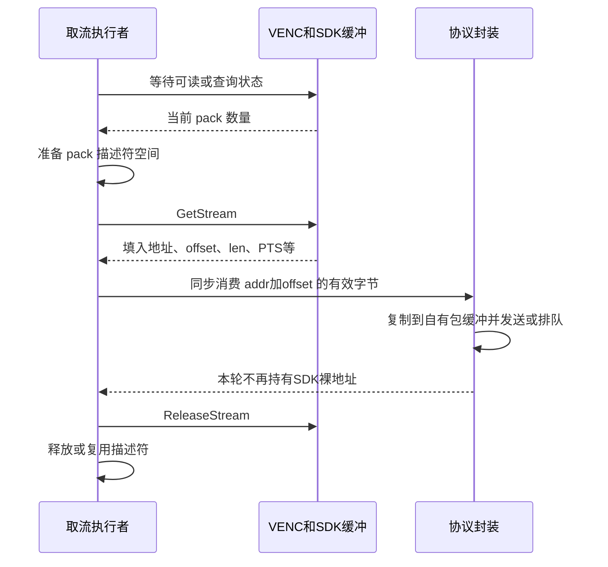

# 07 VENC 编码与码流生命周期

[学习入口](README.md) · 上一章：[VI、ISP、VPSS 图像通路](06_VI_ISP_VPSS图像通路.md) · 下一章：[自定义 RTP 与 UDP 发送](08_自定义RTP与UDP发送.md)

上一章的终点是 VPSS 输出可用于编码的图像。本章解决两个问题：为什么要把图像压缩，以及应用怎样在不破坏硬件缓冲区生命周期的前提下取走压缩结果。

阅读后应能顺着“配置编码器 → 绑定输入 → 等待输出 → 借用码流 → 同步消费 → 归还码流”讲清一轮执行。网络如何把这些字节交给接收端，放到后两章。

> 证据范围：本章重新核对了当前两份应用及公共 VENC 源码。【源码实现】表示可沿函数调用确认；【配置目标】表示代码尝试设置的值；【待确认】表示仍需要配套 SDK、板端返回值、参数回读或实际码流。这里没有新增编译、板端或接收端测试证据。

## 7.1 为什么不能把原始图像直接当作网络视频

### 压缩减少传输量，也引入图像之间的依赖

【背景原理】一幅紧密排列的 1920×1080、YUV 4:2:0 图像约为 `1920×1080×1.5 = 3,110,400` 字节。如果每秒产生 100 幅，仅一遍图像数据量就是约 311 MB/s；实际内存占用还受 stride、对齐和缓冲布局影响。这不是当前板子的 DDR 实测带宽。

VENC 是视频编码模块。应用让它接收 VPSS 图像，并以 H.264 或 H.265 形式输出压缩码流。编码通常利用画面内部和相邻画面之间的重复信息；代价是解码一幅图像可能需要先前的参考图像，因此丢包有时会影响后续画面。

应用没有在 CPU 上逐像素运行 H.265 编码算法。它通过 `ss_mpi_venc_*` 或公共封装设置媒体模块，具体硬件调度和编码实现属于厂商 SDK/媒体硬件边界。

### 理解四个参数，才能解释画质、码率和延迟

| 概念 | 解决的问题 | 对本项目的意义 |
|---|---|---|
| CBR，恒定码率控制 | 围绕目标码率调节编码质量和输出量 | 为链路提供可规划的平均负载；不保证每幅图像大小相同 |
| GOP，图像组结构 | 安排参考关系与刷新节奏 | `NORMAL_P` 不能理解成“永远只有 P 图像、没有刷新图像” |
| 关键图像与参数集 | 为解码器建立或恢复解码状态 | H.264 使用 SPS/PPS；H.265 还包含 VPS；有数据包不等于具备可解码入口 |
| QP，量化参数 | 调整压缩损失和码流大小 | 一般增大 QP 会减少细节与字节数；不能据此计算固定的画质收益 |

参数集描述解码所需的结构和配置，不能当作普通图像丢弃。关键图像、IDR 与 CRA 也不是可以随意互换的词：随机接入和参考刷新行为应结合实际编码格式与码流判断。

【待确认】GOP 数值描述编码配置，不证明输出中每隔相同墙钟时间一定出现完整的解码刷新点。丢帧、帧内刷新及厂商编码行为都可能影响观测结果。

## 7.2 两条主线怎样配置同一个编码层

【源码实现】自定义 RTP 入口是 [new_main2.c](../../hi3516firm/new_main2.c) 的 `encoder_init()`；RTSP 入口是 [sample_rtsp.c](../../sample_source/rtsp_4m/sample_rtsp.c) 的 `venc_set_chn_param()`、`venc_start_encode()`，后者继续调用 [sample_comm_venc.c](../../sample_source/common/sample_comm_venc.c)。

| 配置项 | 自定义 RTP 主线 | `rtsp_4m` 主线 |
|---|---|---|
| 上游 Sensor 选择 | 应用指定 SC500AI 2M/100 fps 模式 | `SENSOR0_TYPE` 来自编译配置；当前 Makefile 默认 SC4336P 4M/30 fps，可被覆盖 |
| VENC 通道 | 通道 0 | 通道 0 和通道 1 |
| 编码图像尺寸 | 1920×1080 | 通道 0：2560×1440；通道 1：1024×768 |
| 编码类型 | H.265 | 两路都是 H.264 |
| 帧率目标 | 输入/输出均设 100 fps | 两路均设 30 fps |
| 码控/GOP/统计周期 | CBR / 100 / 1 秒 | CBR / 60 / 2 秒 |
| 目标码率 | 4096，按源码注释为 Kbit/s | 公共函数按图像面积计算，见下文 |
| 获取粒度设置 | `is_by_frame = TD_FALSE`，启用切片输出 | 公共函数设置 `is_by_frame = HI_TRUE` |
| 发布对象 | 通道 0 → 自定义 RTP | 只发布通道 0；通道 1 仍编码、取流和归还 |

【配置目标】RTSP 的 `sample_comm_venc_h264_cbr_param_init()` 使用：

```text
目标码率 = 4096 × 编码宽度 × 编码高度 ÷ (1920 × 1080)
通道 0：整数计算结果 7281
通道 1：整数计算结果 1553
```

它按像素面积放大或缩小预算，便于复用一个基准配置；它并不结合图像复杂度或网络实时可用带宽选择目标码率。自定义程序绕过这个 H.264 公共分支，直接构造自己的 H.265 CBR 参数，不能用公共函数中的 H.265 默认值替代它。

### 从创建到绑定，谁开始提供图像

自定义程序先在 `encoder_init()` 创建通道、设置码控/切片等参数，再以 `recv_pic_num = -1` 启动接收，随后由 `vpss_bind_venc()` 建立 VPSS 0 到 VENC 0 的连接。

RTSP 程序在 `venc_start_encode()` 中逐个启动 VENC 通道，再执行 `sample_comm_vpss_bind_venc(VPSS_GRP, i, i)`。两路就绪后才创建取流线程。

【源码实现】绑定完成后，主线应用不逐帧调用 `SendFrame` 转交 VPSS 原图。硬件媒体通路持续产生编码结果，应用取流只是消费这些结果。绑定本身不能证明所有模块内部都没有复制。

【待确认】自定义 `encoder_init()` 中多处设置没有检查返回值，且 `venc_chn_attr` 未先整体清零。学习时要把“写了设置语句”与“驱动接受且最终生效”分开；必须结合成功返回、参数回读和输出码流确认。

## 7.3 图像、NAL、SDK pack 与 RTP 包的四种边界

很多取流错误源于把不同层的“包”当成同一件事。

| 边界 | 谁定义 | 包含什么 | 不能默认成立的关系 |
|---|---|---|---|
| 一幅编码图像 | 编码过程 | 表示一幅画面的编码信息 | 一幅图像不一定只有一个 NAL |
| NAL 单元 | H.264/H.265 码流格式 | 图像切片、参数集或补充信息等 | 一个 NAL 不一定能装入一个网络包 |
| SDK pack | SDK 取流接口 | 地址、长度、偏移、PTS、类型等描述及其引用的数据 | 一个 pack 不应未经核实就等同于一个完整 NAL |
| RTP 包 | 传输封装 | RTP 头及一个完整 NAL或其分片等负载 | RTP 包数不等于图像数 |

【背景原理】访问单元（Access Unit）用于组织属于同一解码图像的一组码流内容。本项目通常讨论单路逐行视频的一幅图像，但协议的图像结束标记应以实际访问单元边界为准。

【源码实现】自定义 `sendPacket()` 只检查输入开头的 Annex B 起始码，随后把剩余区域当作一个 NAL。它没有遍历寻找区域内的第二个 NAL。因此“每个输入 pack 恰好适合这样处理”是该发送器的输入假设，不能仅凭变量名确认。

RTSP 库的 `rtsp_sever_tx_video()` 会在输入区域内循环调用 `rtsp_find_h264_h265_nalu()`，能够继续查找多个完整 NAL。但这也不自动解决一个 NAL 跨多个 SDK pack 被切开的情况。

【待确认】当前 SDK 的 pack 划分、切片输出时机、`is_frame_end` 和 PTS 语义，应先查与实际 SDK 配套的接口说明，再对照获取到的码流。这里没有把“注释说一次一个切片”当成已经验证的接口保证。

## 7.4 从等待到归还：两条主线共享的所有权规则

### 先借用描述，再消费字节



【源码实现】应用准备的是 `ot_venc_pack` 描述符数组，不是先申请一块同样大小的压缩码流存储。`GetStream` 成功后，SDK 填入描述符，码流字节仍受 SDK/媒体缓冲生命周期管理。

有效区域从 `pack.addr + pack.offset` 开始，长度为 `pack.len - pack.offset`。这里必须先成立 `offset <= len`；不能把未使用的头部空间当成有效码流，也不能不检查就把错误长度转换成无符号大值。

`ReleaseStream` 归还媒体资源；`free(stream.pack)` 释放应用描述符。这两个动作处理不同资源，不能互相替代。

### 自定义 RTP：主线程短轮询，栈上固定描述符

`rtp_send()` 在主线程反复调用 `processStream()`：

1. `ss_mpi_venc_query_status()` 查询通道 0；没有 pack 就返回，外层 `usleep(1)` 后重试。
2. 使用栈上 `packet_descriptor[32]`，把 `stream.pack_cnt` 设为查询到的 `cur_packs`。
3. `ss_mpi_venc_get_stream(..., 0)` 获取当前码流；失败时记录错误并短暂等待。
4. 对每个 pack 计算有效地址/长度，把 PTS 和 `is_frame_end` 交给 `sendPacket()`。
5. 全部同步封装/发送调用结束后，执行 `ss_mpi_venc_release_stream()`。

【源码实现】固定数组容量是 32，但赋入的 `cur_packs` 没有先与 32 比较。【可能影响】如果 SDK 合法返回更大的数量，描述符容量契约不成立；当前是否可能出现这一数量仍待板端/配套 SDK 确认。正确设计应按所需数量准备容量或显式限制并处理，不能靠“通常很少”保证。

轮询方式简单，也能迅速再次检查状态；`usleep(1)` 不代表调度器保证 1 微秒后执行，更不能据此推算取流延迟。查询/取流失败路径的 100 毫秒等待与正常空轮询也要分开看。

### RTSP：取流线程等待两个通道的 fd

`venc_get_stream_proc()` 先获取两路 VENC fd，然后用 `select()` 等待，超时上限为 2 秒。fd 就绪后调用 `venc_get_and_send_one_frame()`：

1. 查询就绪通道的 `cur_packs`，按数量 `malloc` 描述符。
2. 调用 `GetStream(..., TD_TRUE)`，成功后才能使用描述符中的字节。
3. 通道 0 逐 pack 调用 RTSP 库；当前代码跳过标记为 H.264 SEI 的 pack。
4. 通道 1 不发布，但仍需要 `ReleaseStream`，否则该路输出缓冲会积压。
5. 归还码流，随后 `free` 描述符。

【源码实现】两路共用一个取流线程。通道 0 的封装和网络处理若花费较长时间，通道 1 的消费也会延后。选择等待型循环降低了空转，但没有让两个通道独立并行消费。

SEI 是补充信息。当前示例主动过滤它是应用行为，不等于任何接收器、任何使用场景都可以忽略所有 SEI。

### 为什么异步化不能只把地址塞进队列

假设取流线程把 `pack.addr` 交给发送线程，立即 `ReleaseStream`，发送线程稍后才读地址。该存储可能已被编码器复用，指针数值仍有效也不能保证字节还是原来的码流。

【源码实现】当前自定义路径在归还前同步复制到自有发送缓冲；RTSP 路径在函数返回前把封装后的 RTP 包写入自有 ring。两者没有把 SDK 裸地址长期留给后续网络发送。

如果以后引入异步队列，需要选择并说明所有权：复制有效数据到应用自有块，或依据 SDK 明确支持的机制延长持有期。后者会占住编码输出资源，慢消费者可能反向阻塞编码器，不能无界持有。

## 7.5 切片、帧内刷新与低延迟的真实取舍

【源码实现】自定义程序启用 `slice_output_en`，`split_mode=1`、`split_size=4`，并设置 `is_by_frame=false`。设计意图是编码完成部分图像后尽早取走该部分，减少等待整幅编码完成的时间。

【待确认】`split_size` 在该 SDK 模式下的精确单位、最小输出批次和硬件完成条件应查配套资料。不能只引用源码里“LCU 64×64”的注释，就断言每隔固定像素行数必然有一个网络包。

切片更细可能让输出更早，但也增加边界与封装次数，影响编码效率，并要求接收端正确重组同一图像的多个 NAL/分片。若接收器仍等待整幅图像甚至缓冲多帧，发送侧提前输出的收益未必完整体现到屏幕。

自定义程序还设置以下策略，它们处理的等待位置不同：

| 配置目标 | 试图减少或控制什么 | 需要付出的代价或补充证据 |
|---|---|---|
| `max_reencode_times=0` | 避免反复重编码带来的额外处理 | 复杂画面的码率/画质如何折中需观测 |
| 关闭场景变化检测和自适应 IDR 插入 | 限制额外刷新导致的码流突发 | 场景突变后的质量与恢复能力需评估 |
| 启用按行帧内刷新，`refresh_num=1` | 将局部刷新工作分散到多幅图像 | 不等价于每幅都是独立可解码图像，也不保证丢包后立即恢复 |
| `OT_VENC_FRAME_LOST_P_SKIP` | 在编码侧满足条件时主动舍弃输出机会 | 与网络 UDP 丢包不同；实际触发条件应以 SDK 定义和统计确认 |
| 显式 VENC buffer 大小/RTSP mini buffer | 控制编码缓冲内存预算 | 太小可能增加资源压力；容量不是实际排队时长 |

【源码实现】自定义程序同时设置 GOP 和帧内刷新。不能把注释中的“1 秒完整刷新一张图像”当作最终码流行为；需要解析输出图像类型与参数集、查看实际刷新配置，才能判断二者如何共同生效。

## 7.6 顺着边界检查，而不是只问“有没有视频”

| 现象 | 先检查哪条因果关系 | 能得到什么结论 |
|---|---|---|
| `cur_packs` 长期为 0 | VENC 启动是否成功、VPSS 是否有输出、绑定与通道是否匹配 | 区分输入没有到达与编码输出没有被消费 |
| 运行一段时间后编码停止 | 每次成功 Get 是否匹配 Release，返回值和缓冲占用是否异常 | 支持判断持有资源/消费不及时；不能仅凭现象认定泄漏 |
| 编码数据在增长但接收端无画面 | NAL 边界、参数集、关键图像、时间戳和传输映射 | 问题可能已在编码之后，继续重置 Sensor 缺少依据 |
| 日志“Frames”远高于目标帧率 | 计数发生在图像结束、pack 还是 NAL 层 | 自定义源码每次 `sendPacket()` 增加该计数，不能当实际图像 fps |

这些是下一轮验证的判断路径，本任务未执行对应硬件检查。继续阅读时始终保留两个问题：眼前这块数据属于哪个边界，以及谁还有权持有它。

## 7.7 自查问题与回答要点

1. **为什么 `malloc` 了 pack 数组，仍必须调用 `ReleaseStream`？**
   回答要点：数组保存描述信息；码流字节由 SDK 管理。`free` 数组不归还媒体缓冲，Release 也不替应用释放数组。
2. **为什么 RTSP 的通道 1 不发布，仍不能放任它不取流？**
   回答要点：它已被启动并绑定输入，会消耗编码和输出资源。当前程序通过取出并归还排空它；若不需要该路，应在独立代码变更中从资源配置层关闭，而非只停止发送。
3. **切片输出能否保证屏幕延迟下降？**
   回答要点：它缩短编码侧等整幅的机会；调度、协议发送、网络和接收器缓冲仍可能主导延迟，需要完整测量。
4. **如何证明“一次 GetStream 就是一幅图像”？**
   回答要点：结合 `is_by_frame`、SDK 接口保证、返回的 pack/PTS/结束标记与实际 NAL 解析；不能依据函数名或统计计数器认定。

下一章从“已经借到一段 H.265 字节”继续，把它变成接收端能够识别和重组的 RTP/UDP 数据。
