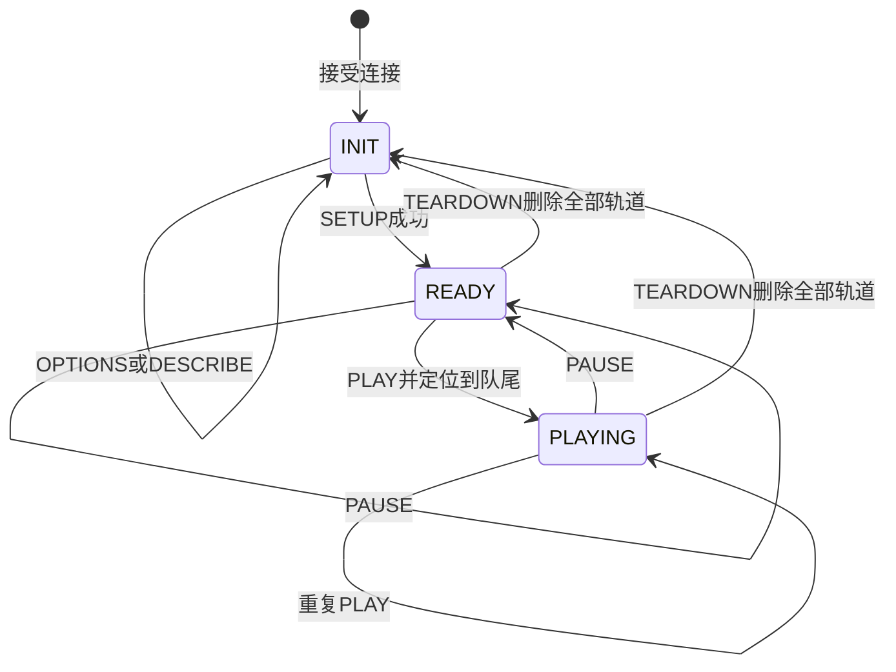

# 09 RTSP 会话与媒体分发

[学习入口](README.md) · 上一章：[自定义 RTP 与 UDP 发送](08_自定义RTP与UDP发送.md) · 下一章：[并发与资源退出](10_并发与资源退出.md)

A 把视频发往事先写定的地址；B 要让不同客户端自行连接、选择接收方式和控制播放。因此除了编码与 RTP，还需要保存“客户端要看哪一路、发到哪里、是否正在播放、已经发送到哪个包”的状态。

本章围绕 [rtsp_4m/sample_rtsp.c](../../sample_source/rtsp_4m/sample_rtsp.c) 和它调用的 [rtsp_demo.c](../../sample_source/rtsp_4m/rtsp_lib/rtsp_demo.c) 展开。B 是双通道 H.264 编码、只发布通道0的程序；库中存在H.265和音频相关字段，不会自动改变当前应用的能力。下面的会话示例用于解释源码，没有新增客户端互通或背压测试。

## 9.1 一路编码结果，为什么还需要三类对象

先设想两名观众观看同一相机。两人需要的图像相同，所以不必为每人再启动一个编码器；但一人可能暂停，另一人的网络可能更快，因此不能共用一个播放状态或一个发送进度。

库据此把资源分为三层：

| 对象 | 保存什么 | 为什么需要单独存在 |
|---|---|---|
| `rtsp_session` | 媒体路径、编码类型、参数集、RTP编码状态和共享视频队列 | 描述同一路内容，集中保存封装后的包 |
| `rtsp_client_connection` | RTSP socket、请求缓冲、Session ID、INIT/READY/PLAYING状态 | 描述一个观众如何控制这一路内容 |
| `rtp_connection` | UDP/TCP承载、端口/通道、SSRC、发送游标和RTCP统计 | 描述这名观众的媒体具体发往哪里、发到哪里 |

应用 `main()` 先创建端口554的服务，再为 `/test.264` 创建媒体会话。这个路径是资源名称，不是磁盘文件。创建函数选择H.264、PT 96、90000 Hz时钟，然后应用才初始化媒体、启动编码和取流。

配置详情见第07章：两路尺寸分别为2560×1440和1024×768，均请求30 fps。取流线程消费两路，但只有通道0的非SEI pack进入RTSP发布函数。轨道名为 `track1`，不是对硬件通道1的映射。

## 9.2 从一个播放地址走到真正开始接收

**RTSP**（实时流协议）负责控制，RTP负责承载压缩内容。客户端发出的PLAY是在改变发送状态，服务端不会把整段视频放在PLAY响应正文中。当前请求实现对应RTSP/1.0的控制过程，原理可对照 [RFC 2326 §10](https://www.rfc-editor.org/rfc/rfc2326#section-10)。

以客户端读取 `rtsp://<板端IP>/test.264` 为例，正常过程是：

1. **询问媒体描述。** 客户端可先OPTIONS询问支持的方法，再DESCRIBE获取SDP。库按路径关联媒体会话，描述视频类型、时钟和轨道。
2. **配置传输。** 客户端对视频轨道SETUP，在Transport字段中提供UDP接收端口，或要求TCP interleaved。库为它建立RTP连接，并返回Session与传输信息。
3. **开始播放。** 客户端带着Session请求PLAY。连接从READY进入PLAYING，游标移到当前队尾，后续新包开始成为它的发送对象。
4. **暂停或离开。** PAUSE把该连接退回READY；TEARDOWN删除对应轨道，轨道全部删除后回到INIT。其他观众与硬件编码不会因此自动停止。

这是一组每客户端状态，不是VENC硬件状态。图中只画当前实际实现的主要转换：



`rtsp_process_request()` 要求 **CSeq**（控制请求序号）来对应请求与响应，已建立会话时还检查Session是否匹配。它与逐个媒体包增加的 RTP 序号分属两条消息流。Session ID是关系校验，不是用户认证；当前这条请求分派链没有账号认证过程。

`PLAY`、`PAUSE` 在INIT状态会返回状态错误。PAUSE后的再次PLAY会跳到新的队尾，已经PLAYING时重复PLAY不会重置游标。源码虽定义RECORDING常量，当前方法分派没有RECORD实现，不能补画一条已经完成的录像链。

## 9.3 有了会话，接收器还需要解码依据

SDP，即会话描述，把PT 96在这个会话中的含义解释为H.264，并给出90000 Hz时钟等信息。上一章A也用PT 96，但映射H.265；动态编号只有结合各自会话约定才有编码含义。

创建B的会话时，应用没有传入现成参数集。后续 `rtsp_sever_tx_video()` 从编码内容中收集SPS/PPS，存到会话；DESCRIBE调用 `build_simple_sdp()`，再由 [utils.c](../../sample_source/rtsp_4m/rtsp_lib/utils.c) 的 `rtsp_build_sdp_media_attr_h264()` 将已有参数集编码进描述。

因此应区分“会话对象存在”和“参数集已经完整”。当前库缺失判断把 `pps_len` 检查了两次，遗漏同处的 `sps_len` 检查；这可能影响某些缺失/到达顺序下的补齐行为，不能据此预先认定现场黑屏原因。

进入PLAYING也不意味着下一包就可显示。游标选择队尾能避免发送一长串旧数据，却可能让新观众先遇到依赖先前图像的内容。当前PLAY处理没有直接请求VENC生成IDR，需要等待后续具备解码入口的内容，或由完整接收方案另行处理恢复。

## 9.4 编码结果怎样变成共享队列里的字节

第07章已说明GetStream借用期间的有效字节。B将SDK pack的有效区域和PTS传给 `rtsp_sever_tx_video()`，该函数在返回前完成下列交接：

1. 从队尾开始预备最多300个RTP包槽；空间不足时先推进队头，淘汰旧包。
2. 检查各PLAYING客户端游标是否仍有效，落在保留区之外的游标移到当前head。
3. 按需收集参数集，在输入区域内循环查找Annex B NAL。
4. 调用 [rtp_enc.c](../../sample_source/rtsp_4m/rtsp_lib/rtp_enc.c) 的 `rtp_enc_h264()`，将RTP头和NAL或FU-A内容复制到包槽。
5. 填入实际包长度并推进tail，再尝试向PLAYING客户端发送。
6. 调用 `rtsp_do_event()` 推进当前网络事件，然后返回调用者。

**队列保存的是自己的RTP字节，而不是SDK裸地址。** 因此应用返回后可以ReleaseStream，待发包仍由RTSP会话持有。

这里的 **FU-A** 是 H.264 的 NAL 分片形式：使用类型 28 的指示字节，再加一个携带 S/E 和原类型的字节。它与上一章 H.265 的类型 49、三字节 FU 结构不同，不能共用头部解释。当前 B 的每槽 1456 字节包含 12 字节 RTP 头，所以单 NAL 可用 1444 字节，FU-A 每片内容最多为 `1456-12-2=1442` 字节；格式依据见 [RFC 6184 §5.8](https://www.rfc-editor.org/rfc/rfc6184#section-5.8)。

300个预备槽也限制单次封包。`rtp_enc_h264()` 的循环受剩余槽数约束，槽用尽后即使 NAL 还有字节，也会返回已生成的正包数；外层随后按完整 NAL 长度推进输入位置。因此超大单 NAL 可能只封出前半部分，最终返回输入 `len` 也不能单独证明全部内容已入队。当前板端是否触发尚无证据；验证时应同时核对输入长度、实际包数和末分片，而不只检查返回值大于零。

`rtp_enc_h264()` 用 `ts × sample_rate / 1000000` 换算时间戳，当前sample_rate为90000，与A一样依赖微秒PTS输入。PTS在哪里生成、同图像pack之间如何对应仍需配套SDK确认，转换结果不是跨电脑共享的墙钟。

H.264封包器给单NAL或最后FU-A分片设置Marker，但接口没有传入访问单元结束信息。通用规则要求Marker指向访问单元最后一包，见 [RFC 6184 §5.1](https://www.rfc-editor.org/rfc/rfc6184#section-5.1)。多NAL图像下，“找到了每个NAL”和“正确标记整幅结束”仍需分别核验。

## 9.5 客户端快慢不同，队列为什么不按人数复制

`rtsp_set_video()` 创建一个环形队列，每槽1456字节，槽数为 `300×2+1=601`。[stream_queue.c](../../sample_source/rtsp_4m/rtsp_lib/stream_queue.c) 留一个空槽区分满和空，容量上限因此是600个RTP包。

原始包存储区是 `601×1456=875056` 字节，此外还有长度数组和结构体。容量不是实际积压量；一个图像可能对应多个包，也不能把600包直接换算成固定秒数。

下面用8槽简化示意真实head/tail/客户端游标关系，数字不是当前601槽配置：

```text
槽号：     0    1    2    3    4    5    6    7
状态：    空   空   旧包  包   包   新包  空   空
                   ↑         ↑         ↑
                 head     快客户端     tail
                   ↑
                慢客户端
有效区间：[head, tail)，客户端各自记录下一个待发送位置
```

`rtsp_tx_video_packet()` 按客户端游标读取共享槽，临发送前写入该客户端SSRC。发送函数报告完整成功后，才把这个客户端的游标向后移；快观众可以先走，慢观众不阻止所有其他人消费同一内容。

但共享存储有限。生产者需要新空间时推进head，慢游标可能落到区间外；代码把它移到head，而不是附近注释说的tail。这样限制了内存增长，也可能从一个NAL中段或缺少参考图像的位置继续发送，当前没有按IDR/参数集边界统一恢复。

还有一个容易忽视的细节：预留300槽发生在知道本次实际包数之前。队列淘汰不能解释为严格的“真实新包放不下时才丢弃相同数量旧包”。实际保留窗口还与这项预留策略相关。

当前主要由同一取流线程操作队列和连接链表，相关函数没有因此需要跨线程加锁。若以后把网络处理独立出去，必须重新定义所有权或同步，不能只增加一个线程同时读写这些对象。

## 9.6 同一份RTP内容怎样走两种承载

SETUP改变的是媒体怎样送到客户端，而不是重新选择编码格式。UDP分支保存客户端端口和独立RTP/RTCP socket；TCP分支保存RTSP连接fd及interleaved通道号。

| 维度 | RTP/UDP | RTP over RTSP/TCP |
|---|---|---|
| 发送目标 | 协商的客户端UDP地址/端口 | 原RTSP TCP连接 |
| 应用消息边界 | 每次UDP数据报 | 需要在TCP字节流中自己表达 |
| 网络丢失影响 | 可能直接丢失NAL/图像内容 | 重传与顺序等待可能增加时延 |
| 当前需维护的发送进度 | 成功/失败及包游标 | 还需要头和负载的部分写入进度 |

TCP提供有序字节流，但不保留每次send调用的消息边界：一次发送的内容，接收端可能分多次读到，也可能与相邻内容一起读到。因此 **TCP interleaved**（交织承载）给每个二进制块加4字节：`$`、通道号、16位负载长度，然后才是RTP或RTCP。它使接收器能从同一条控制连接中识别媒体块，规则见 [RFC 2326 §10.12](https://www.rfc-editor.org/rfc/rfc2326#section-10.12)。

当前 `rtp_tx_data()` 先send这4字节，再send负载；socket为非阻塞。这里的关键是“没有返回错误”仍可能只写入部分字节，函数却没有保存偏移，最终返回完整size。

例如仅作说明：头已经写完，负载只接受500字节，而完整负载有1400字节。下一步应续传剩余900字节；如果直接前移包游标就丢了尾部，如果重新发头又会破坏当前块。现代码没有这份续写状态，类似问题也存在于控制响应 `rtsp_send_msg()`。

这是源码可见的接口处理缺口，不是本次现场复现。改进需要有界待发块、偏移和可写事件；简单循环直到发完，则可能让一名慢观众长期占住唯一取流执行者。

## 9.7 为什么视频停了，控制请求也可能停

到这里可以把控制和媒体两条逻辑关系接在一起。当前正常调用链是：

```text
VENC 0 可读
 → 取流worker取得非SEI pack
 → rtsp_sever_tx_video：收集/封包/入队/尝试发送
 → rtsp_do_event：select网络fd、accept、收请求、分派状态、继续发送
 → 返回worker并ReleaseStream
```

网络 `select()` 的超时为0，处理当下就绪事件后返回；外层worker对VENC fd的 `select()` 最多等待2秒。它们是两个不同的调用，VENC等待超时并不会自动执行网络处理。

因此通道0无发布数据、worker提前结束，或者封包错误在调用尾部之前返回时，不能假定控制请求持续得到处理。仅通道1仍有数据也无助于此，因为它不进入发布函数。内核监听socket存在、TCP连接层建立，与应用已经读取DESCRIBE是不同事实。

`rtsp_lib/test.c` 的测试循环另有事件调用，但它不在本入口链中，库Makefile显式编译列表也不含它。当前应用没有独立RTSP网络线程。

这种集中方式减少了共享状态并发，却让控制活性依赖媒体输入。解除耦合可以选择同一循环同时调度媒体和网络，或用明确的线程安全队列分开执行者；两种方法都需要重新考虑调度预算、队列和退出，不能直接并发调用现有库。

**RTCP**是配合RTP的控制协议，可传递发送统计和时钟关联信息。库还会尝试发送其中的 Sender Report（发送者报告），但接收反馈处理存在TODO，不能据此声称已实现反馈码率控制。音频相关设置/发送函数也有空实现，本应用没有建立音频链。

## 9.8 自查题

1. 两名观众共用一路编码，为什么需要一个session、各自的client connection与RTP发送游标？PAUSE影响哪个对象？
2. READY状态开始PLAY与PLAYING状态重复PLAY有什么区别？PLAY成功后为什么仍可能暂时看不到画面？
3. 假设TCP interleaved头已发出，1400字节RTP内容只写了500字节，下一步应持有什么资源与进度？
4. 停止通道0输出后DESCRIBE不响应，而通道1仍在编码，如何按当前调用链解释？独立网络线程需要额外解决什么？

### 参考答案

1. session共享内容和包存储，client保存控制状态，RTP连接保存承载与消费位置。PAUSE将该客户端置READY，不停止共享VENC，也不暂停其他PLAYING观众。
2. READY→PLAYING会把游标放到当前队尾，重复PLAY不重置。客户端仍需参数集、完整包、合适的解码入口和接收处理；控制成功不是解码成功。
3. 保留该块及其剩余900字节、当前写入偏移和“头已发完”的状态，等待可写后续传。不能推进到下一包或重复插入当前头，也不能回收仍在续写的存储。
4. 只有通道0发布函数尾部驱动事件，通道1取流不调用它。独立化还需保证连接链表、共享ring、发送偏移和退出生命周期的同步或单一所有者关系。

下一章不再重复协议字段，而是追踪这些执行者如何停止，以及谁必须等待谁，才能安全释放仍在使用的资源。
