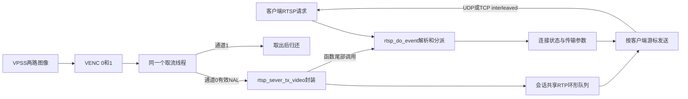
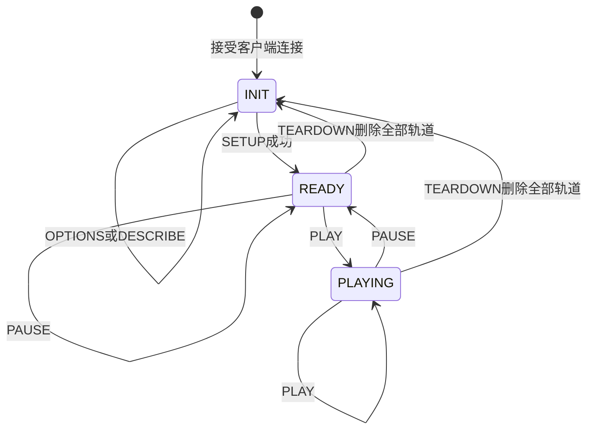

# 09 RTSP 会话与媒体分发

[学习入口](README.md) · 上一章：[自定义 RTP 与 UDP 发送](08_自定义RTP与UDP发送.md) · 下一章：[并发与资源退出](10_并发与资源退出.md)

本章回到另一条主线：[rtsp_4m/sample_rtsp.c](../../sample_source/rtsp_4m/sample_rtsp.c)。它使用双通道 H.264 编码，将通道 0 发布到 `/test.264`，由 RTSP 库管理连接、协商传输方式并分发 RTP 包。

核心问题不再只是“把码流发到一个固定地址”，而是“客户端如何知道流的格式、告诉服务端接收位置、开始或暂停自己的播放，并与其他客户端共享同一路编码结果”。

> 本章区分【源码实现】、【配置目标】、【背景原理】与【待确认】。当前代码能确定接口与状态变化；没有新的实际连接、接收解码、背压或板端测试证据。库存在 H.265 分支，也不能据此把本应用写成 H.265 服务。

## 9.1 控制视频与承载视频，是两条相互关联的流程

### RTSP 负责协商，RTP 负责承载

【背景原理】RTSP 是客户端与服务端交互的控制协议。客户端先获取媒体描述，再配置传输并发起播放；压缩图像通常放入 RTP，而不是直接作为 `PLAY` 响应正文返回。本库的请求语义与 RTSP/1.0 对应，可参看 [RFC 2326 §10](https://www.rfc-editor.org/rfc/rfc2326#section-10)。

【源码实现】`main()` 创建端口 554 的 `g_rtsplive`，再创建 `/test.264` 对应的 `g_session`，随后进入媒体初始化与编码。`create_rtsp_session()` 内调用 `rtsp_set_video(..., RTSP_CODEC_ID_VIDEO_H264, NULL, 0)`。

会话路径是资源名称，不是磁盘上的 `.264` 文件。程序没有先录制一个文件再给用户下载；编码和网络分发持续并行于硬件媒体数据通路。



图中的最后一条边尤其重要：当前应用通过视频发送函数推进网络事件，并不存在独立的 RTSP 网络线程。控制语义与媒体数据是两条逻辑流程，在当前实现中却由同一个取流执行者串行推动。

### 双编码通道与单个公开视频轨道

【配置目标】通道 0 为 2560×1440，通道 1 为 1024×768，均为 H.264、30 fps。Sensor 来自 `SENSOR0_TYPE`，当前 [Makefile.param](../../sample_source/Makefile.param) 默认 SC4336P 4M/30 fps，实际编译时可以覆盖。

【源码实现】`venc_get_and_send_one_frame()` 只有在 `chn == 0` 时调用 RTSP 发布函数。会话的视频轨道名是 `track1`，因此它不是“通道 0 对应 track0、通道 1 对应 track1”的编号映射。

子通道已经创建、绑定并持续取流，但本入口没有第二个公开视频会话。客户端数量增加，也不会在这段代码中自动新建同样数量的硬件编码器。

## 9.2 客户端怎样从 URL 走到可播放状态

### 第一轮请求先建立描述和传输约定

在 [rtsp_demo.c](../../sample_source/rtsp_4m/rtsp_lib/rtsp_demo.c) 中，`rtsp_process_request()` 校验 CSeq、匹配路径，必要时把客户端连接关联到会话，再按方法分派。

| 请求 | 当前处理函数做什么 | 请求后客户端还缺什么 |
|---|---|---|
| OPTIONS | 返回支持的方法集合 | 尚未获知具体编码与接收传输 |
| DESCRIBE | `build_simple_sdp()` 返回 SDP 媒体描述 | 尚未建立 RTP 传输对象 |
| SETUP | 检查轨道和 Transport，创建 RTP 连接，返回 Session 与传输信息 | 已准备接收，但尚未进入播放状态 |
| PLAY | 从 READY 进入 PLAYING 时把游标设到当前队尾；已在 PLAYING 时重复请求不重置 | 仍需后续编码包、参数集及合适的解码入口 |
| PAUSE | 从 READY/PLAYING 转为 READY | 服务端编码仍继续，只暂停该连接的播放状态 |
| TEARDOWN | 删除对应 RTP 轨道连接；轨道都删除后回到 INIT | 若要恢复，需要重新建立传输 |

CSeq 用来对应请求与响应；Session 用来校验已建立的会话关系。它们不是用户身份认证机制。当前请求分派链没有展示账号认证步骤，不能把“会话 ID 匹配”描述成权限校验。

### 状态存在于每个客户端连接



【源码实现】`PLAY` 和 `PAUSE` 在 INIT 状态会返回状态不允许的错误；SETUP 初次成功时创建 Session ID并进入 READY。源码虽然声明 RECORDING 常量，但当前分派表没有提供 RECORD 处理，不能据此画出已实现的录像状态。

【设计含义】暂停一个客户端，不会停止 VENC，也不应影响另一个处于 PLAYING 的客户端。这是“共享媒体生产、独立消费状态”的分工。硬件生产是否节省资源，需要另做无观看者时停流的设计，当前入口没有实现这种按需策略。

## 9.3 SDP 和参数集为什么决定“有包能否解码”

SDP（会话描述）向客户端说明媒体类型、负载映射、时钟和轨道等信息。当前库用 PT 96 表示此会话的 H.264，配 90000 Hz 时钟；它与上一章 PT 96 承载 H.265 的预先约定属于不同会话，二者不矛盾。

【源码实现】`build_simple_sdp()` 调用 [utils.c](../../sample_source/rtsp_4m/rtsp_lib/utils.c) 中的 `rtsp_build_sdp_media_attr_h264()`。当 SPS/PPS 已收集时，函数把它们编码进 SDP 的相应属性。

这些参数不是 `create_rtsp_session()` 一开始就由应用传入的：创建时传入的 codec data 为空。后续 `rtsp_sever_tx_video()` 尝试从编码输入中提取参数集，补入会话的 `vcodec_data`。

因此需要分开观察两个时刻：会话对象已经创建，以及已获得完整且匹配当前码流的 SPS/PPS。前者不自动保证后者。

【源码实现】H.264 的“参数是否缺失”条件重复检查了两次 `pps_len`，没有同时检查 `sps_len`；H.265 分支也有类似的重复条件。【可能影响】特定参数到达顺序或缺失状态下，补齐参数的机会可能不符合设计意图；当前接收失败是否由此造成尚无实测证据。

从 READY 进入 PLAYING 时，`PLAY` 把客户端游标放到队尾，包括首次播放和 PAUSE 后恢复，使它从新数据开始，避免补发旧队列；已经处于 PLAYING 时重复 PLAY 不重置游标。代价是新观众或恢复播放者可能暂时遇不到可随机接入图像。当前代码没有在每次 PLAY 后直接请求编码器生成 IDR 的调用。

## 9.4 SETUP 怎样选择 UDP 或 TCP interleaved

### 选择的是媒体承载，不是把编码格式换掉

【源码实现】`rtsp_handle_SETUP()` 识别 `RTP/AVP/TCP` 并要求 interleaved 参数；另一分支要求客户端接收端口。随后 `rtsp_new_rtp_connection()` 创建客户端自己的传输对象。

| 方式 | 媒体数据走哪里 | 每客户端需要保存的状态 | 主要取舍 |
|---|---|---|---|
| RTP/UDP | 独立 UDP socket，发往协商的客户端端口 | RTP/RTCP 本地端口、对端端口和地址 | 不因传输层重传等待丢失数据，但丢包会直接影响视频 |
| RTP over RTSP/TCP interleaved | 与 RTSP 控制共用 TCP 字节流 | TCP fd、RTP/RTCP 通道编号 | 穿过一些网络环境更方便；重传和排队可能增加等待 |

【背景原理】interleaved 在每个二进制块前放入 `$`、通道号和 16 位长度，再跟 RTP/RTCP 数据。它在 TCP 字节流内恢复消息边界，不会让 TCP 自身变成数据报传输。参见 [RFC 2326 §10.12](https://www.rfc-editor.org/rfc/rfc2326#section-10.12)。

### TCP 短写为什么是必须解释的生命周期问题

`rtp_tx_data()` 的 TCP 分支先 `send()` 4 字节 interleaved 头，再 `send()` RTP 内容。客户端 socket 被设置为非阻塞；一次 `send()` 可以只接受部分字节。

【源码实现】该函数检查 `SOCKET_ERROR`，但没有维护“头已发送多少、负载已发送多少”的偏移状态；两个调用只要没有报错，函数最后返回完整的 `size`。`rtsp_send_msg()` 的控制响应同样没有续写缓冲机制。

【可能影响】在短写或头已发送但负载暂时不能发送的情况下，后续字节可能不再按完整 interleaved 块排列，或游标被过早推进。这是代码与非阻塞 TCP 契约之间的缺口，不代表本任务已经复现了某个客户端故障。

稳健的改进方向是保存待发送块及偏移，socket 再次可写时续传，并限制每个连接的积压量。仅把 `send()` 改成循环直到发完，会把慢客户端的等待转移到当前唯一取流线程，也有代价。

## 9.5 同一份编码结果如何分发给多个客户端

### 三种对象分别持有哪些资源

| 对象 | 持有的数据 | 生命周期含义 |
|---|---|---|
| `rtsp_session` | 路径、codec、参数集、RTP 编码状态、共享 `vstreamq` | 同一路媒体共用，不按观众重复编码 |
| `rtsp_client_connection` | RTSP socket、请求接收区、Session ID、播放状态 | 每个网络连接独立控制 |
| `rtp_connection` | 承载方式、地址/端口、SSRC、`streamq_index`、RTCP 计数 | 每个客户端独立记录读到哪里 |

【源码实现】`rtsp_set_video()` 创建共享队列。宏 `RTP_MAX_PKTSIZ` 算得每槽 1456 字节，`VRTP_MAX_NBPKTS=300`，分配槽数 `300×2+1=601`；环形队列留一槽区分空/满，可用容量上限为 600 个 RTP 包。

这不是 600 幅图像，也不代表运行中一直积压 600 个包。数据区容量是 `601×1456=875056` 字节，另外还需要长度数组和队列结构；实际占用由 head、tail及生产消费进度共同决定。

### 从 SDK 地址复制到会话拥有的包

`rtsp_sever_tx_video()` 的执行顺序是：

1. 从共享队尾开始准备最多 300 个包槽；需要空间时推进 head 淘汰旧包。
2. 检查慢客户端游标是否已落在保留区外，将其调整到当前 head。
3. 按需从输入中提取参数集，并循环扫描 Annex B NAL。
4. 调用 [rtp_enc.c](../../sample_source/rtsp_4m/rtsp_lib/rtp_enc.c) 中的 `rtp_enc_h264()`，把 RTP 头和 NAL/FU-A 负载复制到槽内。
5. 写入实际包长度并推进 tail，使这些包进入可消费区。
6. 对 PLAYING 客户端尝试发送 RTCP SR和视频包，最后调用 `rtsp_do_event()`。

库在函数返回前已完成对 SDK 输入字节的同步消费。因此调用者随后 `ReleaseStream` 时，剩余待发 RTP 数据属于会话队列，不再依赖 SDK 裸地址。

B 的时间戳也沿这条调用链传递：调用者传入 SDK pack 的 PTS，`rtp_enc_h264()` 按 `ts × sample_rate / 1000000` 换算；当前 `sample_rate=90000`。因此它同样依赖微秒输入的单位假设。PTS 的生成位置、同一图像各 pack 的关系及跨端时钟仍需配套 SDK 和运行证据确认，不能只因完成换算就把它当成可直接测量端到端延迟的墙钟。

【源码实现】每次预留按最多 300 个包处理，实际需要多少包在之后封装才确定。因此不能把它描述成“只有当前真实输出包放不下才丢一个旧包”的精确按需策略。

### 每个客户端只保留自己的读游标

`rtsp_tx_video_packet()` 从该客户端的 `streamq_index` 开始，取出共享槽，写入该客户端 SSRC，然后交给 UDP/TCP 发送。当前发送函数认为完整成功后才向后推进游标。

head/tail 管理队列保留区；客户端游标管理它自己的消费位置。快客户端先走，慢客户端可以暂时留后，但无法要求共享队列无限保留旧数据。

【源码实现】慢游标失效时实际被移到 **head**。附近注释写的是 tail，阅读时应以赋值语句为准。[stream_queue.c](../../sample_source/rtsp_4m/rtsp_lib/stream_queue.c) 的 `streamq_inused()` 用来判断游标是否位于保留区间。

这限制了内存增长，却可能从一个 NAL 的中部或依赖先前图像的位置恢复发送。它没有按 IDR/参数集边界统一重同步的机制；弱网花屏后的恢复需要结合剩余码流和下一次可解码入口判断。

共享队列和连接链表没有在这些函数里加互斥锁。当前主要由同一个取流线程操作是理解其设计的前提，不能随手把网络函数挪到另一个线程就认为并发问题已解决。

## 9.6 网络事件到底由谁推进

### 实际调用链只有一个推进者

【源码实现】当前应用的链路是：

```text
VENC fd 可读
  → venc_get_stream_proc
  → venc_get_and_send_one_frame（仅通道 0 的非 SEI pack 发布）
  → rtsp_sever_tx_video
  → rtsp_do_event
  → 非阻塞 select、accept、接收请求、状态处理、可写连接发送
```

`rtsp_do_event()` 自身将网络 `select()` 超时设为 0。它处理一次当前就绪事件便返回，并没有内部常驻循环或自行创建工作线程。

外层取流线程对 VENC fd 的 2 秒 `select()`，与这里网络 fd 的零超时 `select()` 是两次不同的等待。外层超时后只是继续等 VENC，不会顺便处理 RTSP 请求。

目录里的 `rtsp_lib/test.c` 确实另有 `rtsp_do_event()` 调用，但它不在 [当前应用入口](../../sample_source/rtsp_4m/sample_rtsp.c) 的调用链中，[库 Makefile](../../sample_source/rtsp_4m/rtsp_lib/Makefile) 显式编译的对象列表也不含它。不能用测试示例的循环替应用补出独立网络线程。

### 视频停止时，连接成功也可能没有控制响应

【可能影响】当通道 0 没有可发布的数据时，网络事件函数得不到调用。内核监听 socket 可以仍存在，甚至让客户端看到 TCP 连接层成功，但应用可能没有继续 accept、读取 DESCRIBE/SETUP/PLAY 或发送响应。

通道 1 即使继续有数据，也只执行取流归还，不会驱动这个 RTSP 发布函数。媒体故障因此可能表现为控制协议超时，而不仅是“播放后黑屏”。

可改进的方向是在同一拥有者循环内同时调度 VENC 和网络事件，或者通过明确的线程安全队列分离两者。前一种方式需要处理两类 fd 与调度预算；后一种方式需要重新定义 ring、连接链表和退出时序的所有权。

这属于未来代码设计选项，本任务只把当前耦合讲清，没有修改线程模型。

## 9.7 协议存在的部分，与还没有完成的部分

【源码实现】库会尝试发送 RTCP Sender Report（SR，发送报告），保存发送包数、字节数和时间信息。但 UDP RTCP 接收处理以及 TCP interleaved 接收处理处仍有 TODO，不能据此宣称已根据接收反馈自适应码率或完成完整拥塞控制。

H.264 封装函数将单 NAL 末包/最后 FU-A 片的 Marker 置位，而调用接口没有接收完整访问单元结束标志。【背景原理】H.264 RTP 的 Marker 应指向访问单元最后一个包，见 [RFC 6184 §5.1](https://www.rfc-editor.org/rfc/rfc6184#section-5.1)。

【待确认】一幅图像存在多个 NAL 时，应对照当前码流和接收器行为检查 Marker。库能扫描多个 NAL，与库能正确标记整幅图像结束，是两个不同能力。

音频相关枚举、字段及函数名出现在库中，但 `rtsp_set_audio()`、音频发送等路径存在空实现。本应用也没有构造音频主线，不能把这些声明算作已集成音视频服务。

## 9.8 自查问题与回答要点

1. **为什么客户端收到了 PLAY 成功，仍可能暂时无法显示？**
   回答要点：状态进入 PLAYING 不代表已经收到参数集和可解码图像；游标从新数据处开始，仍有网络、封装和解码条件。
2. **RTSP 超时时，为什么要查看 VENC 0 是否在输出？**
   回答要点：本应用通过通道 0 发布函数驱动网络事件；VENC 无输出可能连控制请求都不处理。端口存在不证明事件循环在推进。
3. **为什么队列满时不能简单认为“只影响慢客户端”？**
   回答要点：队列是共享保留区；淘汰使旧游标失效，还可能破坏 NAL/参考图像连续性。单线程发送耗时也会影响整个生产消费循环。
4. **UDP 改为 TCP 后，为什么延迟问题不一定消失？**
   回答要点：传输层重传、字节流顺序等待、socket 积压仍存在；当前实现还需正确处理短写。可靠字节交付与及时画面交付不是同一指标。

下一章继续追踪这些执行者与资源：谁请求停止、谁确认完成、何时 join，以及为什么必须先让消费者退出，再释放它仍会访问的媒体和会话对象。
