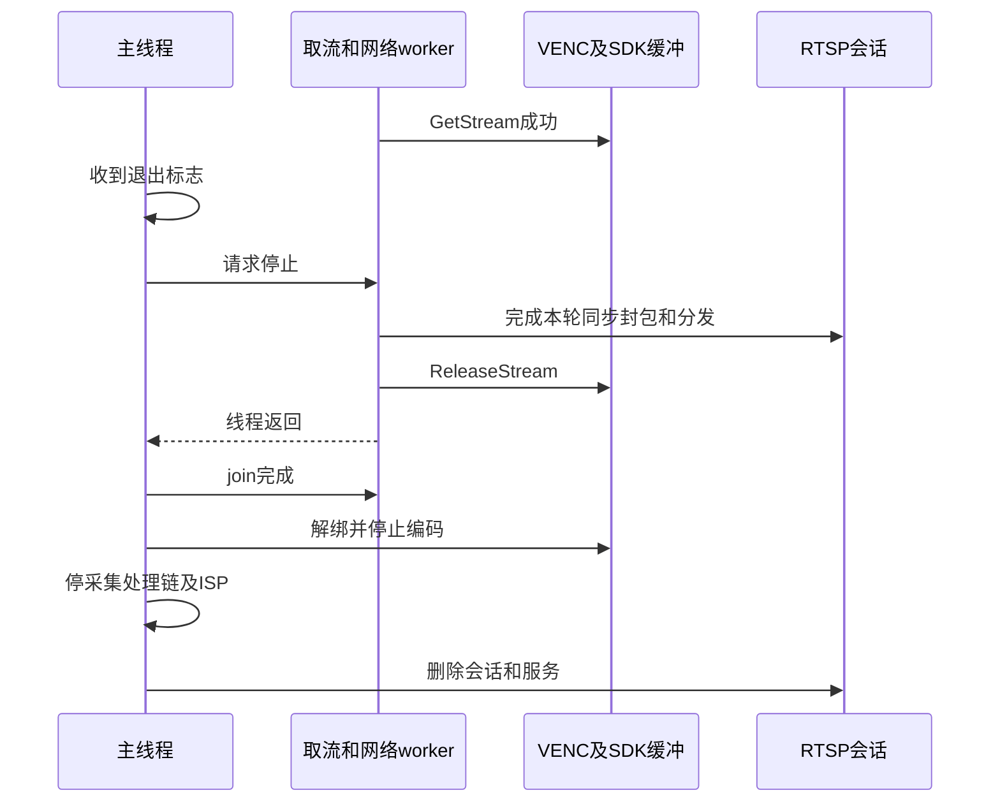

# 10 并发与资源退出：让使用者先完成，再回收资源

[返回学习导航](README.md) · [上一章：RTSP 会话与媒体分发](09_RTSP会话与媒体分发.md) · [下一章：部署与分层验证](11_部署与分层验证.md)

前面已经讲清图像如何被编码、码流如何进入发送缓冲和客户端队列。现在考虑一个具体时刻：用户请求退出，但取流线程刚刚GetStream成功，网络函数还在读取它。此时立即销毁VENC或释放会话，可能让尚在执行的代码失去依赖。

退出因此不是把启动函数反向列一遍，而是先确认谁仍在使用什么，再让这些使用者结束，最后拆除资源。本章沿当前A/B执行者和停止路径推导；没有实际发送信号、启动应用或进行板端退出测试。

## 10.1 先找到执行者，再讨论并发

A的 [new_main2.c](../../hi3516firm/new_main2.c) 在主线程完成初始化，随后直接进入 `rtp_send()`。它另建ISP线程运行 `ss_mpi_isp_run()`，没有独立网络发送线程。

B的 [sample_rtsp.c](../../sample_source/rtsp_4m/sample_rtsp.c) 则由主线程初始化并等待退出标志，取流worker消费两路VENC，其中主路发布同时驱动RTSP事件。公共VI/ISP辅助层还创建ISP运行线程。

| 执行者 | A | B |
|---|---|---|
| 主线程 | 初始化，持续查询/取流/封包/UDP发送 | 初始化，等待退出请求，组织清理 |
| 取流/网络worker | 未另建，工作在主线程 | 等两路VENC fd，取流、主路分发、网络事件 |
| ISP运行线程 | `true_isp_init()` 中创建 | 公共VI启动继续调用ISP辅助层创建 |
| 媒体硬件与驱动 | 持续采集、处理、编码及缓冲流转 | 同左；不由主线程的每秒退出检查驱动 |

ISP Run线程是厂商框架所需的用户态执行者，不能等同于应用自己逐像素完成ISP。媒体硬件与这些CPU线程持续协作；线程数量也不是图像处理模块数量。

完整的并发分析应同时记录“执行位置”和“对象所有者”。例如B的RTP队列属于会话，但多数读写在取流worker；主线程只有在worker不再使用它之后，才适合销毁会话。

## 10.2 一次退出请求如何跨过在途码流

先看B希望实现的正常停止过程。图中的“完成本轮”表示仍借着stream时，先结束当前消费并归还，而不是把停止请求理解成任意位置的强制中断：



当前源码的停止开关还有下一节说明的同步与join条件缺口，所以图表达正常路径意图和资源依赖，不能作为所有退出交错都已正确的证明。

GetStream成功意味着应用临时借到码流；协议函数返回意味着它已不再同步读取SDK地址；ReleaseStream才归还该借用；worker返回之后，join完成线程回收。**这几种“完成”之间存在先后关系，不能合并成一个布尔值。**

B的RTSP队列已经保存自有字节，归还SDK码流不会清空队列。退出时服务可以选择结束连接并丢弃剩余实时数据，但必须先保证没有执行者仍读写队列；当前主函数在媒体停止之后删除会话和服务器。

## 10.3 线程开关为什么不足以表示线程生命周期

`pthread_create()` 返回0代表线程创建成功，非零值代表创建错误。线程之后可能初始化失败、自行返回或正常结束。**joinable**表示线程结束后仍需由其他线程等待并回收；本项目按默认属性创建的线程属于此类。`pthread_join()` 会等目标线程结束并完成回收，但不会主动让它停止，所以应先通过运行开关或对应退出接口让目标具备返回条件。接口语义可对照 [pthread_create](https://man7.org/linux/man-pages/man3/pthread_create.3.html) 与 [pthread_join](https://man7.org/linux/man-pages/man3/pthread_join.3.html)。

| 要记录的事实 | 它回答的问题 | 与其他事实的区别 |
|---|---|---|
| 创建成功 | 是否存在一个需要管理的线程实例？ | 不代表已经产生有效业务数据 |
| 停止请求 | 管理者是否希望结束执行？ | 不代表线程已读到请求或已返回 |
| 结束结果 | 因正常退出、初始化错误还是运行错误结束？ | 不代表管理者已回收它 |
| join完成 | 管理者是否已等待并回收线程？ | 不替线程自动归还其他媒体资源 |

A在 `true_isp_init()` 调用pthread_create后直接把 `g_start_isp` 设为真，未按创建返回值决定。这个字段因此只是代码记录，不能单独证明ISP线程确实存在或业务正常。

B检查了创建返回值，却把 `g_para.thread_start` 同时当运行开关和join条件。下面是当前停止函数的完整核心：

```c
static td_void venc_stop_get_stream(td_void)
{
    if (g_para.thread_start == TD_TRUE) {
        g_para.thread_start = TD_FALSE;
        pthread_join(g_venc_pid, 0);
    }
}
```

问题出现在先后关系：worker若获取fd失败，或select错误后自行退出，会先把 `thread_start` 设为假。主线程以后进入上述函数就跳过join，即使线程曾成功创建。能否join应由“创建过且尚未join”判断，而不应由“仍希望运行”判断。

运行结果同样没有完整传回main。B的main只等用户退出标志，worker提前返回后进程仍可能留着；`venc_get_and_send_one_frame()` 的失败返回也没有被worker转成明确的应用状态。因此“进程还在”和“视频还在工作”需要分别观察。

## 10.4 信号先提出请求，普通流程再完成清理

A的信号处理器只改 `volatile sig_atomic_t g_loop_running`，并且到进入发送阶段才注册SIGINT。B对SIGINT/SIGTERM设置 `g_sample_venc_exit`，其类型为 `volatile td_bool`。

信号可能打断程序的任意位置，所以处理器只提出停止请求，复杂的媒体调用、关闭连接和内存释放留给普通控制流执行。A采用的sig_atomic_t适合这种简单信号通知；B的信号标志类型还需结合平台定义检查其保证。

线程间通信是另一种关系。B主线程和worker共同访问 `g_para.thread_start`，仅有普通布尔读写或volatile不能表达所需同步。volatile也不是互斥锁，不能保证其他共享数据围绕标志读写按预期对另一个线程可见，参见 [GCC 对 volatile 的说明](https://gcc.gnu.org/onlinedocs/gcc/Volatiles.html)。

后续实现可以用具有明确并发语义的原子状态，或用互斥锁把一组共享状态的访问串行化。例如“看到停止请求”与“知道worker因何结束”是不同的信息交接，管理者还需要在适当同步之后读取结果。这些状态应分别记录创建、请求、结果和回收；信号处理器仍只负责提出简单请求。

还需要考虑worker正在等什么。B的VENC select上限为2秒，无数据时提供再次检查开关的机会；有数据时可提前返回。这个超时既不是固定每帧延迟，也不能约束后续SDK调用、网络处理和ISP join的总退出时长。

## 10.5 慢消费者把等待传向哪里

第07章已区分描述符和SDK码流，第08、09章说明发送缓冲与ring。这里把它们接成因果关系：

- **消费较慢但仍持有SDK码流**：归还被延后，有限输出资源持续占用；如果消费长期跟不上，压力可能传回编码生产。
- **先复制到应用有界队列再归还**：SDK持有时间缩短，代价是复制与额外存储；队列满时仍需选择阻塞、丢弃或停止连接。
- **无界排队**：暂时隐藏发送速度不足，却可能不断增长内存和旧画面等待时间，不能作为实时系统的完成方案。

A选择非阻塞UDP，空间不足时允许调用及时失败，然后继续消费后面的pack。当前未检查sendto结果，失败没有反馈到其计数或编码策略。已经进入内核队列的字节仍可能排队，非阻塞不保证没有时延。系统调用语义见 [send(2)](https://man7.org/linux/man-pages/man2/send.2.html)。

B把RTP包放进会话共享ring，各客户端有独立游标。它最多提供600个有效包位，并以最多300槽的预留策略腾挪空间；慢游标失效后移到head。详细槽位关系见第09章。丢弃限制了内存，却不保证从可独立解码的位置恢复。

TCP还要求保存字节进度。如果4字节interleaved头已经发完、负载只发了一部分，后续要继续同一个块；当前发送函数没有这份状态。若将来补上续写，尚未写完的缓冲就又多了一个使用者，队列不能在它完成前随意覆盖，或必须把待发内容转移到客户端自有缓冲。

这说明并发、协议和所有权不能各自设计：更换发送策略，会直接改变哪些对象必须活得更久。

## 10.6 如果增加网络线程，新的交接必须包含什么

假设把网络搬到新线程，取流线程只将 `pack.addr` 入队后立即Release。地址值还在，内容却可能已经被编码器复用。这不是线程速度问题，而是队列没有取得数据使用权。

可行设计首先要确定队列持有副本，还是正式延长SDK借用，再限制容量；其次要规定停止时是否处理剩余数据、何时不再接收新数据、谁关闭连接、谁销毁队列。不能只在结构体里增加一个pthread_t。

B还存在控制事件耦合：当前 `rtsp_do_event()` 由通道0发布入口正常尾部调用。媒体停止、worker返回或封包提前失败时，请求处理也可能停滞；通道1取流不推进它。

解除耦合有两种结构选择。一种仍由单个执行者同时调度VENC和网络fd，保留大部分对象的单线程所有权；另一种跨线程传递自有媒体数据，并把连接链表、会话和发送进度明确交给网络线程。后一种不能让两个线程不加约束地同时操作现有RTSP库。

这些是从当前结构推导的设计选择，本任务没有新增线程或修改源码。

## 10.7 按当前资源依赖核对实际退出链

### B已有的清理主干

B响应主线程退出标志后，调用顺序是：

1. `venc_stop_encode()` 请求取流worker停止并尝试join，然后解绑VPSS/VENC、停止两路编码。
2. `stop_sys_vi_vpss()` 解绑VI/VPSS，停止VPSS，再调用公共VI停止。
3. [sample_comm_vi.c](../../sample_source/common/sample_comm_vi.c) 的 `sample_comm_vi_stop_vi()` 先停ISP，再停pipe、解除dev/pipe关系、停dev及MIPI。
4. 其中 `sample_comm_vi_stop_one_pipe_isp()` 先ISP exit，再由 [sample_comm_isp.c](../../sample_source/common/sample_comm_isp.c) 的 `sample_comm_isp_stop()` join，随后注销Sensor库。
5. 退出SYS，最后由main删除RTSP会话和服务。

这种顺序让使用者先退出，再收走它依赖的对象。它仍受前面join条件、标志同步和接口返回处理的限制；存在清理函数不等于已经验证每个失败交错。

### A当前停在了哪里

A的SIGINT使发送循环退出，`rtp_send()` 返回后main直接 `exit(0)`。源码没有形成与B类似的媒体停止、ISP exit/join及应用缓冲清理主干。

此外，PQ读取函数打开文件、申请整文件缓冲，但没有对应fclose/free；MIPI初始化打开的fd也没有显式close。不能说进程结束后操作系统永远不会回收普通进程资源；这里缺少的是应用可控制、可检查的正常运行/退出回收关系，以及媒体驱动状态的对应证据。

若以后补齐，应先停止新的消费并归还在途stream，再按SDK约束解绑/停止VENC、VPSS、ISP/VI，等待线程不再使用资源后释放发送上下文、文件和fd，最后退出SYS/VB。具体解绑与停止次序必须结合该媒体模式的正式接口要求，不能仅凭“反向调用”决定。

### 初始化只完成一半时，资源记录同样必要

如果VENC 0已启动、VENC 1失败，不能按“两路都已经正常运行”清理；如果线程创建失败，也不能把未成功创建的句柄当成有效join对象。B的阶段标签和编码通道循环位置表达了部分回退关系，A缺少大量返回值检查，使资源是否真正取得更难判断。

一份有用的资源记录应能回答：已建立哪些对象、有哪些活动借用、哪些执行者仍可能访问、谁负责释放、最早失败发生在哪一步。它既服务正常退出，也服务失败回退；并不要求套用与当前C代码无关的类框架。

### AI扩展为何增加一个必须等待的使用者

在独立 [airtsp入口](../../sample_source/airtsp/sample_airtsp.c) 中，dump线程持有VPSS原始帧并调用AI处理。main退出时停止编码取流后，调用 `sample_aidetect_deinit()`，没有先join这个dump线程。

[AI实现](../../sample_source/airtsp/aidetect/sample_aidetect.c) 的deinit会join CPU统计线程，但随后释放输入、结果和MMZ；这不是对dump生产者的等待。于是“有一次join”仍不足以证明共享图像资源已无人使用。具体图像布局、成功路径解除映射与提前返回问题见第14章；这里保留的是必须等待**正确的使用者**这一生命周期原则。

## 10.8 自查题

1. worker已把运行开关设为假并返回，为什么管理者仍可能需要join？创建、停止、结果与回收应各保存什么事实？
2. 用户请求退出时，worker正持有GetStream结果。请按使用关系说明归还、线程返回、join、销毁VENC和会话的先后条件。
3. 将网络异步化以后，为什么SDK裸地址、应用ring槽和TCP部分负载都要重新检查所有权？
4. B的视频停了但进程仍在，或AI退出时已经join了统计线程，为什么这两种表象都不能证明所需工作正常结束？

### 参考答案

1. 运行开关只表示是否继续循环；已创建的joinable线程返回后仍需回收。分别记录创建成功、停止请求、结束原因和join完成，不能用同一个flag替代。
2. 在途消费者先结束对SDK字节的访问并Release，然后worker返回，管理者join；之后才安全拆除它依赖的VENC和会话。实际媒体API的停止/解绑顺序还受SDK约束。
3. SDK地址归还后可被复用；ring槽可能被生产者覆盖；TCP续写还需要保留剩余字节和偏移。必须有副本或正式持有机制，并明确队列满和停止时的处理。
4. B的main没有完整接收worker结果，媒体不工作时进程仍可等待；AI的统计线程与持有图像的dump线程是不同执行者。应沿真正的数据使用者检查停止与join，而不是看进程或任意一次join。

下一章将这些源码关系转成分层验证记录：构建、板端启动、连续编码、网络接收和有序退出分别需要什么证据。
