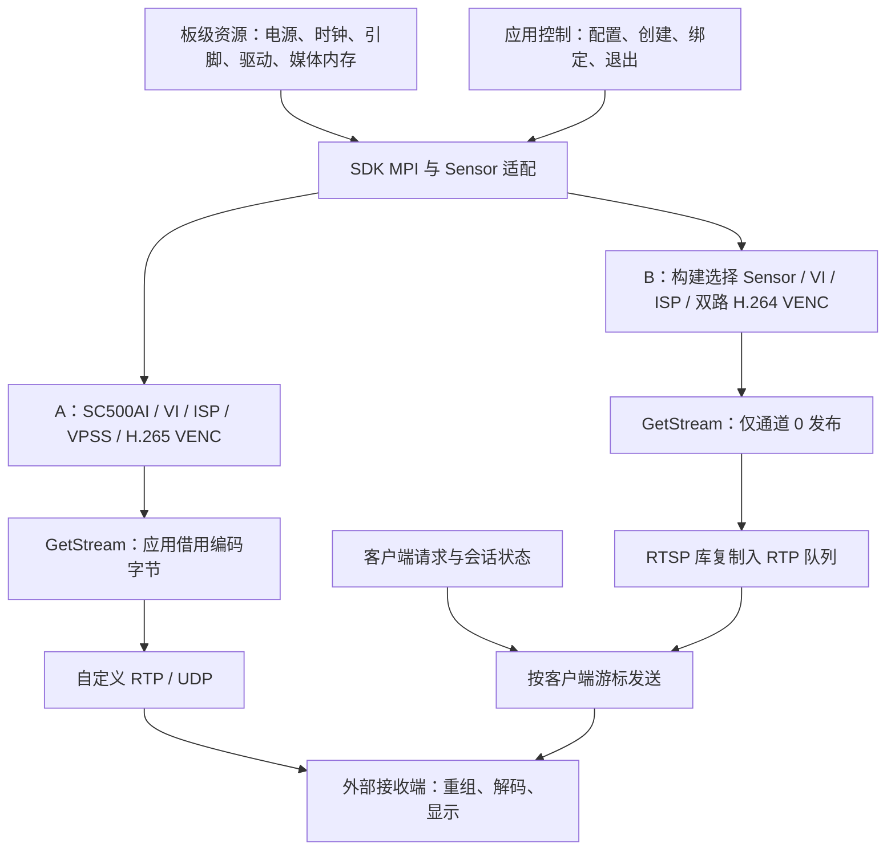
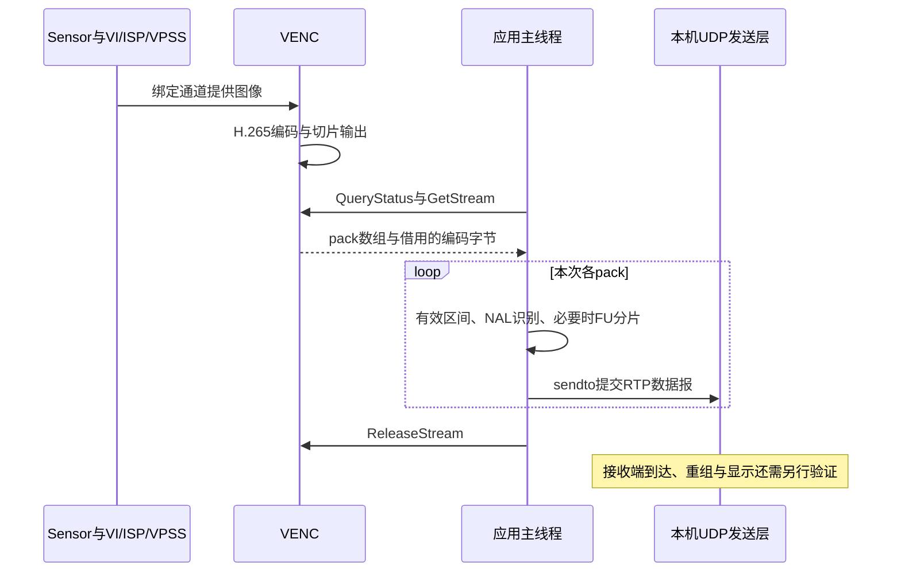

# Hi3516CV610 图像数据传输项目架构解析与业务逻辑全景图

相机输出的像素必须经过接入、图像处理、压缩、协议封装和接收解码，才能成为远端画面。本项目的核心结构是：**应用先建立媒体资源和绑定，硬件持续推进图像处理，用户态在编码出口管理数据与网络消费者。** 理解这条主干后，缓冲、并发、低延迟和故障才有共同的解释基础。

复核日期：**2026-10-13**。本文沿当前源码、Makefile 和配置解释两条独立主线，以配套资料说明公开接口，以历史 DOCX 说明部署背景。Git 已建立；源码版本可定位，现有 ELF、固件与运行对象的对应关系仍需构建和板端证据。以下尺寸、帧率和码率均首先表示配置，未执行交叉编译、板端运行或接收端测量。

本文依次回答系统做什么、模块怎样分层、资源与数据怎样流转、复杂机制为何这样组织、下一步如何验证和改进。详细算例、练习及连续学习路径见 [项目学习入口](Hi3516CV610_项目学习/README.md)，查证入口见 [源码与资料索引](Hi3516CV610_项目学习/16_关键源码与资料阅读索引.md)。

## 一、项目定位与技术全景

### 1.1 核心业务目标与职责边界

工程围绕 Hi3516CV610 的相机采集、图像处理、硬件编码和网络传输展开。其核心价值，是把 Sensor 输出的图像通过芯片媒体流水线变成可传输的 H.264/H.265 码流，再交给有线网络或外部无线图传系统。

后文反复出现的模块可以先按职责识别：VI 管视频输入，ISP 处理原始像素并配合曝光、白平衡控制，VPSS 形成所需尺寸和格式的输出，VENC 将图像编码。SYS/VB 提供系统与媒体缓冲条件，MPI 是应用调用这些能力的厂商接口。这些名称描述不同职责，实际数据关系由配置与绑定建立。

当前仓库汇集应用源码、厂商示例、传感器适配与学习材料，本地另存固件和工具链归档。Git 跟踪范围由根 `.gitignore` 筛选；`src/` 当前为空，实际应用入口在 `hi3516firm/` 与 `sample_source/`。示例依赖各自的构建与配置上下文，因此先选定可执行程序，再追踪它的硬件输入和输出消费者。

| 分析对象 | 当前源码中的职责 | 边界与状态 |
| --- | --- | --- |
| 自定义 RTP 程序 | SC500AI → 1920×1080、100 fps 配置 → H.265 → RTP/UDP，固定发往 `192.168.0.2:5622` | 主入口为 [new_main2.c][a-main]；主要配置直接写在 C 代码中；未确认板端当前运行此版本 |
| `rtsp_4m` 示例 | 同一采集源产生两路 H.264 编码，通过 RTSP 发布通道 0 | 主入口为 [sample_rtsp.c][b-main]；端口 554，会话路径 `/test.264` |
| 其他媒体示例 | 子码流、OSD、AI、MP4、RTMP、GB28181、ONVIF、UVC 等 | 各自具有入口或构建目标，需要逐个选用；不能把目录中的全部能力视为同一个应用已经集成 |
| 无线视频与串口遥测 | 文档描述视频转交 WFB、无线收发和 MAVLink 串口转发 | 依赖外部 `wfb_tx/wfb_rx`、`mavfwd`、无线驱动和启动脚本；当前两条主链路没有这些实现 |

理解全局时应把两类工作分开：**控制流程负责配置硬件、建立绑定、管理资源；媒体数据主要在 VI、ISP、VPSS、VENC 及其缓冲区之间流转。** 应用在编码出口取出压缩码流，才开始进行用户态协议封装与网络发送。

文档中的“设计动因”根据具体实现解释收益与代价，属于源码分析结论；不代表作者留下了对应的设计决策记录。

### 1.2 技术栈清单及选型动因

| 技术项 | 版本/组件 | 承担职责 | 选型优势与约束 |
| --- | --- | --- | --- |
| 运行平台 | Hi3516CV610；Linux 用户态应用 | 相机、ISP、硬件编码及网络接口的运行载体 | 芯片提供专用媒体单元；板型、引脚和内存布局必须与驱动配置一致 |
| 主要语言 | C；辅助资料中包含 C++、Python | 主程序、传感器适配、协议库；辅助模型处理 | C 可直接使用厂商 MPI 和 POSIX 接口；资源与线程生命周期需要显式管理 |
| SDK | 本地包名为 `Hi3516CV610_SDK_V1.0.2.0.tgz` | SYS/VB、VI、ISP、VPSS、VENC、AE/AWB 等 | 复用成熟硬件能力；包名不能证明现有二进制与源码使用同一版本 |
| MPI 接口 | `ss_mpi_*`、`ot_*`；公共构建文件含 `libhi_mpi` 等库 | 配置媒体模块、绑定通道、取得与归还码流 | 避免由 CPU 承担全部图像计算；接口别名与库匹配依赖 SDK 配置 |
| 交叉编译 | `arm-v01c02-linux-musleabi-`；本地工具链包名含 `gcc-20250305` | 构建目标板 ELF 和静态库 | 对应目标 ABI；文件名中的日期不等于 GCC 语义版本，实际编译器版本待确认 |
| 构建系统 | GNU Make；SDK 外层 `Makefile.param` | 选择 Sensor、库路径和公共对象 | 延续厂商示例组织方式；当前工作区缺少独立、完整的外层构建上下文 |
| 图像处理 | MIPI RX、VI、ISP、VPSS、VB | RAW 接入、曝光与白平衡、图像处理、缩放、缓冲管理 | 通过硬件流水线减少应用逐帧搬运；缓冲数量、压缩和在线模式决定资源占用与时延 |
| 传感器适配 | SC500AI 1080p/100 fps 定制源码 | 模式、寄存器、曝光与帧时序回调 | 将 Sensor 差异收敛到厂商约定的回调对象 |
| 编码 | H.265 CBR；H.264 CBR；GOP、切片、帧内刷新 | 把原始图像压缩为网络可承载的数据 | 硬件编码降低 CPU 负担；码率、质量、参考关系和恢复时延相互制约 |
| 网络协议 | POSIX UDP；RTP；源码内嵌 RTSP 库 | 单向视频发送、会话协商、RTP 分发 | 自定义 UDP 路径短；RTSP 提供标准播放控制，但增加连接与发送状态管理 |
| 并发机制 | pthread、`select()`、信号标志 | ISP 运行线程、码流线程、多客户端事件处理 | 机制直接、依赖少；共享标志、线程回收与非阻塞写入需要完整约束 |
| 图像调校 | `sc500ai_1080P_100.bin`、PQ `libbin` | 导入 ISP、3DNR 等调校参数 | 参数可独立于算法库更新；文件必须匹配 Sensor 模式与 SDK |
| 扩展示例 | AIDetect、MP4v2、RTMP、eXosip/osip、gSOAP、UVC | AI、录像、推流、SIP、设备发现、USB 视频 | 复用协议和 SDK 能力；这些依赖按具体目标链接，不属于两条主链路的共同运行依赖 |
| 无线部署依赖 | DOCX 中的 WFB、8812eu、mavfwd | 无线承载、外部 FEC、串口遥测 | 把相机编码与无线传输分成进程；源码、版本和运行参数需另行纳入交付清单 |

主链路没有数据库、Redis、消息中间件或依赖注入容器。这里的“池”主要是媒体 VB 缓冲池；RTSP 内部队列是进程内 RTP 包队列。传感器、码流和会话对象是理解系统的关键数据模型。

## 二、系统架构与分层设计

### 2.1 目录组织与模块拓扑

以下展示仓库根目录下的组织；未纳入 Git 的 SDK、工具链和大型资料需在克隆后另外补齐：

~~~text
hi3516_Image_Data_Transmission/
├─ hi3516firm/                  自定义 RTP 源码、PQ 参数、内核配置片段、固件与说明
│  ├─ new_main2.c               本文主链路 A
│  ├─ pin_mux.c / sys_cfg.h     内核侧引脚/系统配置片段
│  └─ hi3516firm/               较完整的使用与部署 DOCX
├─ 学习文件/smart_sc500ai_100/  SC500AI 1080p/100 fps 传感器适配
├─ sample_source/               厂商媒体示例及应用分支
│  ├─ common/                  SYS、VI、ISP、VPSS、VENC 等公共辅助函数
│  ├─ rtsp_4m/                 本文主链路 B：精简的双通道 H.264/RTSP
│  ├─ rtsp_1m/                 主 H.265 + 子 H.264，发布子通道
│  ├─ osd_rtsp/                图像叠字与 RTSP
│  ├─ airtsp/                  用户态取帧、AI、绘制、送编码的实验分支
│  ├─ mp4/ rtmp/ gb28181/      文件录像、RTMP、SIP 视频接入示例
│  ├─ onvif_g/                 设备发现与 gSOAP 应用
│  ├─ uvc_app*/ host_uvc/      USB 设备端/主机端视频示例
│  ├─ scene_auto/              INI 驱动的场景参数切换
│  └─ venc/ vie/ svp/ ...      其他硬件功能、图像质量与算法示例
├─ docs/Hi3516CV610_项目学习/  按主线展开的学习正文与来源索引
├─ docs/_authoring/            本项目内容/格式 skill、蓝图与编写记录
├─ AGENTS.md                  仓库协作与文档维护规则
├─ SDK/                         SDK 归档
├─ 交叉编译工具链/              工具链归档
├─ hi3516cv610/                 芯片与发布资料
├─ mirror/                      boot、kernel、UBI/UBIFS 等镜像
├─ 工具/ 辅助文档/              厂商工具、说明、模型与参考样例
└─ src/                         当前为空
~~~

本地示例目录中混有 `.o`、`.a`、ELF、码流文件和源文件；Git 保留必要的第三方库，排除可重建编译产物。`mirror/buildroot`、`mirror/busybox*` 中可见的是镜像材料，不能据目录名认定完整 Buildroot/BusyBox 源码就在这里。

关键扩展的真实入口如下，便于区分“已经走到的调用”与“仅有目录或库”：

| 扩展 | 入口/关键函数 | 与主链路的关系 |
| --- | --- | --- |
| RTSP 子码流 | [rtsp_1m/sample_rtsp.c][extra-1m]：主通道 H.265，子通道 H.264；发送分支选择索引 1 | 独立应用；不能据目录名推定码率为 1 Mbit/s |
| OSD | [sample_osd_rtsp.c][extra-osd]：`HH_OSD_Init`、`HH_OSD_All_Refresh` | 独立分支，在原有媒体链路上叠加定时刷新 |
| AI | [sample_airtsp_normal][ai-main] → dump → `sample_aidetect_proc_one_frame_new` | 在 VPSS 与 VENC 之间插入用户态处理，改变帧所有权与并发关系 |
| MP4 | [sample_mp4.c][extra-mp4]：`SAMPLE_MP4_SaveStream` | 独立的持久化路径，不是 RTP/RTSP 默认旁路录像 |
| RTMP | [sample_rtmp.c][extra-rtmp]：`rtmp_sender_alloc`、`rtmp_sender_start_publish` | 从参数取得发布地址，使用另一套输出协议 |
| GB28181 | [src/main.c][extra-gb]：配置、SIP 注册、保活、eXosip 事件分发 | 依赖 eXosip/osip；目录、目标与配置中存在 `gb28181/gb28281` 命名混用 |
| ONVIF | [onvif.c][extra-onvif]：discovery 与 gSOAP 初始化/运行 | 单独的设备服务入口，未见主 RTP 程序调用 |
| UVC | [uvc_app_sdk/application.c][extra-uvc]：camera 接口的 init/open/run/close | 使用设备接口函数表，接入 USB 视频路径 |
| 场景切换 | [scene_sample.c][extra-scene]：从命令行目录加载 INI | 独立程序；主 RTP 的 PQ BIN 导入并不经过这里 |

### 2.2 核心分层架构

软件分层围绕资源所有权展开。底层先提供可用硬件和媒体内存，SDK 将设备能力映射成可调用接口，应用决定具体通道图，协议层消费编码结果。两条应用共享这种组织方式，选择的 Sensor、模式和网络消费者各自独立。

图中的上半部分是能力和控制依赖，下半部分是应用出口的数据交接。VI/ISP 内部耦合与在线通路由芯片和 SDK 决定，概念图不能替代硬件内部总线图。

**板级资源层**保证 Sensor 与 SoC 之间的控制、像素和内存条件；`pin_mux.c` 等材料需要进入匹配的内核/驱动配置才会作用于板端。**媒体硬件与驱动层**持续接入和处理图像，VB 管理其缓冲，通道绑定建立生产者到消费者的关系。

**SDK 适配层**将 Sensor 寄存器差异收敛到回调，将重复启动与回退步骤封装进 `sample_comm_*`。**应用编排层**则选定模式、创建线程、按依赖建立和撤销资源。A 直接调用 MPI 较多，B 通过公共辅助层完成更多工作，因此相同的生命周期责任散布在不同文件中。

最后，**协议与外部承载层**把压缩字节组织成媒体包。A 预设目的端点，B 还维护 SDP、会话和客户端进度。历史无线部署在另一个进程消费本机 UDP；它与当前 A 的远端目的地址需要明确对应。

绑定让应用无需逐帧手工转交原始图像，编码出口的组包仍有复制，AI 分支也会映射与复制像素。判断性能与所有权应落到每一次真实交接，而不是用“整个系统零复制”概括。接下来沿初始化与一帧数据分别观察这些边界。

## 三、核心主干流程全周期解析

### 3.1 系统启动与初始化链路

#### 3.1.1 配置在不同阶段怎样生效

构建阶段决定程序包含哪些接口和 Sensor 支持，板级启动提供驱动与内存，运行阶段再下发通道参数。后一个阶段只能使用前一阶段已经提供的能力。例如应用填入一个 Sensor 枚举，不能自动补齐缺失的驱动、引脚和配套传感器库。

部署说明包含 `/etc/init.d/S99autostart` 示例：先装载媒体驱动、指定 Sensor/MMZ，再设置网络，最后选择启动本地 RTSP、本地 RTP 或 WFB 派生程序。该脚本以 DOCX 代码片段形式存在，当前文件系统中没有对应的独立脚本；所给示例的功能调用开关默认注释，需要部署者选择启用。[部署说明][deploy-doc]

因此有三个不同的配置时刻：

| 时刻 | 配置来源 | 影响 |
| --- | --- | --- |
| 构建时 | `Makefile.param` 的 Sensor、板型、SDK 路径及链接库 | 决定编进应用的 Sensor 支持和目标 ABI |
| 板级启动时 | 驱动装载参数、内核配置、引脚、MMZ、网络 | 决定硬件是否可用，以及应用可以申请哪些媒体资源 |
| 应用运行时 | C 结构体常量、PQ BIN；部分独立示例使用 CLI/INI | 决定通道、尺寸、帧率、编码方式与目的端点 |

`sample_source/Makefile.param` 默认 Sensor 为 `SC4336P_MIPI_4M_30FPS_10BIT`、板型为 `DMEB_QFN`；自定义程序在源码中选用 `SC500AI_MIPI_2M_100FPS_10BIT`。两者不能互相代替。`pin_mux.c` 是内核侧配置片段，其存在不能证明对应设置已经编进板上运行的镜像。[构建配置][build-param]

#### 3.1.2 链路 A：自定义 RTP 程序的启动顺序

`new_main2.c::main()` 先填充各组配置，再按下面的顺序直接启动组件：[主入口][a-main]

| 顺序 | 函数与证据 | 实际作用及后续依赖 |
| --- | --- | --- |
| 1 | `set_vi_*`、`set_vpss_*` | Sensor 总线、4 lane RAW10、1920×1080、VI pipe/channel、VPSS 等配置；`VI_OFFLINE_VPSS_ONLINE`，wrap 关闭 |
| 2 | [`sys_init`][a-sys] | SYS/VB 退出旧状态，设置缓冲并初始化；`max_pool_cnt` 填 2，实际只填 pool 0 的 3 个 Bayer 块；配套参考将该字段列为保留项 |
| 3 | [`vi_init`][a-vi] | 打开 `/dev/ot_mipi_rx`，配置时钟、复位和 MIPI；建立 VI dev、pipe、channel，设置提前中断及低延迟 |
| 4 | [`true_isp_init`][a-isp] | 注册 SC500AI、AE、AWB 回调；设置 ISP 100 fps；初始化 ISP 并创建 `ss_mpi_isp_run` 线程 |
| 5 | [`isp_calibration_load_bin`][a-pq] | 从当前工作目录读取 `sc500ai_1080P_100.bin`，导入 ISP/3DNR 调校参数 |
| 6 | [`vpss_init`][a-vpss] | 创建 VPSS group，启动 NV21 通道 0，配置低延迟行数 |
| 7 | `vi_bind_vpss` | 将 VI 输出绑定到 VPSS group |
| 8 | [`encoder_init`][a-venc] | 创建 H.265 CBR 通道，设置切片、码控、帧内刷新并开始接收图像 |
| 9 | `vpss_bind_venc` | 绑定 VPSS 通道 0 与 VENC 通道 0，完成媒体数据通路 |
| 10 | [`rtp_send`][a-sendloop] | 建立非阻塞 UDP socket，申请发送缓冲，进入取码流与发送循环 |

这个顺序说明了因果关系：编码器配置完成并绑定后才可能持续产生码流；协议层只能处理已经产生的压缩数据。ISP 线程负责持续运行图像处理控制，主线程负责编码出口与网络发送。

需要注意配置覆盖关系：曝光上限在 ISP 初始化阶段设置为 10,000 μs，随后又导入 PQ BIN。导入是否改变先前的曝光/降噪参数，应通过 SDK 语义和导入后的参数回读确认，不能只看先前的赋值就认定最终生效值。

当前启动路径的多数 MPI、ioctl、内存分配与线程调用没有返回值闭环。`Ready for streaming` 仅表示执行到了打印位置；`main()` 最终 `exit(0)` 也无法表达此前的失败状态。

#### 3.1.3 链路 B：RTSP 示例的启动顺序

`rtsp_4m` 的 `main()` 注册 SIGINT/SIGTERM，创建端口 554 的 RTSP server 和 `/test.264` 会话，再调用 `sample_venc_rtsp()`。[主入口][b-main]

`sample_venc_rtsp()` 从编译时 Sensor 类型取得输入尺寸，建立 SYS/VB、VI/ISP、VPSS，然后为两个通道创建并绑定 H.264 编码器，启动取流线程；主线程每秒观察退出标志。`sample_comm_vi_start_vi()` 内部依次启动 MIPI、VI dev、pipe 与 ISP，因此调用点虽然没有单独的 `isp_init()`，ISP 仍在公共辅助链中完成初始化。[应用编排][b-orchestrate]、[公共 VI 启动][common-vi]

这条链路的资源配置与 A 不同：

- VI 与 VPSS 均采用在线模式，wrap 默认启用。VB 的 `max_pool_cnt` 赋值为 128，配套参考将其列为保留字段；实际配置主要填写子通道 pool 1 的 3 个块和 wrap pool 2 的 1 个块。判断占用应读有效池项及大小计算。
- VPSS 输出尺寸分别为 2560×1440、1024×768；两个编码通道均配置 H.264 CBR、30 fps、GOP 60。
- 通道 0 使用 wrap/压缩相关设置；显式的 VPSS 200 行低延迟设置落在通道 1，而 RTSP 发送的是通道 0。不能把该设置直接当作主码流的低延迟保障。
- 初始化通过返回值和 `goto` 清理路径回退已启动的组件，正常退出也包含解除绑定、停编码器、停 VI/VPSS 和退出 SYS。这些补偿步骤回收已建立的资源；它们无法替代运行期间的 worker 故障传播。[VB 与模式][b-vb]、[VPSS 启动][b-vpss]、[编码启动][b-encode]

外层回退还依赖内层函数正确处理“只创建了一半”的状态。例如公共 SYS 辅助函数在 VB 初始化成功、SYS 初始化失败时直接返回，该路径没有立即退出 VB；部分 ISP 失败分支也需单独核对。因此这里的分阶段回退是可见的组织方式，不能据此断言所有失败均已完整回收。[04 初始化](Hi3516CV610_项目学习/04_媒体系统初始化.md) 按创建点和退出点配对说明。

### 3.2 典型业务执行流

#### 3.2.1 链路 A：一幅图像怎样变成 H.265/RTP 数据

初始化建立的媒体链持续产生编码结果，主线程只在 VENC 出口借用这些结果。借用开始时，SDK 给出地址、长度、偏移和时间信息；借用结束时，应用必须归还，后续 SDK 才能安全复用相应存储。

具体入口为 [`processStream()`][a-getstream]。它查询 `cur_packs`，把数量填入 stream，使用 32 个栈上描述符调用 GetStream。当前没有先验证数量是否超过数组容量；这是应用边界检查缺失，是否在当前配置触发仍需接口与运行证据。

拿到 stream 后，`addr + offset` 是读取起点，`len - offset` 是有效长度。这里的描述符数组和编码数据是两类对象：数组由应用准备，字节由 SDK 持有。`sendPacket()` 去掉头部 Annex B 起始码，小 NAL 直接发送，大 NAL 在支持的类型内拆成 FU；`transmit()` 写 RTP 头并复制成完整发送缓冲。

PTS 经 `pts × 9 / 100` 映射到 RTP 时间戳，成立前提是 SDK PTS 单位为微秒；输出采用 90 kHz 媒体时钟。序号每个 RTP 包递增，`is_frame_end` 参与最后一个包的 Marker 判定。时间戳、图像边界与 pack 的关系详见 [07 编码](Hi3516CV610_项目学习/07_VENC编码与码流生命周期.md) 和 [08 RTP](Hi3516CV610_项目学习/08_自定义RTP与UDP发送.md)。

本次所有 pack 处理完后调用 ReleaseStream。当前发送函数同步读取字节，所以可以随后归还；若引入异步消费者，必须先形成独立副本或合法的持有协议。保留地址数值本身不延长使用权。

A 没有 RTSP 协商与接收确认。地址、编码与负载映射由双方预先约定，且当前代码未检查 `sendto()` 返回值。执行到发送调用、数据被本机接受、远端收到、解码显示分别是四个完成条件。无包时外层短暂休眠后再查，查询/取流失败时等待 100 ms；这种重试没有错误分级或流水线重建。

#### 3.2.2 链路 B：RTSP 请求与视频分发的交汇

RTSP 客户端提出“我要播放”的请求，VENC 提供“可供播放”的媒体数据。两者在同一个取流线程中交汇：控制状态决定谁可以消费，媒体入口提供消费者实际读取的字节。先看正常请求，再看它怎样被当前事件循环推进。

**媒体路径**：`venc_get_stream_proc()` 收集两个 VENC fd，用 `select()` 等待可读；`venc_get_and_send_one_frame()` 查询包数、分配描述符、取流、处理并归还。仅通道 0 的非 SEI 包被传给 `rtsp_sever_tx_video()`，通道 1 仍然被编码和取出，但未在此会话发布。[取流与发送][b-getstream]

**请求路径**：RTSP 库接受连接后解析请求，检查 CSeq、会话路径及适用状态下的 Session ID，再分发到 OPTIONS、DESCRIBE、SETUP、PLAY、PAUSE、TEARDOWN。这里的 Session ID 用于会话对应，不能当作用户身份认证。[请求分发][rtsp-request]

| 请求阶段 | 库内动作 | 对后续数据流的影响 |
| --- | --- | --- |
| DESCRIBE | 根据会话编码类型及已取得的参数集构建 SDP | 客户端得知编解码与 track 信息；参数集来源依赖编码流 |
| SETUP | 解析 Transport，创建 RTP 连接，选择 UDP 或 RTSP TCP interleaved | 建立媒体传输地址或 TCP 通道，进入 READY |
| PLAY | READY→PLAYING 时把读游标移到当前 tail；已 PLAYING 的重复 PLAY 不再次重置 | 新播放或暂停恢复从后续数据开始；重发请求不会清空已有播放进度 |
| PAUSE | 回到 READY | 暂停当前播放状态 |
| TEARDOWN | 销毁对应 track 的传输对象，无剩余 track 时回到 INIT | 释放媒体连接资源 |

以一个刚完成 PLAY 的客户端为例，后续码流进入 `rtsp_sever_tx_video()` 后，库扫描 Annex B NAL，提取 SPS/PPS 等信息，调用 `rtp_enc_h264()` 分包，写入会话共享的 RTP 环形队列，再按客户端游标发送；满足条件时还发送 RTCP Sender Report。[RTSP 数据入口][rtsp-tx]

这里存在一个重要耦合：在当前应用调用关系中，`rtsp_do_event()` 由 `rtsp_sever_tx_video()` 末尾驱动。若主编码通道长期没有传入视频，或者发布函数在到达尾部前错误返回，监听 socket 虽已创建，本轮请求处理也可能不被推进。主线程的等待退出循环不会补做网络事件处理。改进时应让同一所有者事件循环独立处理网络和 VENC 就绪，避免未经同步就把 RTSP 库分给多个线程。

#### 3.2.3 持久化与外部交接发生在哪里

两条主链路的主体是连续数据传输：Sensor 输入与网络输出之间没有数据库事务。PQ BIN 是启动时读取的文件，RTP 包和 RTSP 会话保存在内存中。MP4 文件落盘是另一个示例的职责。

AI 分支存在模型文件与结果目录，但实时处理函数中的 `save_result` 调用被注释，不能依据 `output/result.txt` 的存在认定实时检测结果持续写入。旧离线输入文件仍被初始化流程打开，也说明该分支尚保留离线样例与在线取帧的混合结构。[AI 初始化][ai-init]、[AI 实时处理][ai-proc]

部署说明中的无线派生程序将视频发往本机 `127.0.0.1:5622`，由另一个 WFB 进程接收再无线发送；当前 `new_main2.c` 固定发送到 `192.168.0.2`。二者的目的地址差异必须在交付时明确，不能用文档中的派生程序名替代当前源文件的实际配置。[部署说明][deploy-doc]

### 3.3 状态机与关键数据模型

#### 3.3.1 核心模型与所有权

同一幅图像在不同阶段被不同模型描述。原始帧描述像素布局，stream 描述编码字节，RTP 包加入传输顺序和媒体时间，session 则关联消费者。转换时必须同时交接数据含义和使用权，不能只复制一个地址或编号。

| 模型 | 关键字段/载体 | 生命周期与一致性要求 |
| --- | --- | --- |
| Sensor 描述 | `g_sns_sc500ai_obj`、模式表、AE/AWB/ISP 回调 | 注册后由 ISP/算法框架调用；总线与传感器模式必须一致 |
| 媒体通道 | VI dev/pipe/chn、VPSS grp/chn、VENC chn | 数字 ID 与绑定关系组成有向数据通路；停机应先停止消费者再拆除上游 |
| 原始视频帧 | `ot_video_frame`、帧信息容器、stride、物理/虚拟地址、PTS | 尺寸、平面和步长共同描述内存；不能仅用宽×高替代真实布局 |
| 编码码流 | `ot_venc_stream` → `ot_venc_pack[]` | 描述符容量与 SDK 返回数量一致；addr/offset/len 有效区间受借出周期约束 |
| RTP 包 | 序号、90 kHz 时间戳、SSRC、PT、Marker、负载 | 序号按包增加，时间戳关联采样时刻；一个图像可对应多个 NAL 和多个 RTP 包 |
| RTSP 会话 | path、codec、RTP encoder、共享视频队列、客户端列表 | 一个会话保存编码配置和共享数据，各客户端保存自己的发送进度 |
| RTSP 客户端 | state、Session ID、控制 socket、RTP/RTCP 连接、队列游标 | 状态与传输资源必须一起变化；断开连接时回收资源 |
| 退出控制 | A 的 `sig_atomic_t`；B 的共享布尔标志 | 信号通知、线程退出和“是否需要 join”是不同语义，不能由一个布尔值完全替代 |

#### 3.3.2 RTSP 会话状态

~~~mermaid
stateDiagram-v2
    [*] --> INIT
    INIT --> READY: SETUP 成功
    READY --> PLAYING: PLAY
    PLAYING --> READY: PAUSE
    READY --> READY: PAUSE 或重新 SETUP
    PLAYING --> PLAYING: PLAY
    READY --> INIT: TEARDOWN 后无 track
    PLAYING --> INIT: TEARDOWN 后无 track
    INIT --> [*]: 连接清理
    READY --> [*]: 连接清理
    PLAYING --> [*]: 连接清理
~~~

这张图抽取当前视频 track 的主要状态变化。READY 转 PLAYING 时设置读取起点，PLAYING 中重复 PLAY 保持原游标；TEARDOWN 还要结合剩余 track 是否存在判断是否回 INIT。源码虽然还定义其他状态常量，但请求分发中没有完整的录像会话实现；头文件中的能力声明不能替代实际处理函数。[SETUP/PLAY/PAUSE/TEARDOWN][rtsp-state]

#### 3.3.3 媒体程序的运行状态

两条应用均通过调用顺序隐式表达“配置 → 硬件就绪 → 编码运行 → 输出运行 → 退出”，没有统一的应用状态机对象。A 的失败多打印后继续或被忽略，B 使用较完整的初始化回退，但取流线程异常退出不会自动让主线程结束。

因此，后续工程化需要显式记录哪些资源已创建、线程是否成功启动、输出是否健康。只有这样才能同时支持失败退出、可重复启动和准确的运行状态报告。

## 四、关键技术实现与设计模式深潜

### 4.1 核心算法 / 复杂机制剖析

#### 4.1.1 Sensor 回调怎样连接算法与硬件

框架要调曝光或帧率，必须知道具体 Sensor 用哪些寄存器、怎样编码数值、有哪些时序限制。`学习文件/smart_sc500ai_100/` 因而承担硬件差异适配：`sc500ai_cmos.c` 提供模式与 AE/AWB/ISP 回调，`g_sns_sc500ai_obj` 将注册、注销和总线操作组成函数表；`sc500ai_sensor_ctrl.c` 用 `sc500ai_linear_2m100_10bit_init()` 写入启动寄存器序列。[适配对象][sensor-obj]、[寄存器初始化][sensor-init]

初始化写入使 Sensor 进入目标模式，运行中 `cmos_fps_set()` 等回调再根据框架要求调整时序/参数。底层控制最终经 `sensor_common.c` 的 I²C 接口到达器件。AE、AWB 和 ISP 算法主体由配套库提供，可见源码负责约定和交接，不能从注册操作推断算法内部实现。[帧率回调][sensor-fps]

100 fps 的帧周期是 10 ms；曝光、读出、接收和处理都必须遵守相应时序。A 设置曝光上限后又加载 PQ，最终参数要以导入后的值为依据。`cmos_fps_set()` 的 `lines_per500ms` 仍使用 `(lines * 2) * 15`，该字段与 100 fps 模式的配套关系需要进一步核对。MIPI RAW10 与内部 Bayer12 则处于传输与存储的不同边界，应按 SDK 定义对照，不能只凭数字不同判定错误。完整控制链见 [03 Sensor](Hi3516CV610_项目学习/03_板级资源与Sensor适配.md)。

#### 4.1.2 缓冲机制为何决定持续处理

Sensor 连续产帧，下游同时在处理旧帧，所以媒体系统需要可复用的缓冲，而不是只准备一个图像数组。VB 块大小保证单个对象放得下，块数量决定同时容纳多少在途对象；释放一个对象才能恢复对应的可用额度。长期生产快于消费时，有限缓冲最终仍会遇到背压或丢弃。

以紧凑 8 位 NV21 为例，Y 平面占 `W×H` 字节，交错 VU 平面占其一半。但实际每行可能有 padding，因此访问下一行要使用 stride，块大小还必须考虑压缩和 SDK 对齐。1920×1080 的紧凑帧是 3,110,400 字节，这与 A 的 VENC 编码缓存 `ALIGN_UP(1920×1080×3/4,64)=1,555,200` 字节是不同用途的内存。

wrap 使用受模式约束的循环缓冲机制，depth 控制相应通道可供用户获取的帧队列深度，二者不能替代 VB 数量，也不能由 depth=0 推断硬件无缓冲。online/offline 则描述 VI_CAP/VI_PROC、VI/VPSS 等具体边界的交接方式；应分别对照 A、B 的模式和配套参考。[05 缓冲](Hi3516CV610_项目学习/05_SYS_VB与缓冲区管理.md) 与 [06 图像通路](Hi3516CV610_项目学习/06_VI_ISP_VPSS图像通路.md) 展开布局和模式限制。

缓冲使用窗口也延续到编码出口：GetStream 借用 SDK 的压缩结果，ReleaseStream 归还；RTSP 分包后复制进自己的 queue，形成第二个生命周期。理解这两个存储域，才能判断异步发送与退出是否安全。

#### 4.1.3 低延迟设计：减少逐级等待，并控制码流突发

为了让一幅图像尽早离开系统，链路 A 在采集、处理、编码和发送阶段分别减少等待或限制突发。各参数不能简单相加为总延迟，应先确认它作用于哪个数据边界：[VI 初始化][a-vi]、[VPSS 初始化][a-vpss]、[编码配置][a-venc]

| 阶段 | 当前设置 | 试图解决的问题 | 代价或验证边界 |
| --- | --- | --- | --- |
| VI | 提前中断，`early_line=880`；低延迟 `line_cnt=270` | 让下游处理更早获得进度/数据 | 精确触发与传递语义依赖 SDK；不能直接相加推算最终延迟 |
| VPSS | NV21、depth 0、低延迟 270 行 | 减少应用侧积压和等待整帧的机会 | depth 0 不等于硬件完全没有缓冲 |
| VENC 输出 | `is_by_frame=false`，启用 slice output，`split_mode=1`、`split_size=4` | 允许分片编码结果较早被取出 | 增加包处理频率；切片单位与输出约定需以 SDK 为准 |
| 码控 | H.265 CBR，目标 4096 Kbit/s，100 fps，GOP 100，统计周期 1 s | 约束平均带宽与参考周期 | 实际瞬时包量仍受场景和关键帧影响 |
| 编码计算 | `max_reencode_times=0`；关闭自适应插入 IDR 和场景变化检测 | 限制重编码与额外关键帧造成的不确定性 | 质量、码率跟踪与恢复能力需要一起评估 |
| 码流平滑 | P_SKIP 丢帧策略；按行帧内刷新，`refresh_num=1`、QP 30 | 在压力下控制输出，分散部分刷新开销 | 应用未读取实际丢帧或恢复效果；帧内刷新不等于网络纠错 |
| 网络发送 | `O_NONBLOCK`；固定 RTP 负载上限；申请 2 MiB socket 发送缓冲 | 避免发送系统调用长期阻塞取流 | 内核排队仍可引入时延，发送失败也可能直接损失媒体数据 |

源码同时构造了 AVBR 参数，但生效的 `rc_mode` 是 H.265 CBR；ROI 设置全部注释，不能写成当前已启用。这里应追到真正提交 SDK 的结构体和活动调用，不能用“定义过某种配置”替代“选择了该配置”。

#### 4.1.4 HEVC RTP 封装：把一个 NAL 放入网络预算

编码器可以产生比网络单包预算更大的 NAL，因此封包要保留媒体边界，同时控制每次传输的尺寸。`sendPacket()` 先去掉 Annex B 起始码；剩余 NAL 不超过 1405 字节时直接作为 RTP 负载。较大的特定类型 NAL 被拆成 Fragmentation Unit：2 字节 Payload Header 加 1 字节 FU Header，单个分片最多承载 1402 字节原 NAL 数据。[封装函数][a-packet]

`transmit()` 写入 12 字节基本 RTP 头：序号递增、动态 PT=96、固定 SSRC=`0xDEADBEEF`、网络字节序时间戳。PT=96 的编码含义由会话或双方约定决定，源码注释中的“0x60 是 H265 标志位”不准确；基本头字段含义见 [RFC 3550](https://www.rfc-editor.org/rfc/rfc3550)。

HEVC 使用 90 kHz RTP 时钟；FU 的类型值为 49，S/E 位表达分片起止，Marker 对应访问单元的最后一个 RTP 包。当前实现利用 SDK 的 `is_frame_end` 决定 Marker，方向上对应这一语义，但仍需验证 SDK pack 与访问单元的映射。[RFC 7798](https://datatracker.ietf.org/doc/html/rfc7798)

该实现具有明确的适用假设：

1. **一个 SDK pack 对应一个带起始码的 NAL。** 函数只处理开头的起始码，没有扫描后续多个 NAL。实际 SDK 输出契约应单独确认。
2. **仅为 NAL type 0、1、19、20、21 的大 NAL 分片。** 其他大 NAL 会被丢弃；这个列表也不能代表 HEVC 的全部 VCL 类型。
3. **分片头第二字节固定为 1。** 它约束了 layer/temporal 信息，未通用保留原 NAL 头相应字段；泛化编码模式前需修正。[FU 字段规则](https://datatracker.ietf.org/doc/html/rfc7798#section-4.4.3)
4. **“UDP 直发模式”沿用同一前处理。** `stream_mode=0` 只是省掉 RTP 头；起始码此前已被移除，大包也可能已经变成 FU，所以接收数据不能简单拼接成原始 Annex B 文件。

按无 IP options 的 IPv4 计算，1405 字节负载加 RTP 12、UDP 8、IP 20，共 1445 字节。这个算式说明源码如何制定包长预算；实际无线隧道的 MTU 定义、附加封装和可用预算仍需与 WFB 配置核对。

例如去起始码后的 NAL 共 4000 字节，移去原 2 字节头后余 3998 字节，按 1402 字节负载分成 1402、1402、1194 三段；加各自 3 字节 FU 头，RTP 负载为 1405、1405、1197 字节。三包使用同一时间戳，序号连续，最后一片只有同时对应访问单元末尾才置 Marker。第 08 章继续核对 S/E 位、头字段和完整字节预算。

当前代码使用 `memcpy()` 拼接 RTP 头与数据。注释中的 `sendmsg/iovec` 方案没有启用；即使启用，也只能先减少特定用户态拼接复制，不能据此声称端到端零复制。

#### 4.1.5 RTSP 环形队列：共享包数据，独立客户端游标

RTSP 会话保存一个定长 `stream_queue`，客户端 RTP 连接保存各自的 `streamq_index`。编码数据只需分包并入队一次，再被多个客户端读取，避免为每个客户端重新执行编码和 RTP 分片。[会话与队列创建][rtsp-video]、[队列实现][rtsp-queue]

例如客户端甲已经发送完一个包，乙尚未发送，两者可以引用相同槽数据，只更新各自游标。生产者不必为每个客户端重复编码，但必须知道旧槽何时退出有效区。视频队列配置为 `2×300+1=601` 个槽，环形队列保留一个空位，最多存 600 个包；单槽包缓冲按 `RTP_MAX_PKTSIZ=1456` 配置，601 槽数据区为 875,056 字节，约 875 KB，另有结构体和分配开销。容量单位是 RTP 包，不能固定换算成多少视频帧或多少毫秒。

生产者需要空间时弹出旧包；落后的客户端游标如果已经不在有效范围内，会移动到当前 `head`。源码注释写“移动到 tail”，但实际赋值是 `streamq_head(q)`，意味着从仍保留的最旧位置继续，而非直接跳到最新位置。[慢客户端处理][rtsp-slow]

单次发布还受到 300 个预备槽的限制：H.264 分包器用完槽后，即使 NAL 未处理完仍可返回正包数，外层随后按完整 NAL 长度推进输入。因而“返回成功”不能单独证明超大输入已经完整入队。这个容量边界与慢客户端淘汰是两个问题，具体调用和检查点见 [09 RTSP](Hi3516CV610_项目学习/09_RTSP会话与媒体分发.md)。

这种设计限定了内存上界，但丢弃单个 RTP 包并不保持完整 NAL、完整图像或参考链。接收端可能需要等后续可恢复位置才能重新正确解码。若产品要求弱网恢复，应明确队列丢弃粒度、参数集重发与关键帧恢复策略。

库会发送 RTCP Sender Report，但接收端 RTCP 处理仍有 TODO。`rtsp_set_audio()` 和音频发送入口也主要是空实现。因此不能把该库描述为已具备完整音视频、接收反馈和自适应码率能力。[事件循环][rtsp-event]、[音频接口][rtsp-audio]

#### 4.1.6 AI 分支：用户态处理改变了原有数据通路

`airtsp` 的主要意图是：VPSS 通道 1 取帧 → 映射 Y/UV → 复制到模型输入缓冲 → `ss_mpi_aidetect_process()` → 在 Y 分量上绘制矩形 → `ss_mpi_venc_send_frame()` 送入 VENC 1 → 发布 H.264 子码流。[AI 主流程][ai-main]、[VPSS 取帧][ai-dump]、[单帧处理][ai-proc]

这条路径的算法由 AIDetect SDK 和模型 BIN 提供；当前资料不足以把网络结构认定为 YOLO 或其他特定架构。模型信息通过接口查询，源码另外设置类别和跟踪参数。

主通道 0 仍保留直接绑定；改变的是通道 1 的原始帧交接。它引入更多 CPU 复制、MMZ 缓冲和线程，因此扩展首先是所有权与布局的改变，再是新增算法。三类契约需要先收敛：

- **图像布局契约**：应用小通道配置为 1024×768，而处理函数硬编码 1024×576；Y/UV 复制未使用实际 stride。模型尺寸、VPSS 输出和复制范围尚未形成一致约束；`sample_aidetect_make_frame()` 第二段 MMZ 复制的源仍是 `p_img_data` 起点，却声明 `YVU_PLANAR_420`，也未见相应色度重排。需要先核实平面布局，不能称为已完成正确格式转换。
- **接口类型契约**：dump 线程函数的声明、定义和 pthread 入口签名不一致；送 VENC 的代码传入 `ot_video_frame*`，而相邻 SDK 接口说明使用 `ot_video_frame_info*`。后者需用目标 SDK 正式头文件确认并修正封装类型，不能据现有 ELF 推定当前源码接口正确。
- **资源生命周期契约**：主流程创建 dump 线程后，退出时没有先 join 它就调用 AIDetect deinit；后者释放全局结果、输入和 MMZ，存在生产者仍使用这些资源的竞态。

成功路径中可以看到 `munmap()` 和 `free(gray_data)`，所以问题不能笼统描述为每帧必然泄漏；风险集中在提前返回路径与线程退出顺序。当前默认 pet 分支另有每帧 20 ms 的主动等待，也应计入吞吐与时延分析。

### 4.2 运用的设计模式及收益

这些组织方式可从职责关系辨认，并非作者另有一套面向对象框架。例如回调函数表解决硬件差异，ring 与游标解决消费者进度差异，分阶段回退解决创建半途失败。模式名称的价值在于说明解决了哪个重复问题。

| 模式/组织方式 | 具体位置 | 实际收益 | 当前边界 |
| --- | --- | --- | --- |
| 硬件流水线与数据流图 | VI → VPSS → VENC 的通道绑定 | 应用主要管理控制流程，持续图像传递交给 SDK/硬件 | 模块 ID、格式、尺寸和初始化顺序必须一致 |
| 门面式辅助层 | `sample_comm_sys/vi/isp/vpss/venc` | 把重复的 SDK 启动、参数和回退步骤集中处理 | 自定义 RTP 程序大量直接调用 MPI，未充分复用错误处理 |
| 函数表适配/策略 | `g_sns_sc500ai_obj`；UVC camera 接口 | 上层用统一接口驱动不同 Sensor 或设备实现 | 每个回调仍必须遵守签名、时序和资源约定 |
| Reactor 式事件处理 | VENC fd 的 `select()`；RTSP socket 事件循环 | 在少量线程中复用多个通道/连接 | 两个事件源当前以函数嵌套方式耦合，网络事件缺少独立驱动 |
| 有界生产者—消费者队列 | RTSP 会话 RTP 环形队列 | 多客户端共享媒体包，限制缓存内存 | 慢客户端丢包策略未形成解码恢复闭环 |
| 状态机 | RTSP INIT/READY/PLAYING 与请求分发 | 限制请求顺序，管理传输资源 | 应用硬件生命周期尚未有同等完整的状态记录 |
| 分阶段补偿清理 | `rtsp_4m` 的初始化错误标签和 stop 函数 | 失败时按已完成阶段释放资源 | 这是资源回退机制；仍需处理异步线程失败和 join 状态 |

工程采用 C 过程式编排，职责围绕硬件资源和流式数据组织。用 Controller/Service/DAO 命名无法准确描述这里的主干；更合适的边界是板级资源、媒体流水线、应用生命周期与协议输出。

### 4.3 并发控制、容错与一致性保障

#### 4.3.1 线程分工与同步边界

如果停止信号在一个 pack 正被封装时到达，当前执行者仍需结束本轮访问；如果 AI 正使用全局 MMZ，主线程就不能立即释放它。因此退出协议必须知道谁仍持有资源。

| 路径 | 主要执行者 | 共享对象与问题 |
| --- | --- | --- |
| 自定义 RTP | 主线程取流/发送；ISP 线程执行 `ss_mpi_isp_run()` | 单发送线程独占 RTP 序号与发送缓冲；SIGINT 使用 `sig_atomic_t` 通知，但缺少完整停机与 ISP join |
| RTSP | 主线程等待退出；工作线程取 VENC 流并驱动 RTSP | 主线程和 worker 共享 `thread_start`；普通布尔变量没有形成线程同步协议 |
| RTSP 库 | 当前数据和事件处理集中在取流线程 | 会话队列与连接列表没有明显的并发保护；维持单一所有者有助于避免额外锁 |
| AI | 主线程、dump/处理线程、资源统计线程 | 统计线程有 mutex 和 join；dump 线程没有同样的退出等待，资源释放与计算可能重叠 |

RTSP 的 `venc_stop_get_stream()` 只有在 `thread_start==true` 时才 join；worker 自己失败退出时先把它设为 false，于是已经创建的 joinable 线程可能不被回收。建议分别记录“创建成功”“请求停止”“工作结果”，对创建成功的线程执行一次 join，并通过受控同步把失败传回主线程。[线程生命周期][b-thread]

#### 4.3.2 失败处理与数据一致性

这里没有数据库事务，运行一致性来自数据含义、资源使用权和完成条件的共同约束：

1. **媒体缓冲成对借还**：成功 GetStream/GetFrame 后，所有路径都应归还；异步消费者不能越过缓冲有效期。
2. **传输边界完整**：UDP 包发送结果应检查；TCP 必须维护未发送字节与发送阶段。一次 `send()` 不保证发送完请求长度。
3. **会话与数据一致**：SDP 的编码参数要与实际流匹配；改变编码器尺寸或类型后，客户端旧状态需要明确重建。
4. **退出顺序一致**：先停止并等待使用者，再解绑、关闭硬件、释放共享内存；失败回退只能操作已经成功创建的资源。

当前 RTP 路径在查询/取流失败后循环重试，但没有错误分级、重建流水线或失败退出阈值；RTSP 有连接关闭与硬件初始化回退，但没有完整的网络反馈驱动码控或熔断机制。这些能力不能由“存在重试循环”推导出来。

资源回收遵循依赖关系：主线程请求停止并唤醒等待，worker 完成本轮或进入错误回收、归还它持有的帧/流，然后返回；主线程 join 确认它不会再访问共享对象，随后按 SDK 约定解绑和停止编码、VPSS、ISP/VI，退出 SYS/VB，并关闭剩余文件/socket、释放堆内存。清理只针对已成功创建的资源，具体 MPI 次序以配套 SDK 为准。[10 并发与退出](Hi3516CV610_项目学习/10_并发与资源退出.md) 将这些完成条件分别展开。

## 五、系统上下游依赖与扩展性分析

### 5.1 外部依赖与数据接口

应用链路之外的前提决定能否运行和正确解码。依赖核对从对象身份开始：哪个 Sensor、哪套驱动和 SDK、哪个运行目录、哪个接收器。把这些身份与下面的数据契约一起记录，才便于重复部署和定位版本差异。

#### 5.1.1 运行时依赖及数据契约

| 上下游 | 当前接口/资源 | 数据契约与待确认项 |
| --- | --- | --- |
| Sensor 与板级电路 | SC500AI、MIPI RX、I2C/时钟/复位 | 源码选择 bus 0 和 4 lane；实际硬件连线、时钟和引脚归属待确认 |
| 媒体内核驱动 | `/dev/ot_mipi_rx`、MPI、MMZ/VB | 用户态库与内核模块版本、Sensor 配置、内存保留区域必须匹配 |
| PQ 调校文件 | `./sc500ai_1080P_100.bin` | 相对当前工作目录；需要与当前 Sensor 模式、SDK/PQ API 相匹配 |
| 自定义 RTP 接收端 | `192.168.0.2:5622`，UDP，PT 96 | 需要明确 H.265 映射、参数集、时间戳、丢包与恢复行为；两条主入口未实现对应接收器 |
| RTSP 客户端 | TCP 554，`/test.264` | 通过 SETUP 协商 RTP/UDP 或 TCP interleaved；客户端解码缓存也是总时延的一部分 |
| 无线承载进程 | 文档中的本机 UDP 5622 → WFB | FEC 和无线加密由外部组件承担；当前 RTP C 文件没有实现这些机制 |
| 遥测转发 | 文档中的 `/dev/ttyAMA2`、57600 baud、UDP 14550/14551 | 串口 MAVLink 与视频在外部进程汇合到无线部署中，未见自定义 RTP 主程序处理遥测 |
| AI 模型 | `./model/det_pet_normal.bin` 等 | 输入尺寸和格式由模型接口与应用共同约束；模型训练来源和网络结构待确认 |
| 可选文件输出 | MP4、AI 离线结果等独立示例 | 需要明确创建、关闭、异常断电和文件完整性；不是主 RTP/RTSP 的默认持久化 |

DOCX 无线部署示例给出视频 FEC 参数 `k=8,n=12`。若按 8 个数据块对应 12 个编码块理解，编码块数量开销为 50%；它不包含全部无线与网络开销，也不证明当前板端使用此配置。部署所依赖的 libsodium、libpcap、libevent 等来自外部构建流程，不能把说明中的版本当作主应用已经链接的版本。[无线参考说明][wireless-doc]

RTSP 请求分发中未见身份认证步骤。若产品需要跨可信边界使用，应在服务设计中明确认证、访问范围与设备配置权限；本次只检查代码路径，没有进行网络探测或漏洞复现。

#### 5.1.2 构建与交付依赖的缺口

**厂商示例依赖 SDK 外层构建环境。** 顶层 `sample_source/Makefile` 和局部 `Makefile.param` 使用工作区之外的相对 `Makefile.param`；其中的编译器、头文件路径、发行库目录和 Sensor 库由外层提供。当前归档的 SDK/工具链没有在此工作区形成完整可执行的本机构建环境。[总构建入口][build-root]、[公共构建参数][build-param]

**RTSP 静态库的依赖顺序有缺口。** `rtsp_4m/Makefile` 的 `all` 先依赖最终可执行文件，之后才执行 `make -C rtsp_lib` 的等价子构建；最终目标没有把 `librtsp.a` 列入依赖。干净构建可能在库生成前开始链接，增量构建也可能先使用旧库。应把静态库变成显式前置目标，再参与最终链接，而不是依赖目录中遗留的 `.a`。[RTSP Makefile][build-rtsp]

**自定义 RTP 应用依赖手工整理目录。** `new_main2.c` 包含 `./smart_sc500ai_100/sc500ai_cmos.h`，但当前 Sensor 文件实际位于 `学习文件/smart_sc500ai_100/`；相邻目录缺少该路径。PQ 的 `ot_pq_bin.h`、`libbin.a` 也来自说明中的独立 PQ API。DOCX 提供手工交叉编译命令，源码附近没有包含全部依赖的构建脚本。[源码包含路径][a-include]、[PQ 与编译说明][deploy-doc]

**源码、二进制与烧录镜像尚未可追溯关联。** 工作区存在 `rtp_demo2`、`sample_rtsp_4m` 和若干固件，但未见统一清单记录源码版本、SDK/工具链版本、库摘要、配置和最终程序摘要。烧录 XML 也只是计划文件，不能替代板端分区与运行版本证据。

合理的交付清单应记录：选定应用入口、Sensor/板型、SDK 与 PQ 版本、编译参数、运行目录、目的地址、依赖文件、启动脚本、构建产物摘要及板端验证结果。先补齐这一小份清单，就能减少“同名程序实际不同版本”的排查成本。

### 5.2 潜在技术债、性能瓶颈与优化建议

#### 5.2.1 源码审计发现与优先级

下表的 P1 表示应优先修正的正确性或资源生命周期问题，P2 表示后续工程化与维护问题。优先级针对本项目的稳定运行，不表示已经确认线上故障或安全漏洞；本次没有构造触发输入或执行硬件复现。

| 优先级 | 问题与源码证据 | 可能影响 | 建议的最小改动 |
| --- | --- | --- | --- |
| P1 | A 多数初始化调用未检查；`venc_chn_attr` 未整体初始化便传给 SDK。[SYS][a-sys]、[VENC][a-venc] | 配置失败后继续运行，部分字段不确定，最终仍可能退出码 0 | 结构体按 SDK 要求初始化；每阶段返回错误；统一按已成功阶段清理并向 main 传播结果 |
| P1 | A 固定 `packet_descriptor[32]`，直接把 `cur_packs` 交给取流；去起始码后缺少最小 NAL 长度检查，offset/len 也未核验。[取流][a-getstream]、[NAL][a-packet] | 数量或长度超出应用假设时，描述符容量和有效区间无保护 | 校验数量与长度；按已验证上限分配或复用可扩容描述符，保持 Get/Release 成对 |
| P1 | A PQ 导入函数在正常结束及多处失败返回前没有关闭已打开的文件、释放已分配的缓冲，且 `fread` 仅判断是否为 0；MIPI fd、socket、堆缓冲及 ISP/媒体资源缺少统一退出。[PQ][a-pq]、[发送循环][a-sendloop] | 本次分配可能持续占用至进程退出；非零短读也会继续提交，错误状态不能完整传回 main | 按已获得的资源统一清理并核对读取长度；处理 SIGTERM；停止并等待线程后回收硬件与内存 |
| P1 | RTSP TCP 分别发送 4 字节 interleaved 头和负载，只检查错误，未维护短写和中断后的进度。[TCP 发送][rtsp-tcp] | 正常网络背压下也可能破坏发送边界或遗漏数据 | 为待发送数据维护阶段与字节偏移，在可写事件中续发，完成后再推进包游标 |
| P1 | AI 分支输出尺寸与硬编码复制尺寸不一致；未处理 stride；线程入口与帧类型约定不一致。[AI 处理][ai-proc]、[AI 主流程][ai-main] | 输入图像布局、模型结果和编码输入可能不正确 | 从真实 frame/model 属性建立统一布局；逐平面按 stride 复制；使用正式 SDK 类型和标准 pthread 入口 |
| P1 | AI 退出时没有等待 dump 线程便释放输入、结果和 MMZ。[退出入口][ai-main]、[AI deinit][ai-deinit] | 帧处理与资源释放竞争 | 发出停止请求、解除等待并 join dump，再执行 AI deinit 和媒体停机 |
| P2 | A 忽略 `sendto()` 结果；`frames_sent` 按 NAL 调用增加，`bytes_sent` 只统计分片路径。[发送][a-transmit]、[统计][a-stats] | 打印的帧数、速率和包数无法代表实际 FPS 或成功发送量 | 分开统计图像、NAL、RTP 包、成功字节与发送失败；空样本保护除法，初始化统计时基 |
| P2 | RTSP 事件循环只在视频发送入口被调用。[事件驱动位置][rtsp-tx] | 主码流中断时请求处理也停滞 | 合并成有明确所有者的事件循环，独立驱动网络和 VENC；保留有界退出等待 |
| P2 | 单次 RTSP 发布预备 300 个槽，H.264 分包器在槽耗尽时仍可返回正包数，外层未核验 NAL 是否完整消费。[分包与队列分析](Hi3516CV610_项目学习/09_RTSP会话与媒体分发.md) | 超大 NAL 或单次输入耗尽预算时可能只入队部分内容；是否触发需实际码流确认 | 明确输入大小上限或返回已消费字节数；核验末分片与完整消费，失败时不把部分 NAL 当成完整成功 |
| P2 | B 用同一 `thread_start` 表示运行状态和是否需要 join；worker 失败没有传回主线程。[线程管理][b-thread] | 无视频但进程仍运行；部分退出路径不回收线程 | 独立记录 created/stop/result，建立同步并传播故障 |
| P2 | HEVC 封装依赖 NAL 类型白名单、固定 layer/TID，未解析一个 pack 内的多 NAL。[封装][a-packet] | 更换编码配置或 SDK 输出形式后兼容性不确定 | 先确认 pack 契约，再将 NAL 扫描和 RTP 封装抽成有明确输入边界的模块 |
| P2 | RTSP 参数集获取条件重复检查 `pps_len`，没有对应检查 `sps_len`；四个分支复制相同库源码。[参数集条件][rtsp-slow] | 参数集缺失时恢复逻辑不完整；修复容易只落到一个分支 | 修正各参数集条件；把已确认共用的 RTSP 源码收敛为单一构建依赖 |
| P2 | MP4 固定 1024×576/25 fps，而配置输入为 1024×768/30 fps；以 `seq>25` 且 `pack_cnt>=3` 尝试开始，`seq>500` 关闭并停止后续写入。[录像入口][extra-mp4] | 文件描述、样本时序与真实码流可能不一致，pack 数也不保证关键帧 | 按真实编码属性和可解码边界建轨，显式管理录制状态与关闭 |
| P2 | 构建依赖顺序、Sensor 相对路径和产物追溯缺失。[构建][build-rtsp]、[包含路径][a-include] | 干净环境和增量环境可能得到不同结果 | 修正库目标依赖，补一个可重复的交叉编译入口和产物清单 |

其中“32 个描述符是否会被当前 SDK 配置超过”“当前目标 SDK 是否允许某帧类型转换”等实际触发条件尚未验证；表中将可直接观察的缺少检查/类型不一致，与运行后果的可能性分开描述。AI 的第二段复制源与像素布局问题属于本轮新增静态发现，尚未进行模型或板端复现。

四个 RTSP 分支的 `rtsp_demo.c` 在本次检查中内容摘要一致：`rtsp_4m`、`rtsp_1m`、`osd_rtsp`、`airtsp`。这个事实支持合并公共修复，但不意味着四个应用的编码类型、发送通道与生命周期也相同。

#### 5.2.2 性能瓶颈应沿数据路径定位

| 位置 | 从源码能推导的开销 | 优化方向与边界 |
| --- | --- | --- |
| 原始图像带宽 | 1920×1080 NV21 紧凑帧为 3,110,400 字节；100 fps 单次完整经过约 311 MB/s | 这是尺寸算术，不是实测 DDR 带宽；实际 stride、模块读写和压缩会改变总量。优先保持硬件绑定，避免无必要的用户态整帧复制 |
| A 取流等待 | 空队列时反复查询并 `usleep(1)` | 1 μs 参数不等于实际调度间隔；可参考 B 的 fd 就绪等待，比较 CPU 占用与取流时延后决定 |
| A RTP 分片 | 分片先复制到 `g_tx_buffer`，随后再复制到组合缓冲 | 可用有明确所有权的向量发送减少拼接；收益应在包率高时测量，不能先宣称零复制 |
| socket 排队 | 请求 2 MiB 发送缓冲，且没有读取实际值或队列时延 | 依据接收端时延与本地丢包计数确定队列预算；单纯增大缓冲可能延长积压 |
| B 双编码 | 通道 1 被编码、取流和释放，但没有发布 | 若产品只需要主码流，可评估关闭子编码及相应输出资源；保留后续使用场景时应显式发布或说明用途 |
| B 动态分配 | 每次取流按包数 malloc/free 描述符 | 可在通道上下文复用容量受控的数组，减少分配抖动；不要以固定小数组替代容量检查 |
| RTSP 慢客户端 | 共享有界队列，按包丢旧数据 | 明确允许的延迟窗口与恢复策略，并区分主动丢弃、网络失败和解码恢复 |
| AI 用户态路径 | 多次复制、Y 分量绘制、每帧分配，默认 pet 分支额外等待 20 ms | 先修正尺寸/stride/所有权，再复用缓冲、控制处理频率；固定等待已占用单帧时间预算 |

端到端时延应分解为曝光/读出、ISP/VPSS、编码、取流与本地排队、网络、接收缓存和显示。当前程序的发送侧打印无法区分这些阶段，更不能代表玻璃到玻璃时延。

#### 5.2.3 扩展路线与最小验证闭环

建议按以下依赖顺序推进，避免在底层契约尚不清楚时合并所有示例：

1. **确定一个交付入口。** 选择当前要交付的 RTP 或 RTSP 主程序，固定 Sensor、编码模式、目的地址、运行目录和 SDK/PQ 版本。其他示例保留独立边界。
2. **先修生命周期与边界。** 处理初始化返回值、描述符容量、NAL 长度、线程 join 和 TCP 续发；这些改动直接影响是否能稳定启动、运行与退出。
3. **补准可观测性。** 将输入图像数、编码图像数、NAL 数、RTP 包数、成功发送字节、失败和丢弃原因分别统计。连接状态与 worker 健康状态应可被主线程感知。
4. **收敛公共模块。** 将共用 RTSP 库设为单一目标；把目的地址与少量模式参数移出源码硬编码。随后再考虑把采集、编码、传输拆成独立配置和生命周期对象。
5. **按需求接入扩展。** AI 插入点首先满足 frame 布局和所有权；OSD、录像、无线和遥测分别说明资源与时序影响。多个示例默认使用相同媒体编号，不能未经资源规划同时启动。

必要验证分层如下；本次完成的是文档与源码静态核对：

| 证据层级 | 本次状态 | 下一步真正需要回答的问题 |
| --- | --- | --- |
| 源码与文档 | 已追踪核心调用、配置、资源交接与上述问题 | 代码实际执行什么，哪些内容只是注释、示例或部署说明 |
| 主机侧纯逻辑 | 未运行新增测试 | 修正封装/发送状态后，用正常边界的离线单元用例确认包长、时间戳、分片及分段写入进度 |
| 目标工具链构建 | 未执行 | 配套 SDK/PQ/Sensor 头库能否从干净目录编译链接，产物 ABI 与依赖是否匹配 |
| 板端运行 | 未执行 | 初始化每阶段是否成功，实际帧率/尺寸/参数是否生效，停机后是否正确回收 |
| 接收与业务验收 | 未执行 | 接收端解码、丢包恢复和总时延是否满足目标；无线与长时间现场运行需独立证据 |

按这个顺序，每一轮改进都有清晰的消费者和验证对象：先保证字节可用且资源可回收，再证明传输与画面，最后衡量性能与扩展效果。具体检查路径见 [11 分层验证](Hi3516CV610_项目学习/11_部署与分层验证.md)、[12 性能分析](Hi3516CV610_项目学习/12_低延迟与性能分析.md)、[13 故障排查](Hi3516CV610_项目学习/13_分层故障排查.md)；扩展的逐帧与文件流程见 [14 扩展](Hi3516CV610_项目学习/14_扩展示例与无线部署.md)。

[a-main]: <../hi3516firm/new_main2.c>
[a-include]: <../hi3516firm/new_main2.c>
[a-sys]: <../hi3516firm/new_main2.c>
[a-vi]: <../hi3516firm/new_main2.c>
[a-isp]: <../hi3516firm/new_main2.c>
[a-pq]: <../hi3516firm/new_main2.c>
[a-vpss]: <../hi3516firm/new_main2.c>
[a-venc]: <../hi3516firm/new_main2.c>
[a-transmit]: <../hi3516firm/new_main2.c>
[a-packet]: <../hi3516firm/new_main2.c>
[a-getstream]: <../hi3516firm/new_main2.c>
[a-stats]: <../hi3516firm/new_main2.c>
[a-sendloop]: <../hi3516firm/new_main2.c>
[b-main]: <../sample_source/rtsp_4m/sample_rtsp.c>
[b-orchestrate]: <../sample_source/rtsp_4m/sample_rtsp.c>
[b-getstream]: <../sample_source/rtsp_4m/sample_rtsp.c>
[b-thread]: <../sample_source/rtsp_4m/sample_rtsp.c>
[b-encode]: <../sample_source/rtsp_4m/sample_rtsp.c>
[b-vb]: <../sample_source/rtsp_4m/sample_rtsp.c>
[b-vpss]: <../sample_source/rtsp_4m/sample_rtsp.c>
[common-vi]: <../sample_source/common/sample_comm_vi.c>
[rtsp-request]: <../sample_source/rtsp_4m/rtsp_lib/rtsp_demo.c>
[rtsp-state]: <../sample_source/rtsp_4m/rtsp_lib/rtsp_demo.c>
[rtsp-video]: <../sample_source/rtsp_4m/rtsp_lib/rtsp_demo.c>
[rtsp-audio]: <../sample_source/rtsp_4m/rtsp_lib/rtsp_demo.c>
[rtsp-event]: <../sample_source/rtsp_4m/rtsp_lib/rtsp_demo.c>
[rtsp-tcp]: <../sample_source/rtsp_4m/rtsp_lib/rtsp_demo.c>
[rtsp-tx]: <../sample_source/rtsp_4m/rtsp_lib/rtsp_demo.c>
[rtsp-slow]: <../sample_source/rtsp_4m/rtsp_lib/rtsp_demo.c>
[rtsp-queue]: <../sample_source/rtsp_4m/rtsp_lib/stream_queue.c>
[sensor-obj]: <../学习文件/smart_sc500ai_100/sc500ai_cmos.c>
[sensor-fps]: <../学习文件/smart_sc500ai_100/sc500ai_cmos.c>
[sensor-init]: <../学习文件/smart_sc500ai_100/sc500ai_sensor_ctrl.c>
[extra-1m]: <../sample_source/rtsp_1m/sample_rtsp.c>
[extra-osd]: <../sample_source/osd_rtsp/sample_osd_rtsp.c>
[extra-mp4]: <../sample_source/mp4/sample_mp4.c>
[extra-rtmp]: <../sample_source/rtmp/sample_rtmp.c>
[extra-gb]: <../sample_source/gb28181/src/main.c>
[extra-onvif]: <../sample_source/onvif_g/onvif.c>
[extra-uvc]: <../sample_source/uvc_app_sdk/application.c>
[extra-scene]: <../sample_source/scene_auto/src/sample/scene_sample.c>
[ai-main]: <../sample_source/airtsp/sample_airtsp.c>
[ai-dump]: <../sample_source/airtsp/dump/vpss_chn_dump.c>
[ai-proc]: <../sample_source/airtsp/aidetect/sample_aidetect.c>
[ai-init]: <../sample_source/airtsp/aidetect/sample_aidetect.c>
[ai-deinit]: <../sample_source/airtsp/aidetect/sample_aidetect.c>
[build-root]: <../sample_source/Makefile>
[build-param]: <../sample_source/Makefile.param>
[build-rtsp]: <../sample_source/rtsp_4m/Makefile>
[deploy-doc]: <../hi3516firm/hi3516firm/海思hi3516-hi3519使用文档(3).docx>
[wireless-doc]: <../hi3516firm/hi3516firm/无人机图传xg.docx>
